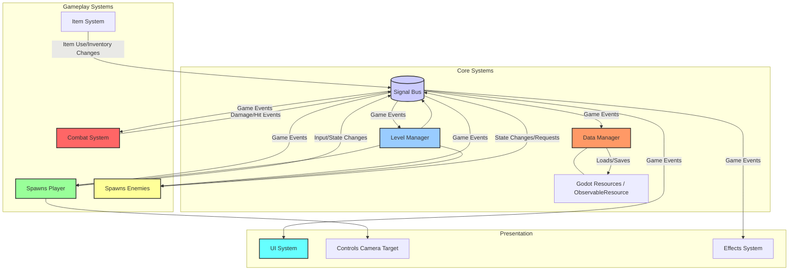

# Rogue Gauntlet Architecture

This document provides a high-level overview of the Rogue Gauntlet project structure and architecture, focusing on core concepts and component interactions. For implementation details, please refer directly to the source code.

## Core Architectural Principles

Rogue Gauntlet is built upon the following key principles:

- **Component-Based:** Game entities (Player, Enemies, Items, etc.) are constructed by composing Godot Nodes and attaching C# scripts (components) that define specific behaviors (e.g., Health, Movement, Combat). This promotes reusability and modularity.
- **Event-Driven:** Communication between different systems and components is primarily handled through a centralized `SignalBus`. This decouples systems, allowing them to react to game events without direct dependencies on each other (Observer pattern).
- **Explicit authoring:** Save authored component dependencies as exported Node/Resource assignments in scenes and Resources. Templates prewire common dependencies; missing required references are validation errors and empty optional references remain unavailable to their consumer. Runtime target acquisition and initialization of genuinely dynamic context remain separate.
- **Scene-Oriented:** We leverage Godot's scene system extensively. Game objects, levels, and UI elements are organized as scenes, which can be easily instanced and managed within the scene tree.
- **Data-Oriented:** Game configuration and authored definitions are stored with Godot Resources (`.tres`) or custom C# resources such as `ObservableResource`. Runtime-mutated state should copy from authored defaults before play instead of writing back into shared definitions.

## System Overview

The following diagram illustrates the major logical systems within Rogue Gauntlet and their primary communication pathways, often facilitated by the `SignalBus`.

## Key System Descriptions

- **Signal Bus (`SignalBus.cs`):** A central, singleton event bus. Systems emit signals (events) to the bus, and other systems subscribe to signals they care about, enabling decoupled communication.
- **Game Flow:** Main menu, new-game, save-slot, or scene-transition orchestration should be introduced as a focused flow/session coordinator when those features exist, not as a generic gameplay registry.
- **Level Manager:** Handles seed-based procedural generation of game levels — placing authored rooms or building rooms from coded Resource presets, connecting them with corridors, resolving doors, furnishing procedural interiors, placing occlusion, baking navigation, and spawning the player and enemies. Connectivity is doorway-driven: explicit doorways are always connected while inferred open edges are optional, and a spanning tree guarantees every room is reachable. See `docs/level-design.md` for the full pipeline.
- **Room Furnishings:** Independent arrangement scenes supply authored decoration and collision. Resource definitions/pools and selectable placement strategies choose safe placements after routing; the generator owns local reservations and isolated per-room RNG. Complete authored rooms remain separate landmarks. See [Level design](docs/level-design.md#reusable-room-arrangements).
- **Generation Randomness:** A per-generation context owns independent layout, monster, item-placement, and decoration streams. Resource strategies receive RNGs explicitly; stable reward sources derive their loot streams from source identity. Gameplay-time randomness retains its own saved continuation counter. See `docs/randomness-and-seeds.md` for current behavior and persistence limits.
- **Room Authoring:** Room scenes combine physical layout (`GridMap` floor/wall/decoration data) with editor-visible semantic markers for authored intent such as doorway connection points. GridMaps remain the source of room shape and passability, while markers describe gameplay meaning that generators and runtime systems can consume.
- **Map Visibility (Fog of War):** A runtime occlusion `GridMap` of flat black caps hides unreachable void and undiscovered areas. Rooms are revealed on entry (`RoomManager` → `FogOfWar`), cascading through door-free connectors but stopping at closed doors; opening a door reveals beyond it. Newly revealed areas fade in smoothly via a short-lived overlay rather than popping, while restoring a save reveals instantly. Closed doors show an occlusion-aware x-ray silhouette so they remain visible at any camera angle, and reveal state is persisted per dungeon depth in the save.
- **Presentation Fades:** A reusable `FadeOutComponent` eases 3D content out via material/modulate alpha (working on every renderer) instead of disappearing in a single frame. It backs dying enemies (`DeathComponent`) and is available for props or other despawning actors; the fog reveal uses the same alpha approach for its overlay.
- **Data Manager:** Manages the loading, saving, and access to game data, such as player progress, settings, or definitions stored in Godot Resources. May interact with the `SignalBus` to trigger saves or load data based on game events.
- **Player Controller:** The player root acts as a thin facade for its authored scene. Input, stats synchronization, inventory side effects, interactions, buffs, attacks, movement, health, and hit detection live in focused child components, with runtime player resources copied from authored defaults on spawn.
- **Combat System:** Governs combat mechanics, including attack execution, damage calculation, hit detection (often using attack nodes and `HurtBox` components), and status effect application (`Buffs`). Actor-specific controllers resolve authored attack definitions and rig animation profiles; a shared execution clock coordinates animation, contact, projectiles, recovery, and interruption. A shared token-owned pose component handles attacks, defenses and forced reactions while the actor AnimationTree handles locomotion. Actor-local action gates arbitrate commitment, and movement enforces their restrictions for both players and enemies. Weapon grip Resources adapt canonical item axes to shared rig sockets. Melee contact uses actor-local physics queries configured by Resource profiles; optional swooshes trace authored weapon markers on the same contact timeline without owning collision.
- **Enemy AI:** Controls the behavior of non-player characters. Enemies are scene-composed actors with reusable behavior components and resource-driven behavior profiles for monster-specific tuning such as detection, roaming, attack ranges, and action timing. Each enemy's brain is a small state machine (idle, patrol, chase, search, flee) sitting above dedicated perception (sight/hearing) and navigation (navmesh path-following) components, with a timed-action layer gating animations and attacks. Definition-driven monsters separate immutable identity/defaults and strategy Resources from per-instance component state. An authored tactical strategy creates an isolated selector per actor to resolve bounded retreat and attack opportunities; existing action gates retain execution authority. Strategies request movement, attacks and defenses through existing actor-local executors; scenes compose capabilities independently. The five-monster roster, tactical policies and editable assemblies are described in [Monster authoring](docs/monster-authoring-design.md). More specialized monsters should prefer new scenes/resources before adding global systems.
- **Item System:** Manages game items, including inventory, equipment, consumables, and their effects. Item Resources define authored behavior; a factory creates independent runtime copies under explicit Resource policies. The player inventory controller coordinates ownership and use; a level-local component reconstructs seeded items and persists differences. Inventory resources and item-slot resources are runtime state copied per player instance. Item events are emitted when items are used, equipped, picked up, dropped, or destroyed.
- **Stats & Itemization:** Player stats are a composable layer rather than fixed fields. Primary attributes (Strength, Dexterity, Vitality, Intelligence) plus base secondary stats resolve as `base + attribute derivation + active modifiers` (additive then multiplicative); a `StatProfile` resource holds the attribute-to-stat derivation rules and is the seam classes/races plug into. Buffs and equipment contribute `StatModifier`s registered under their source object, so any effect reverses exactly without drift. Equipment that drops rolls a depth-scaled rarity and randomized affixes (`Affix`/`AffixPool` produce per-instance `RolledAffix`es) using the per-run seeded loot RNG; a rolled item is a duplicate of the shared definition and is persisted with its rarity and affixes. Every equipable also carries a `Tier` (the base item's ladder rung, independent of rolled rarity), and loot table entries carry their own depth eligibility so one authored table serves every depth. Resource groups give each loot category its own probability budget before choosing a variety, keeping supply rates independent of the number of equipment definitions. This is distinct from the type-level identification disguise system. See `docs/stats-and-itemization.md`.
- **Item Identification:** Potions, scrolls, and jewelry (rings/amulets) hide their true identity behind a per-run disguise (a random appearance — descriptor plus model — assigned to each item *type*, not each instance; a definition's own model is only an editor fallback) until discovered by use, wearing, or a scroll of identify — drawing on the original *Rogue*. `IIdentifiable` is the shared contract across the two identity-bearing branches (`IdentifiableItem` for consumables, `IdentifiableEquipableItem` for jewelry), since C# single inheritance keeps them from sharing a base class. Scroll effects that aren't stat buffs (identify, enchant, teleport, summon) are authored `ScrollEffect` strategies rather than bespoke item subclasses; effects needing a chosen item route through an inventory targeting mode. See `docs/item-identification-system.md`.
- **Character Classes:** Playable classes are designer-authored `CharacterClass` resources (visual model, attribute block, class `StatProfile`, starting gear, pre-identified item types) collected in an ordered `CharacterCatalog`. The class is chosen in a menu carousel at new-game start, persisted per save slot by id, resolved by `GameSession`, and applied by the player on spawn — including swapping the shared-rig KayKit model at runtime. Classes supply the `StatProfile` seam described above. See `docs/character-classes.md`.
- **UI System:** Responsible for displaying all user interface elements, such as the HUD, menus, inventory screens, and dialog boxes. Primarily reacts to signals from the `SignalBus` to update displayed information based on game state changes.
- **Camera System:** Controls the game camera's behavior, potentially following the player or other targets, framing action, or executing specific camera movements. May be influenced by player actions or game events.
- **Effects System:** Manages visual and audio effects, such as particle effects for attacks, sound effects for actions, or screen shakes. Often triggered by signals from other systems (e.g., `CombatSystem`). Full-screen status overlays live on a screen-effects layer in the gameplay scene, between the 3D world and the HUD. `Main` binds the spawned player to it, and drivers map player health and the `StatusCondition`s that buffs declare to effects, so status sources never reference presentation.

## Directory Structure Overview

- `/asset-studio`: Offline 3D art authoring with persistent character and item recipes. Concepts, source models, and build previews stay here; validated art is exported to `/assets`. Gameplay item definitions, stats, and runtime scene composition belong to a separate authoring step under `/scenes`.
- `/scenes`: Contains Godot scene files (`.tscn`) representing game entities, levels, UI elements, and reusable component assemblies. Scenes often have a root node with attached C# scripts.
  - Subdirectories (`/player`, `/enemies`, `/items`, etc.) organize scenes by feature area.
- `/scripts`: Holds core C# script files (`.cs`), particularly singleton/event infrastructure such as `SignalBus`, base classes, interfaces, and logic not directly tied to a specific scene node initially.
- `/common`: Contains reusable C# code, utility classes, interfaces, and base classes that are generally applicable across different parts of the project (e.g., `ObservableResource`).
- `/assets`: Stores all raw art, audio, 3D models, fonts, and other media files used by the game. Godot's import files (`.import`) will reside alongside them.
- `/addons`: Includes third-party plugins or extensions integrated into the project via Godot's addon system (e.g., Phantom Camera, Lines and Trails 3D).
- `/docs`: Contains supplementary documentation files, like this architecture overview, design notes, or diagrams.

## Contribution Guidelines

When adding new features or modifying existing ones:

- Adhere to the **Component-Based** principle: Build functionality by creating and composing reusable node scripts.
- Utilize the **Event-Driven** approach: Use the `SignalBus` for communication between decoupled systems. Avoid direct references where an event is more appropriate.
- Consult the `README.md` for project setup, coding standards, and the general contribution workflow.
- Keep this `ARCHITECTURE.md` updated if significant changes are made to the core structure or principles.
