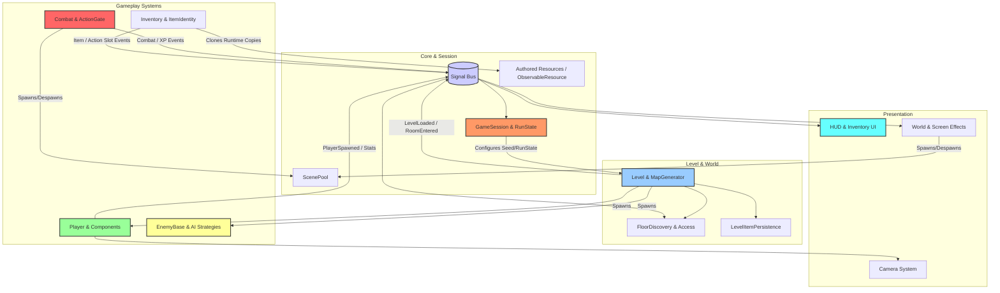

# Rogue Gauntlet Architecture

This document provides a high-level overview of the Rogue Gauntlet project structure and architecture, focusing on core concepts and component interactions. For implementation details, please refer directly to the source code.

## Core Architectural Principles

Rogue Gauntlet is built upon the following key principles:

- **Composition, Strategy & Factory:** Actors and interactive props are constructed by composing focused `[GlobalClass]` child `Node` components (`HealthComponent`, `MovementComponent`, `AttackController`, etc.) behind thin root facades (`Player`, `EnemyBase`). Behavior varies via stateless `[GlobalClass] Resource` strategies (`RoomLayoutStrategy`, `UnlockMethod`, `EnemyTacticalStrategy`, `ScrollEffect`), while factories and `ScenePool` instantiate or clone runtime copies (`CreateRuntimeCopy()` / `Duplicate()`) so authored `.tres`/`.tscn` definitions remain immutable.
- **Editor-First `[Export]` Authoring:** Tunable attributes, configurable actor states, and authored `Node`/`Resource` dependencies are exposed as `[Export]` `{ get; set; }` properties with `IsNodeReady()`-guarded reactive setters rather than C#-only `GetX()`/`SetX()` methods or implicit `GetNode` lookups. Missing required references are surfaced as configuration warnings/errors; unassigned optional references cleanly disable that capability.
- **Three-Tier Notification Model:**
  - **Local component events (`[Signal]`):** Components emit Godot `[Signal]` delegates for parent/sibling coordination and editor signal wiring (using plain C# `event` only for non-`Variant` `in` struct payloads like `DamageContext`).
  - **Observed runtime data (`ObservableResource`):** Runtime-mutated resources route `[Export]` setters through `SetValue(ref field, value)` to emit `Resource.Changed`.
  - **Cross-system broadcasts (`SignalBus`):** Decoupled game/UI systems communicate via `SignalBus` static emit helpers, wrapping subscriptions to long-lived emitters in `this.SubscribeUntilExit(...)`.
- **Seeded Determinism & Delta Persistence:** Untouched floor content is reconstructed deterministically from the run seed and isolated RNG streams (`GenerationRandom.DeriveSeed`); saves record only player state and floor deviations (`LevelItemPersistence`, `FloorDiscovery`, `DoorAccessSaveData`, cleared entity IDs).
- **Effect composition:** Reusable visual scenes combine focused timing and geometry nodes. Authored strategy Resources select presentation behavior while each cast owns its mutable state.

## System Overview

The following diagram illustrates the major logical systems within Rogue Gauntlet and their primary communication pathways.

## Key System Descriptions

Actor appearance effects, including invisibility, share the local world-effect host and source-owned surface controller. Gameplay-facing adapters request authored effects and observe their state; they do not maintain separate rendering clocks.

- **Signal Bus (`SignalBus.cs`):** A central, singleton event bus. Systems emit signals (events) to the bus, and other systems subscribe to signals they care about, enabling decoupled communication.
- **Game Flow:** The `GameSession` autoload coordinates menus, save slots, run identity and level transitions, and nothing else. Run-wide state (run seed, gameplay loot counter, cleared entities, identification) is a plain `RunState` it owns and hands to each level; player capture and restore is the static `PlayerSaveCodec`. It is not a gameplay registry: components reach run and floor context through their `Level`.
- **Level Manager:** Handles seed-based procedural generation of game levels — placing authored rooms or building rooms from coded Resource presets, connecting them with corridors, resolving doors, furnishing procedural interiors, placing occlusion, baking navigation, and spawning the player and enemies. Connectivity is doorway-driven: explicit doorways are always connected while inferred open edges are optional, and a spanning tree guarantees every room is reachable. Generation hands gameplay a `GeneratedFloor` that holds the layout and answers every spatial query; the generator checks its own placements against the same instance, so the two cannot drift. Special encounters are planned once by the mob factory, before access and loot. See `docs/level-design.md` for the full pipeline.
- **Door Access:** Door scenes compose per-instance locks and secret discovery with motion/navigation; components announce state changes and the door presents them. Ways to unlock are authored strategy Resources on the lock definition, and passive discovery is a reusable component shared by secret doors and traps. The actor-neutral interaction executor supplies actor context for reserved, atomic key/pick spending. Level-local generation validates matching key sources and persists access separately from exploration. See [Door access](docs/door-access.md).
- **Room Furnishings:** Independent arrangement scenes supply authored decoration and collision. Resource definitions/pools and selectable placement strategies choose safe placements after routing; the generator owns local reservations and isolated per-room RNG. Complete authored rooms remain separate landmarks. See [Level design](docs/level-design.md#reusable-room-arrangements).
- **Generation Randomness:** A per-generation context owns independent layout, monster, item-placement, and decoration streams. Resource strategies receive RNGs explicitly; stable reward sources derive their loot streams from source identity. Gameplay-time randomness retains its own saved continuation counter. See `docs/randomness-and-seeds.md` for current behavior and persistence limits.
- **Room Authoring:** Room scenes combine physical layout (`GridMap` floor/wall/decoration data) with editor-visible semantic markers for authored intent such as doorway connection points. GridMaps remain the source of room shape and passability, while markers describe gameplay meaning that generators and runtime systems can consume.
- **Map Visibility (Fog of War):** The level's `FloorDiscovery` node discovers space through bounded top-down line of sight, stopping at walls and at thresholds whose doors are closed, read from the doors themselves. Persistent sub-tile exploration history feeds a world-aligned screen shader with smooth inward edges and reveal fades; permanent caps cover void. Room entry remains independent of discovery. Tile-based content gates and x-ray indicators read explored history only through `ExplorationVisibility`; the level saves it per depth together with door and trap discoveries. See [Level design](docs/level-design.md#map-occlusion-and-fog-of-war).
- **Actor/item VFX:** Actor-local hosts own burst/sustained scene lifetimes and cosmetic randomness. One surface controller arbitrates cloak and skin materials; death restores their baseline before corpse fading. Item auras follow runtime item knowledge, and committed inventory notifications drive consumable feedback. See [world effects](docs/world-effects.md).
- **Presentation Fades:** A reusable `FadeOutComponent` eases 3D content out via instance-local material/modulate alpha overrides (compatible with the Mobile renderer). It backs dying enemies (`DeathComponent`) and is available for props or other despawning actors. Fog presentation owns its separate sample-based fade, and multi-mesh actor shader fades use a two-pass depth pre-pass + color pass (`SurfaceAppearanceController`).
- **Scene Pooling (`ScenePool.cs`):** Short-lived combat and presentation scenes (projectiles, floating damage numbers, hit effects, world effects) are spawned and recycled via `ScenePool.Spawn<T>` / `ScenePool.Despawn` and reset per-spawn state in `IPooledNode.OnSpawnedFromPool()`.
- **Player Controller:** The player root acts as a thin facade for its authored scene. Input, stats synchronization, inventory side effects, interactions, buffs, attacks, movement, health, and hit detection live in focused child components, with runtime player resources copied from authored defaults on spawn.
- **Combat System:** Governs combat mechanics, including attack execution, damage calculation, hit detection (often using attack nodes and `HurtBox` components), and status effect application (`Buffs`). Actor-local status presenters reconcile source-owned conditions with movement and visual effects; hurtboxes can also accept a source-owned shield that absorbs and reflects resolved damage. Authored spell definitions compose delivery and presentation, with gameplay integration currently exercised in the combat harness. Actor-specific controllers resolve authored attack definitions and rig animation profiles; a shared execution clock coordinates animation, contact, projectiles, recovery, and interruption. A shared token-owned pose component handles attacks, defenses and forced reactions while the actor AnimationTree handles locomotion. Actor-local action gates arbitrate commitment, and movement enforces their restrictions for both players and enemies. Weapon grip Resources adapt canonical item axes to shared rig sockets. Melee contact uses actor-local physics queries configured by Resource profiles; optional swooshes trace authored weapon markers on the same contact timeline without owning collision.
- **Enemy AI:** Controls the behavior of non-player characters. Enemies are scene-composed actors with reusable behavior components and resource-driven behavior profiles for monster-specific tuning such as detection, roaming, attack ranges, and action timing. Each enemy's brain is a small state machine (idle, patrol, chase, search, flee) sitting above dedicated perception (sight/hearing) and navigation (navmesh path-following) components, with a timed-action layer gating animations and attacks. Definition-driven monsters separate immutable identity/defaults and strategy Resources from per-instance component state. An authored tactical strategy creates an isolated selector per actor to resolve bounded retreat and attack opportunities; existing action gates retain execution authority. Strategies request movement, attacks and defenses through existing actor-local executors; scenes compose capabilities independently. The five-monster roster, tactical policies and editable assemblies are described in [Monster authoring](docs/monster-authoring-design.md). More specialized monsters should prefer new scenes/resources before adding global systems.
- **Item System:** Manages game items, including inventory, equipment, consumables, and their effects. Item Resources define authored behavior; a factory creates independent runtime copies under explicit Resource policies. The player inventory controller coordinates ownership and use; a level-local component reconstructs seeded items and persists differences. Inventory resources and item-slot resources are runtime state copied per player instance. Item events are emitted when items are used, equipped, picked up, dropped, or destroyed.
- **Stats & Itemization:** Player stats are a composable layer rather than fixed fields. Primary attributes (Strength, Dexterity, Vitality, Intelligence) plus base secondary stats resolve as `base + attribute derivation + active modifiers` (additive then multiplicative); a `StatProfile` resource holds the attribute-to-stat derivation rules and is the seam classes/races plug into. Buffs and equipment contribute `StatModifier`s registered under their source object, so any effect reverses exactly without drift. Equipment that drops rolls an always-visible quality from a `QualityLadder` whose qualities are introduced by depth: Poor and Superior get a word and a base-stat scale, while Magic and Rare get affixes from the definition's `EquipmentRollTable` (depth-gated `Affix` tiers produce per-instance `RolledAffix`es), plus a possible hidden, sticky curse, all from the per-run seeded loot RNG at creation; a rolled item is a duplicate of the shared definition and is persisted with its quality, adjective, scale, affixes, curse and what the player knows about them. Weapons and armor also carry a `Tier` (the base item's ladder rung, independent of rolled quality), and shared loot pools carry each entry's depth eligibility so one authored pool serves every table and depth. Tables give each category pool its own probability budget before choosing a variety, keeping supply rates independent of the number of equipment definitions; a drop profile adds a source's chance, roll count and creation policy. This is distinct from the type-level identification disguise system. See `docs/stats-and-itemization.md`.
- **Item Identification:** Potions, scrolls, and jewelry (rings/amulets) hide their true identity behind a per-run disguise (a random appearance — descriptor plus model — assigned to each item *type*, not each instance; identity definitions have no model of their own) until discovered by use, wearing, or a scroll of identify — drawing on the original *Rogue*. `IIdentifiable` is the shared contract across the two identity-bearing branches (`IdentifiableItem` for consumables, `IdentifiableEquipableItem` for jewelry), since C# single inheritance keeps them from sharing a base class. Scroll effects that aren't stat buffs (identify, enchant, teleport, summon) are authored `ScrollEffect` strategies rather than bespoke item subclasses; effects needing a chosen item route through an inventory targeting mode. See `docs/item-identification-system.md`.
- **Character Classes:** Playable classes are designer-authored `CharacterClass` resources (visual model, attribute block, class `StatProfile`, starting gear, pre-identified item types) collected in an ordered `CharacterCatalog`. The class is chosen in a menu carousel at new-game start, persisted per save slot by id, resolved by `GameSession`, and applied by the player on spawn — including swapping the shared-rig KayKit model at runtime. Classes supply the `StatProfile` seam described above. See `docs/character-classes.md`.
- **UI System:** Responsible for displaying all user interface elements, such as the HUD, menus, inventory screens, and dialog boxes. Primarily reacts to signals from the `SignalBus` to update displayed information based on game state changes.
- **Camera System:** Controls the game camera's behavior, potentially following the player or other targets, framing action, or executing specific camera movements. May be influenced by player actions or game events.
- **Effects System:** Manages visual and audio effects, such as particle effects for attacks, sound effects for actions, or screen shakes. Often triggered by signals from other systems (e.g., `CombatSystem`). Full-screen status overlays live on a screen-effects layer in the gameplay scene, between the 3D world and the HUD. `Main` binds the spawned player to it, and drivers map player health and the `StatusCondition`s that buffs declare to effects, so status sources never reference presentation.

## Directory Structure Overview

- `/asset-studio`: Offline 3D art authoring with persistent character and item recipes. Concepts, source models, and build previews stay here; validated art is exported to `/assets`. Gameplay item definitions, stats, and runtime scene composition belong to a separate authoring step under `/scenes`.
- `/scenes`: Contains Godot scene files (`.tscn`) representing game entities, levels, UI elements, and reusable component assemblies. Scenes often have a root node with attached C# scripts.
  - Subdirectories (`/player`, `/enemies`, `/items`, etc.) organize scenes by feature area.
- `/scripts`: Holds core C# script files (`.cs`), particularly singleton/event infrastructure such as `SignalBus`, base classes, interfaces, and logic not directly tied to a specific scene node initially.
- `/common`: Contains reusable C# code, utility classes, interfaces, and base classes that are generally applicable across different parts of the project (e.g., `ObservableResource`, `NodeSubscriptionExtensions`).
- `/tests`: Contains GdUnit4 C# unit and integration test suites compiled into the `Debug` configuration.
- `/assets`: Stores all raw art, audio, 3D models, fonts, and other media files used by the game. Godot's import files (`.import`) will reside alongside them.
- `/addons`: Includes third-party plugins or extensions integrated into the project via Godot's addon system (e.g., Phantom Camera, Lines and Trails 3D).
- `/docs`: Contains supplementary documentation files, feature deep-dives, and implementation specs (`docs/specs/`).

## Contribution Guidelines

When adding new features or modifying existing ones:

- Adhere to the **Composition, Strategy & Factory** and **Editor-First `[Export]`** principles: build functionality from `[GlobalClass]` node components and `[GlobalClass] Resource` strategies wired via `[Export]` properties.
- Follow the **Three-Tier Notification Model**: `[Signal]` delegates for local component events, `ObservableResource` for observed runtime data, and `SignalBus` (with `SubscribeUntilExit`) for cross-system broadcasts.
- Consult `AGENTS.md`, `.agents/skills/godot-csharp/SKILL.md`, and `README.md` for project setup, Godot 4.7 C# idioms, Mobile renderer rules, and testing workflows.
- Keep this `ARCHITECTURE.md` updated if significant changes are made to the core structure or principles.
