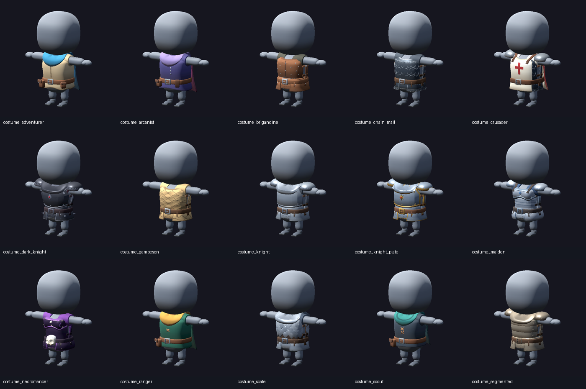

# Published costumes

Final wearable GLBs, Godot lineups and walk/attack animations. Source recipes remain under `costumes/`.

Build and review in OS temporary storage: `studio.py armor compare costume_knight`. After visual review, publish explicitly: `studio.py armor publish costume_knight`. `armor catalog` recomposes published outputs only. Changed inputs require fresh review; old final artifacts remain visible with `source_current: false`.

Only published outputs appear in this index. Legacy studies and one-off comparisons are excluded.

[Plate family](plate_family.png) · [Field family](field_family.png) · [Mail family](mail_family.png) · [Travel family](travel_family.png)

| Costume | Source | Status | Review focus |
| --- | --- | --- | --- |
| [costume_adventurer](adventurer/lineup.png) · [motion](adventurer/lineup.gif) · [GLB](adventurer/costume.glb) | [costumes/adventurer/costume.json](../../costumes/adventurer/costume.json) | needs visual review | Travel costume with a single continuous cloth cape: front chest bib, shoulder yoke and back drape; no separate collar or gorget. Review updated fit and motion. |
| [costume_arcanist](arcanist/lineup.png) · [motion](arcanist/lineup.gif) · [GLB](arcanist/costume.glb) | [costumes/arcanist/costume.json](../../costumes/arcanist/costume.json) | needs visual review | Travel costume with a single continuous cloth cape: front chest bib, shoulder yoke and back drape; no separate collar or gorget. Review updated fit and motion. |
| [costume_brigandine](brigandine/lineup.png) · [motion](brigandine/lineup.gif) · [GLB](brigandine/costume.glb) | [costumes/brigandine/costume.json](../../costumes/brigandine/costume.json) | needs visual review | Riveted leather shell with a front closure, integrated seams and seated iron hardware. |
| [costume_chain_mail](chain_mail/lineup.png) · [motion](chain_mail/lineup.gif) · [GLB](chain_mail/costume.glb) | [costumes/chain_mail/costume.json](../../costumes/chain_mail/costume.json) | needs visual review | Staggered ring relief on continuous fitted mail; shared low belt and curved mail hip panels. |
| [costume_crusader](crusader/lineup.png) · [motion](crusader/lineup.gif) · [GLB](crusader/costume.glb) | [costumes/crusader/costume.json](../../costumes/crusader/costume.json) | needs visual review | One continuous ivory tabard-cape runs over the shoulders down the full front and back, with a crimson cross painted into its front surface. No separate neck bib, gorget or front tabard. Fitted belt and leather-supported steel pauldrons remain independent. |
| [costume_dark_knight](dark_knight/lineup.png) · [motion](dark_knight/lineup.gif) · [GLB](dark_knight/costume.glb) | [costumes/dark_knight/costume.json](../../costumes/dark_knight/costume.json) | needs visual review | Dark knight: broader keeled cuirass, dark steel, red gem and seated chest/hip spikes; shared fitted waist and hip protection. Gorget-mounted rigid steel shoulder caps; articulated mounts under current review. |
| [costume_gambeson](gambeson/lineup.png) · [motion](gambeson/lineup.gif) · [GLB](gambeson/costume.glb) | [costumes/gambeson/costume.json](../../costumes/gambeson/costume.json) | needs visual review | Padded cloth torso with integrated diamond stitching, fitted leather belt and curved hip panels. |
| [costume_knight](knight/lineup.png) · [motion](knight/lineup.gif) · [GLB](knight/costume.glb) | [costumes/knight/costume.json](../../costumes/knight/costume.json) | needs visual review | Practical steel knight: plain steel edges, simple buckle, restrained wear and no gold or emblem. Gorget-mounted rigid steel shoulder caps; articulated mounts under current review. |
| [costume_knight_plate](knight_plate/lineup.png) · [motion](knight_plate/lineup.gif) · [GLB](knight_plate/costume.glb) | [costumes/knight_plate/costume.json](../../costumes/knight_plate/costume.json) | needs visual review | Approved Paladin reference: steel armor with gold trim and sunburst emblem. Original knight_plate path retained for compatibility. Gorget-mounted rigid steel shoulder caps; articulated mounts under current review. |
| [costume_maiden](maiden/lineup.png) · [motion](maiden/lineup.gif) · [GLB](maiden/costume.glb) | [costumes/maiden/costume.json](../../costumes/maiden/costume.json) | needs visual review | Female plate with open neckline, articulated pauldrons on fitted leather shoulder straps, blue gem and horizontal banding on both belly and back plate. |
| [costume_necromancer](necromancer/lineup.png) · [motion](necromancer/lineup.gif) · [GLB](necromancer/costume.glb) | [costumes/necromancer/costume.json](../../costumes/necromancer/costume.json) | needs visual review | Approved female costume: shaped breast-only cuirass, fitted belly plates, oversized skull relief buckle, curved hip panels and connected purple shoulder cloth. |
| [costume_ranger](ranger/lineup.png) · [motion](ranger/lineup.gif) · [GLB](ranger/costume.glb) | [costumes/ranger/costume.json](../../costumes/ranger/costume.json) | needs visual review | Travel costume with a single continuous cloth cape: front chest bib, shoulder yoke and back drape; no separate collar or gorget. Review updated fit and motion. |
| [costume_scale](scale/lineup.png) · [motion](scale/lineup.gif) · [GLB](scale/costume.glb) | [costumes/scale/costume.json](../../costumes/scale/costume.json) | needs visual review | Silver steel torso scales on dark backing, plain metal skirt and hip plates, with a fitted steel gorget trial. |
| [costume_scout](scout/lineup.png) · [motion](scout/lineup.gif) · [GLB](scout/costume.glb) | [costumes/scout/costume.json](../../costumes/scout/costume.json) | needs visual review | Travel costume with a single continuous cloth cape: front chest bib, shoulder yoke and back drape; no separate collar or gorget. Review updated fit and motion. |
| [costume_segmented](segmented/lineup.png) · [motion](segmented/lineup.gif) · [GLB](segmented/costume.glb) | [costumes/segmented/costume.json](../../costumes/segmented/costume.json) | needs visual review | Real overlapping metal bands with riveted edges; approved low belt and curved hip protection. Gorget-mounted rigid steel shoulder caps; articulated mounts under current review. |
