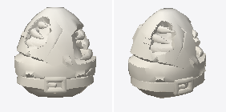
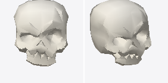
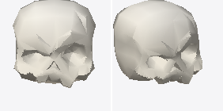
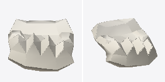

# Anatomy & Skeletal Mesh Prefabs

Curated uncolored 3D geometry prefabs for `anatomy`.

| Preview | Prefab Name | Tris / Verts | Dimensions (W × H × D) | Example Code |
| :---: | :--- | :---: | :---: | :--- |
|  | **`ribcage_torso`** | 1130 tris 1273 verts | 0.79 × 0.87 × 0.69m | `library.load("ribcage_torso", slot="bone")` |
|  | **`skull_complete`** | 518 tris 671 verts | 0.84 × 0.99 × 0.91m | `library.load("skull_complete", slot="bone")` |
|  | **`skull_cranium`** | 394 tris 462 verts | 0.84 × 0.86 × 0.91m | `library.load("skull_cranium", slot="bone")` |
|  | **`skull_jaw`** | 124 tris 209 verts | 0.46 × 0.32 × 0.49m | `library.load("skull_jaw", slot="bone")` |
