# Items & Equipment Mesh Prefabs

Curated uncolored 3D geometry prefabs for `items`.

| Preview | Prefab Name | Tris / Verts | Dimensions (W × H × D) | Example Code |
| :---: | :--- | :---: | :---: | :--- |
| 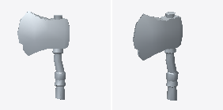 | **`axe_1h`** | 274 tris 340 verts | 0.71 × 1.24 × 0.18m | `library.load("axe_1h", slot="metal")` |
| 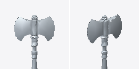 | **`axe_double`** | 508 tris 591 verts | 1.24 × 1.72 × 0.26m | `library.load("axe_double", slot="metal")` |
| 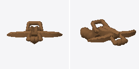 | **`crossbow_1h`** | 584 tris 678 verts | 0.91 × 0.41 × 1.22m | `library.load("crossbow_1h", slot="wood")` |
| 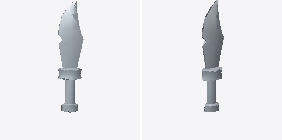 | **`dagger_assassin`** | 172 tris 207 verts | 0.26 × 1.21 × 0.15m | `library.load("dagger_assassin", slot="metal")` |
| 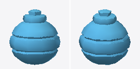 | **`flask_potion`** | 310 tris 300 verts | 0.38 × 0.42 × 0.36m | `library.load("flask_potion", slot="glass")` |
| 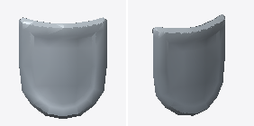 | **`shield_heater`** | 262 tris 285 verts | 0.88 × 1.02 × 0.25m | `library.load("shield_heater", slot="armor")` |
| 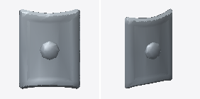 | **`shield_kite`** | 262 tris 286 verts | 0.88 × 1.19 × 0.30m | `library.load("shield_kite", slot="armor")` |
| 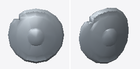 | **`shield_round`** | 284 tris 322 verts | 0.88 × 0.88 × 0.33m | `library.load("shield_round", slot="armor")` |
| 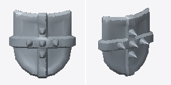 | **`shield_spiked`** | 420 tris 592 verts | 1.01 × 1.04 × 0.46m | `library.load("shield_spiked", slot="armor")` |
| 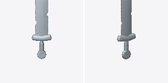 | **`sword_1h`** | 300 tris 359 verts | 0.50 × 1.78 × 0.13m | `library.load("sword_1h", slot="metal")` |
| 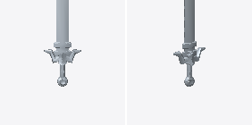 | **`sword_2h`** | 412 tris 545 verts | 0.84 × 2.37 × 0.25m | `library.load("sword_2h", slot="metal")` |
| 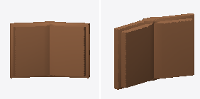 | **`tome_open`** | 292 tris 418 verts | 0.83 × 0.57 × 0.22m | `library.load("tome_open", slot="leather")` |
| 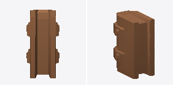 | **`tome_spellbook`** | 292 tris 399 verts | 0.29 × 0.57 × 0.43m | `library.load("tome_spellbook", slot="leather")` |
| 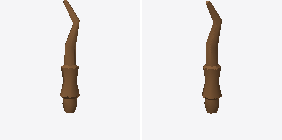 | **`wand_arcane`** | 150 tris 158 verts | 0.16 × 0.97 × 0.16m | `library.load("wand_arcane", slot="wood")` |
