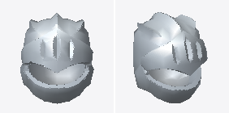
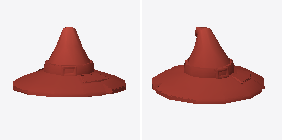
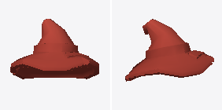

# Outfits & Headgear Mesh Prefabs

Curated uncolored 3D geometry prefabs for `outfits`.

| Preview | Prefab Name | Tris / Verts | Dimensions (W × H × D) | Example Code |
| :---: | :--- | :---: | :---: | :--- |
|  | **`knight_helmet`** | 480 tris 504 verts | 1.14 × 1.36 × 1.25m | `library.load("knight_helmet", slot="metal")` |
|  | **`wizard_hat`** | 396 tris 402 verts | 2.09 × 1.13 × 2.09m | `library.load("wizard_hat", slot="cloth")` |
|  | **`wizard_hat_ragged`** | 308 tris 340 verts | 1.79 × 1.27 × 1.74m | `library.load("wizard_hat_ragged", slot="cloth")` |
