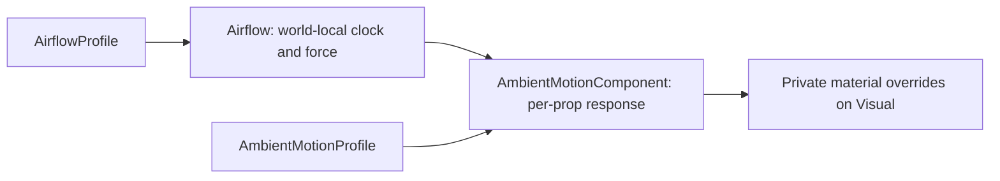

# Ambient motion

Generated levels sway their banners, tapestries, ferns, broadleaf plants and bushes in a shared indoor draft. The motion is continuous, a slow gust cycle with spatially varied, overlapping waves; it is not a random event or room-entry trigger. Scene pause and the airflow's playback speed drive one clock for geometry and shadows.

## Component ownership

The code lives in `scenes/effects/ambient_motion/`. `Airflow` is an explicitly wired scene dependency, not an autoload or registry. Its stateless profile supplies direction and slowly varying, spatially coherent gusts. Each prop's component samples that source and owns its own spring response; the shared response profile holds no simulation state.

`Prop.Motion` selects an authored component scene. Room and corridor placement attach it to the finished prop visual without changing geometry measurement, collision, placement RNG or saved floor state. Once generation has finalized world transforms, `Level` calls its exported `Airflow.Bind` on the generator subtree; the room generation harness does the same after placing or rotating its preview. Components stay static until they have a source, and an explicitly assigned local source takes precedence.

The component preserves the source materials' properties through `SurfaceMaterialFactory` and restores slots through `MeshMaterialSnapshot`. GPU vertex deformation changes the silhouette and its shadow, and the normal follows the deformation; source meshes and imported materials stay unchanged. Disabling or removing the component restores the original material slots and cull margin; leaving and re-entering the tree reacquires the effect.

The vertex shader keeps a zero-weight `TIME` reference so Godot treats the prop as an animated shadow caster and refreshes cached point-light shadows; the deformation itself uses the shared `Airflow` clock. Matching shadows therefore cost shadow-map redraws for nearby shadow-casting lights, so measure before rolling motion out to many more props.

**Debug → Visual effects → Wind (banners and plants)** suppresses the world's airflow without changing authored `Enabled` settings. Stopping a source restores its props' static materials and cull margins and stops their updates, so the comparison includes the animated shadow redraws. Standalone sources without a lit world stay controllable through `Airflow.Enabled`.

## Inspector controls

- **Airflow → Profile:** direction, steady strength, gust strength and period, spatial scale and direction variation. Enabled and playback speed control the source and its paused clock.
- **Prop → Motion:** optional component scene (`cloth_motion.tscn` or `foliage_motion.tscn`); leave it empty for a static prop. Every cosmetic variant uses the same capability.
- **AmbientMotionComponent:** explicit Target, Airflow, material template and response Profile; Enabled opts that visual subtree in or out.
- **Response Profile → Attachment:** normalized anchor in the target bounds, free direction and pinned fraction. Hanging cloth is fixed at the top, foliage at its roots. An optional support normal keeps wall-mounted cloth from bending through its wall; zero leaves foliage unrestricted.
- **Response Profile → Response / Flutter:** bend amplitude, response frequency, damping, flutter amplitude and frequency. Profile edits update the response and conservative render bounds while playing.

The cloth and foliage presets share one implementation and differ only in exported data. The response uses a height-based attachment falloff, so props with both rigid and flexible parts may need a finer movement mask, and coarse geometry limits bending quality. Larger movement with gameplay contact would need collision and physics behavior.

## Authoring and inspection

Assign a response scene to a prop's `Motion` to opt it in; the placement factory supplies the target and the playing world's airflow the force. The source asset needs no wrapper or material edits, and scene-based and mesh-library props share the same path. Inspect placed props and their shadows on a generated floor or in the [room generation harness](../scenes/debug/rooms/room_generation_harness.tscn). The floor atmosphere's fog and dust keep their own motion.
