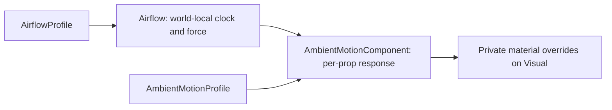

# Ambient motion

Generated levels animate the existing banner variants, tapestries, ferns, broadleaf plants and bushes with a shared indoor draft. The motion is continuous, with a 7.5-second base gust cycle and spatially varied overlapping waves; it is not a random event or room-entry trigger. Scene pause and airflow playback speed control the same clock for geometry and shadows.

## Component ownership

`Airflow` is an explicitly wired scene dependency, not an autoload or registry. Its stateless profile supplies direction and slowly varying, spatially coherent gusts. Each prop component samples that source and owns its own spring response. The shared response profile contains no simulation state.

`Prop.Motion` selects an authored component scene. Room and corridor placement attach it to the finished prop visual without changing geometry measurement, collision, placement RNG or saved floor state. Once generation has finalized world transforms, `Level` calls its exported `Airflow.Bind` on the generator subtree. Components remain static until supplied a source, and explicitly assigned local sources take precedence. The room-generation harness uses the same binding after placing or rotating its preview.

The component preserves native source material properties through `SurfaceMaterialFactory` and reversible slots through `MeshMaterialSnapshot`. GPU vertex deformation changes the silhouette and its shadow, and the normal follows the deformation. The source meshes and imported materials remain unchanged. Disabling or removing the component restores the original material slots and cull margin; leaving and re-entering the tree reacquires the effect.

The vertex entry point includes a zero-weight `TIME` reference so Godot recognizes an animated shadow caster and refreshes cached point-light shadows. Actual deformation uses the shared `Airflow` clock, including pause and playback speed. Matching shadows therefore require shadow-map redraws for nearby shadow-casting lights; this cost should be measured before broad rollout.

## Inspector controls

- **Airflow → Profile:** direction, steady strength, gust strength/period, spatial scale and direction variation. Enabled and playback speed control the source and its paused clock.
- **Prop → Motion:** optional component scene (`cloth_motion.tscn` or `foliage_motion.tscn`); leave it empty for a static prop. Every cosmetic variant uses the same capability.
- **Prop → AmbientMotion:** explicit Target, Airflow, Material template and response Profile; Enabled opts that visual subtree in or out.
- **Response Profile → Attachment:** normalized anchor in the target bounds, free direction and pinned fraction. Hanging cloth is fixed at the top; foliage is fixed at its roots. An optional support normal prevents wall-mounted cloth bending through its wall; zero leaves foliage unrestricted.
- **Response Profile → Response / Flutter:** bend amplitude, response frequency, damping, flutter amplitude and frequency. Profile edits update private materials during play.

The banner and foliage presets share an implementation and differ only in exported data. The response uses a height-based attachment falloff. Props containing both rigid and flexible parts may need a more precise movement mask; sufficiently coarse geometry also limits bending quality. Larger movement with gameplay contact would require appropriate collision/physics behavior.

## Authoring and inspection

Assign a compatible response scene to a prop's `Motion` property to opt it in. The placement factory supplies the target; a playing world's explicitly assigned airflow supplies the force. The source asset needs no wrapper or material edits, and scene-based and mesh-library props use the same capability path. Profile edits update the response and conservative render bounds while playing.

Inspect placed props and their shadows in the generated game or the [room-generation harness](../scenes/debug/rooms/room_generation_harness.tscn). The floor atmosphere's fog and dust retain their independently authored motion.
