# Item Catalog

Pictures of every weapon and shield definition, by tier, beside the [monster catalog](../monster-catalog/README.md). The [gameplay item catalog](../item-catalog.md) maps all definitions, families and rules; stats live in each linked `.tres`. Renders come from each item's world model (the one shown in the inventory and dropped in the world) through `asset-studio/godot/render_item_catalog.gd` (see the `assets` skill); the Studio shields without a render here link to their [Asset Studio lineup](../../asset-studio/catalogs/items/README.md#shields).

`Tier` is the base item's rung (1–5), which fences the depths it drops at; the quality an instance rolls (Poor to Rare) is separate (see [stats and itemization](../stats-and-itemization.md#equipment-quality-affixes-and-enchantment)). Wands and staves are spell weapons: each drop rolls its spell (see [spell weapons](../weapon-attack-system.md#spell-weapons-wands-and-staves)). The four elemental-looking weapons deal physical damage.

## Weapons

### Tier 1

| | Weapon | Hands | Notes |
|---|---|---|---|
| 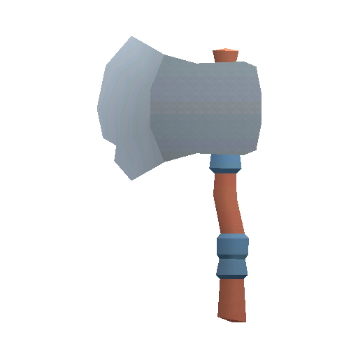 | [Axe](../../scenes/items/weapons/axe_common.tres) | 1H | |
| 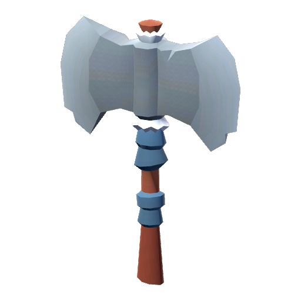 | [Battle Axe](../../scenes/items/weapons/battleaxe_starter.tres) | 2H | |
| 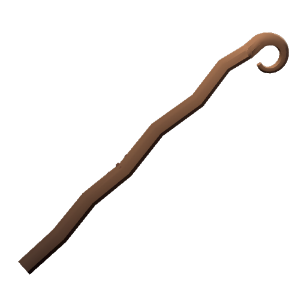 | [Crooked Staff](../../scenes/items/weapons/staff/staff_crooked.tres) | 2H | Spell staff |
| 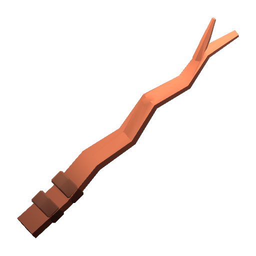 | [Crooked Wand](../../scenes/items/weapons/wand/wand_crooked.tres) | 1H | Spell wand |
| 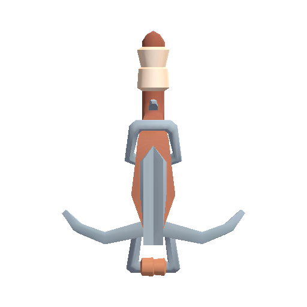 | [Crossbow](../../scenes/items/weapons/crossbow_common.tres) | 2H | Crossbow |
| 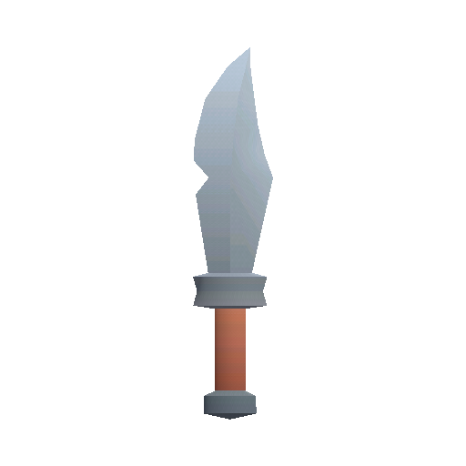 | [Dagger](../../scenes/items/weapons/dagger_common.tres) | 1H | |
| 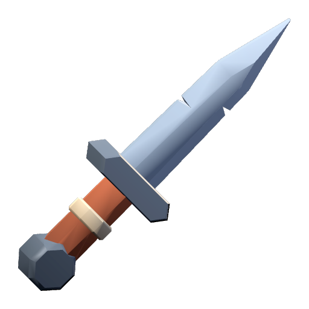 | [Short Steel Dagger](../../scenes/items/weapons/dagger/dagger_short.tres) | 1H | |
| 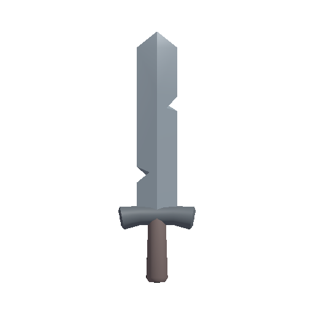 | [Shortsword](../../scenes/items/weapons/shortsword_common.tres) | 1H | |
| 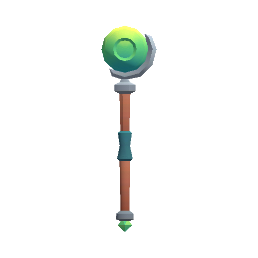 | [Staff](../../scenes/items/weapons/staff_common.tres) | 2H | Spell staff |
| 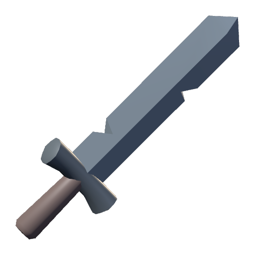 | [Sword](../../scenes/items/weapons/longsword_common.tres) | 1H | |
| 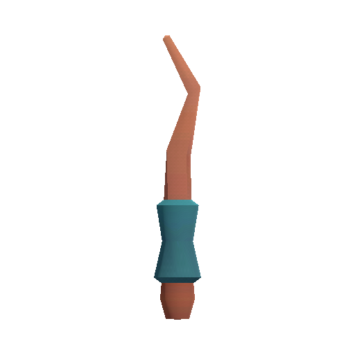 | [Wand](../../scenes/items/weapons/wand.tres) | 1H | Spell wand |
| 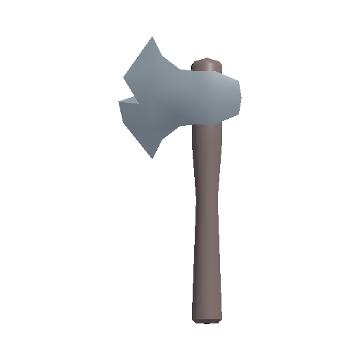 | [Woodcutter's Axe](../../scenes/items/weapons/axe_old.tres) | 1H | |
| 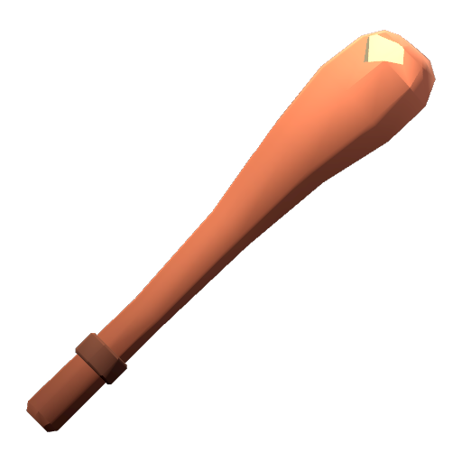 | [Wooden Club](../../scenes/items/weapons/club/club_wood_old.tres) | 1H | |
| 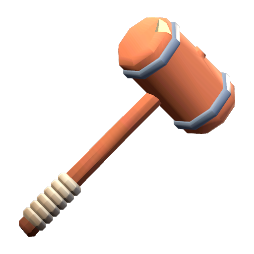 | [Wooden Cudgel Mallet](../../scenes/items/weapons/hammer/hammer_mallet.tres) | 1H | |
| 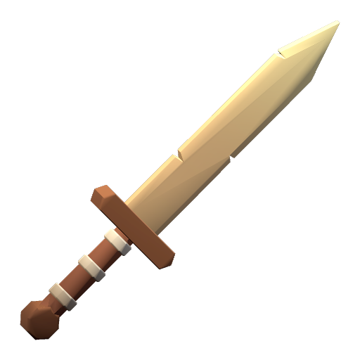 | [Wooden Practice Greatsword](../../scenes/items/weapons/greatsword/greatsword_wooden.tres) | 2H | |

### Tier 2

| | Weapon | Hands | Notes |
|---|---|---|---|
| 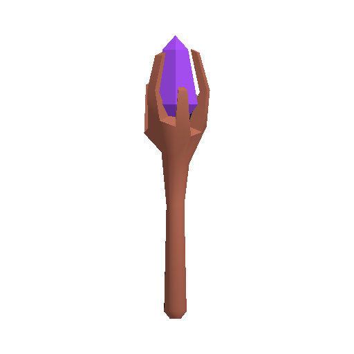 | [Ash Staff](../../scenes/items/weapons/staff_uncommon.tres) | 2H | Spell staff |
| 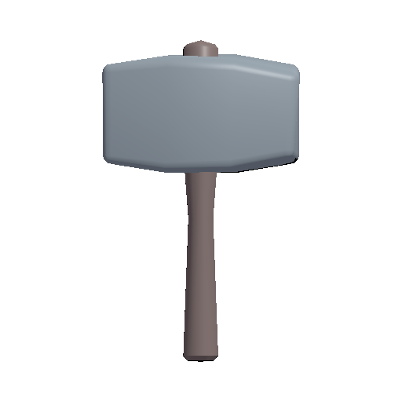 | [Hammer](../../scenes/items/weapons/hammer_common.tres) | 1H | |
| 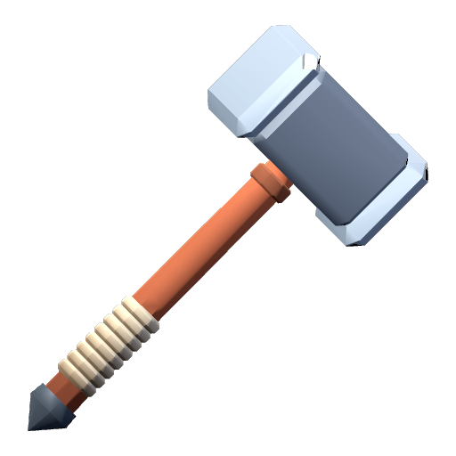 | [Heavy Sledge](../../scenes/items/weapons/warhammer/warhammer_sledge.tres) | 2H | |
| 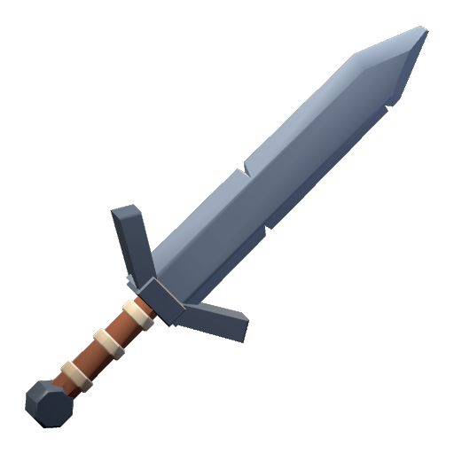 | [Iron Claymore](../../scenes/items/weapons/greatsword/claymore_iron.tres) | 2H | |
| 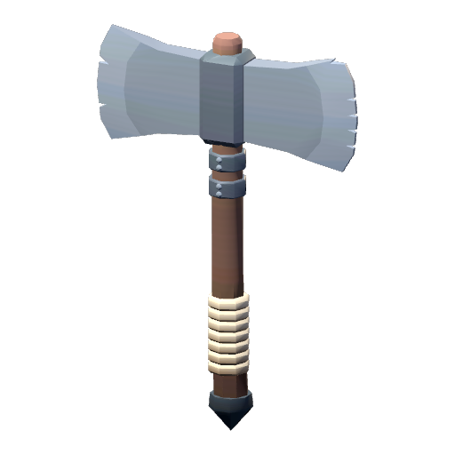 | [Iron Cleaver Greataxe](../../scenes/items/weapons/battleaxe/battleaxe_iron.tres) | 2H | |
| 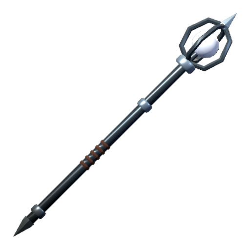 | [Iron Staff](../../scenes/items/weapons/staff/staff_iron.tres) | 2H | Spell staff |
| 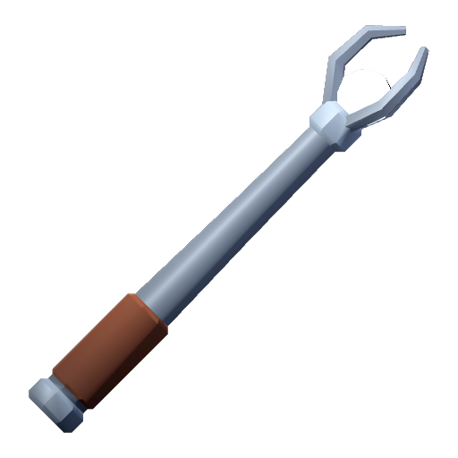 | [Iron Wand](../../scenes/items/weapons/wand/wand_iron.tres) | 1H | Spell wand |
| 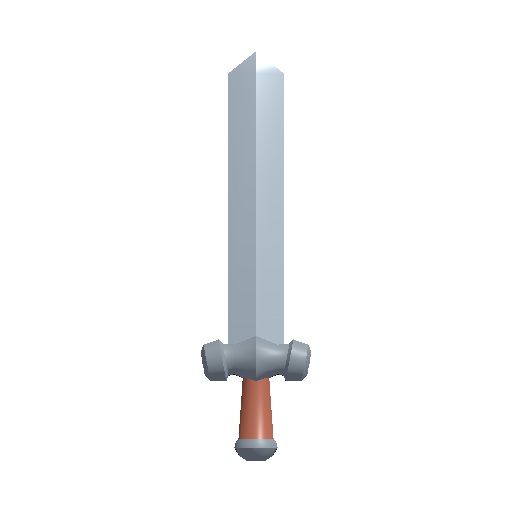 | [Longsword](../../scenes/items/weapons/sword_common.tres) | 1H | |
| 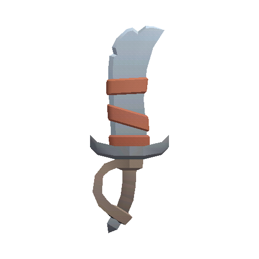 | [Saber](../../scenes/items/weapons/saber_skeleton.tres) | 1H | |
| 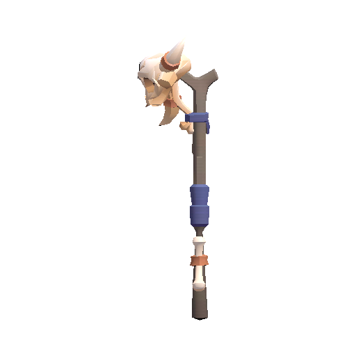 | [Skeleton Staff](../../scenes/items/weapons/staff_skeleton.tres) | 2H | Spell staff |
| 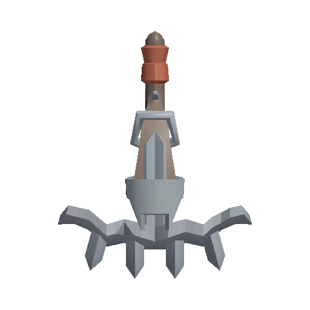 | [Spiked Crossbow](../../scenes/items/weapons/crossbow_spiked.tres) | 2H | Crossbow |
| 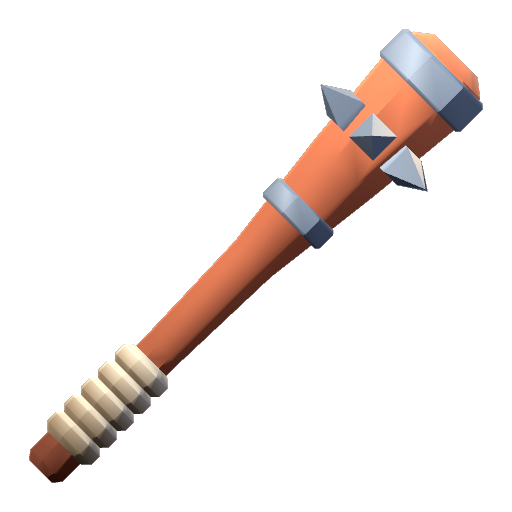 | [Steel Cudgel](../../scenes/items/weapons/club/club_steel.tres) | 1H | |
| 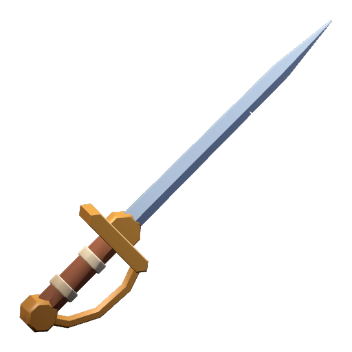 | [Steel Rapier](../../scenes/items/weapons/sword/rapier_steel.tres) | 1H | |
| 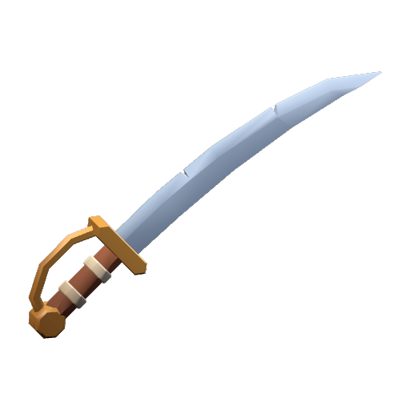 | [Steel Saber](../../scenes/items/weapons/sword/saber_steel.tres) | 1H | |
| 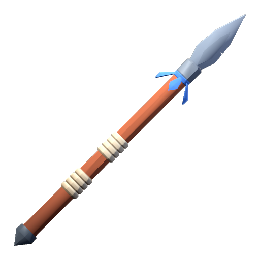 | [Steel Spear](../../scenes/items/weapons/polearm/spear_steel.tres) | 2H | |
| 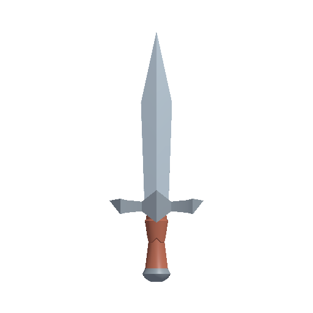 | [Stiletto](../../scenes/items/weapons/dagger_uncommon.tres) | 1H | |
| 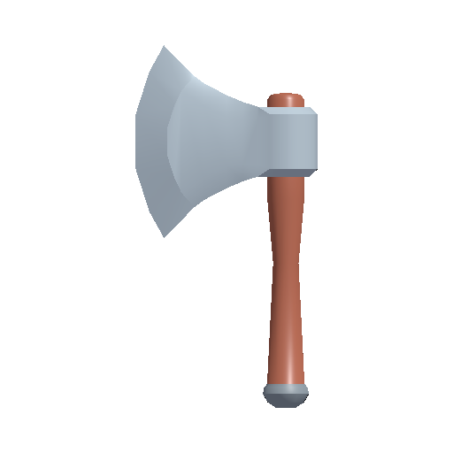 | [War Axe](../../scenes/items/weapons/axe_uncommon.tres) | 1H | |

### Tier 3

| | Weapon | Hands | Notes |
|---|---|---|---|
| 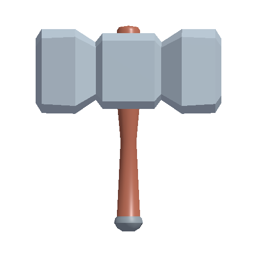 | [Battle Hammer](../../scenes/items/weapons/hammer_uncommon.tres) | 1H | |
| 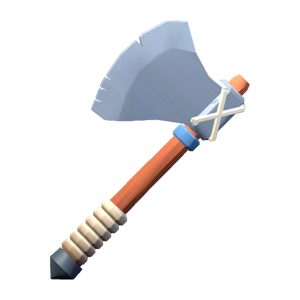 | [Bearded Viking Axe](../../scenes/items/weapons/axe/axe_bearded.tres) | 1H | |
| 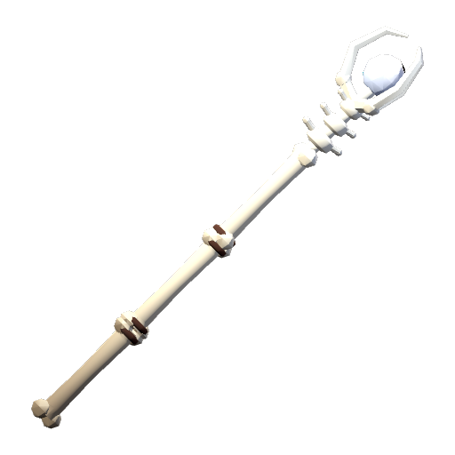 | [Bone Staff](../../scenes/items/weapons/staff/staff_bone.tres) | 2H | Spell staff |
| 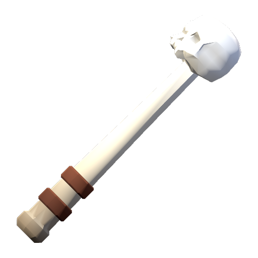 | [Bone Wand](../../scenes/items/weapons/wand/wand_bone.tres) | 1H | Spell wand |
| 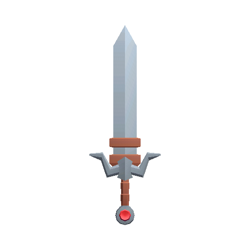 | [Broadsword](../../scenes/items/weapons/broadsword_common.tres) | 2H | |
| 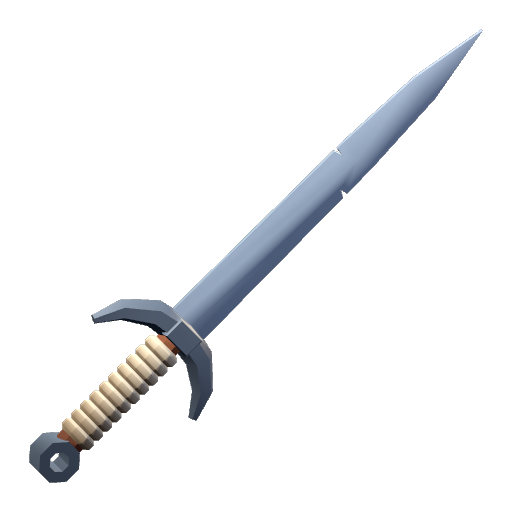 | [Crescent Longblade](../../scenes/items/weapons/greatsword/longblade_crescent.tres) | 2H | |
| 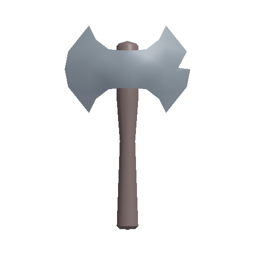 | [Double Axe](../../scenes/items/weapons/axedouble_common.tres) | 2H | |
| 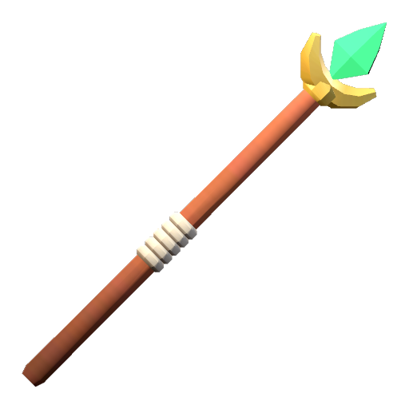 | [Emerald Crescent Staff](../../scenes/items/weapons/staff/staff_emerald.tres) | 2H | Spell staff |
| 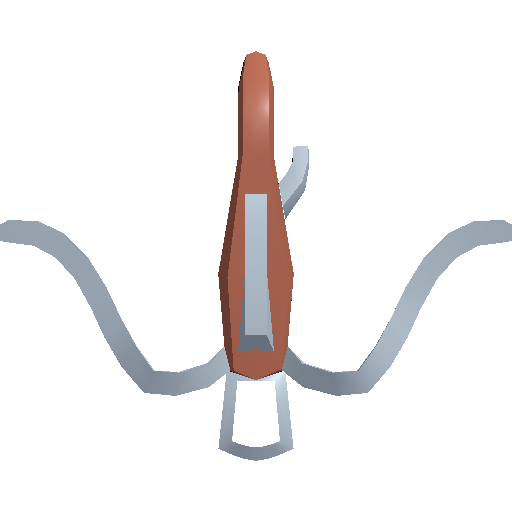 | [Heavy Crossbow](../../scenes/items/weapons/crossbow_uncommon.tres) | 2H | Crossbow |
| 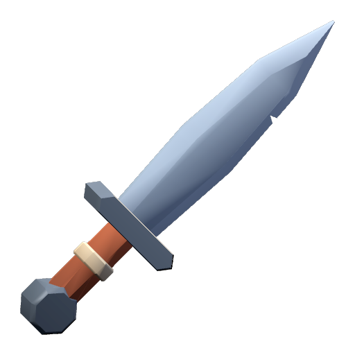 | [Heavy Hunting Dirk](../../scenes/items/weapons/dagger/dagger_dirk.tres) | 1H | |
| 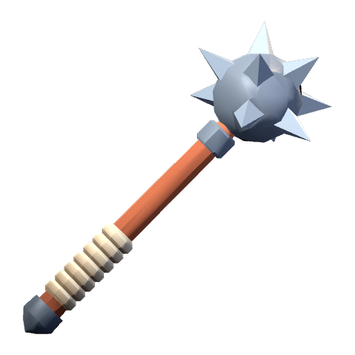 | [Iron Morning Star](../../scenes/items/weapons/mace/morning_star_iron.tres) | 1H | |
| 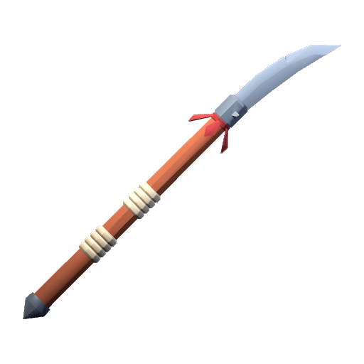 | [Iron War Scythe](../../scenes/items/weapons/polearm/scythe_iron.tres) | 2H | |
| 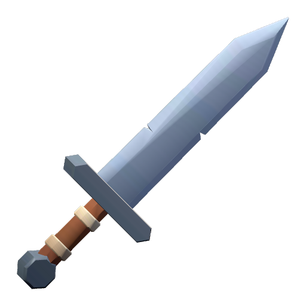 | [Knightly Broadblade](../../scenes/items/weapons/sword/sword_knight.tres) | 1H | |
| 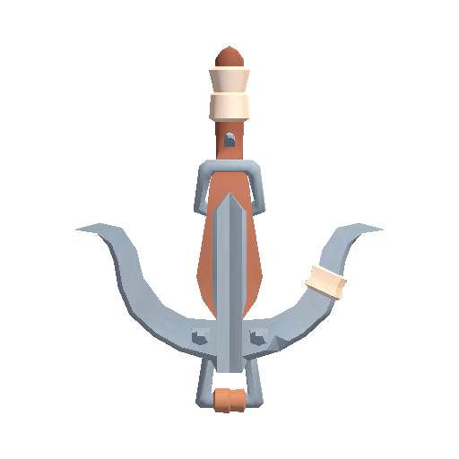 | [Large Crossbow](../../scenes/items/weapons/crossbow_2handed.tres) | 2H | Crossbow |
| 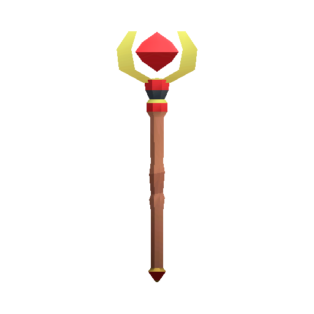 | [Ruby Scepter Wand](../../scenes/items/weapons/wand/wand_ruby.tres) | 1H | Spell wand |
| 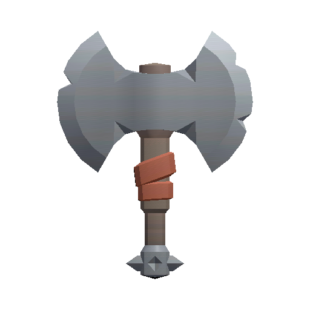 | [Skeleton Battle Axe](../../scenes/items/weapons/battleaxe_skeleton.tres) | 2H | |
| 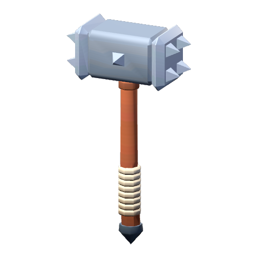 | [Spiked Maul](../../scenes/items/weapons/warhammer/warhammer_spiked.tres) | 2H | |
| 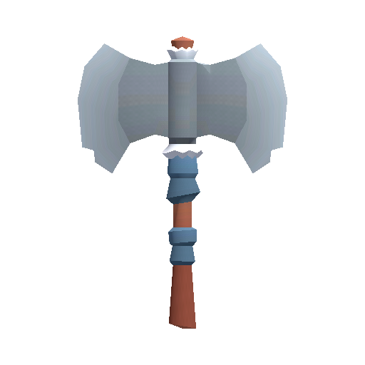 | [Steel Battle Axe](../../scenes/items/weapons/battleaxe_common.tres) | 2H | |
|  | [Steel Broadsword](../../scenes/items/weapons/greatsword/broadsword_steel.tres) | 2H | |
|  | [Steel Halberd](../../scenes/items/weapons/polearm/halberd_steel.tres) | 2H | |

### Tier 4

| | Weapon | Hands | Notes |
|---|---|---|---|
|  | [Arbalest](../../scenes/items/weapons/crossbow_rare.tres) | 2H | Crossbow |
|  | [Assassin's Dagger](../../scenes/items/weapons/dagger_rare.tres) | 1H | |
|  | [Curved Greatblade](../../scenes/items/weapons/greatsword/greatblade_curved.tres) | 2H | |
|  | [Frost Blade](../../scenes/items/weapons/sword/sword_frost.tres) | 1H | Ice look |
|  | [Great Axe](../../scenes/items/weapons/axedouble_uncommon.tres) | 2H | |
|  | [Horned Staff](../../scenes/items/weapons/staff/staff_horned.tres) | 2H | Spell staff |
|  | [Royal Axe](../../scenes/items/weapons/axe_rare.tres) | 1H | |
|  | [Royal Broadsword](../../scenes/items/weapons/broadsword_rare.tres) | 2H | |
|  | [Royal Hammer](../../scenes/items/weapons/hammer_rare.tres) | 1H | |
|  | [Royal Sword](../../scenes/items/weapons/sword_rare.tres) | 1H | |
|  | [Rune Staff](../../scenes/items/weapons/staff_rare.tres) | 2H | Spell staff |
|  | [Scholar's Wand](../../scenes/items/weapons/wand/wand_carved.tres) | 1H | Spell wand |
|  | [Steel Greatsword](../../scenes/items/weapons/greatsword/greatsword_steel.tres) | 2H | |
|  | [Stone Maul](../../scenes/items/weapons/warhammer/warhammer_stone.tres) | 2H | Earth look |
|  | [Warhammer](../../scenes/items/weapons/warhammer.tres) | 2H | |

### Tier 5

| | Weapon | Hands | Notes |
|---|---|---|---|
|  | [Archmage Astral Staff](../../scenes/items/weapons/staff/staff_archmage.tres) | 2H | Spell staff |
|  | [Celestial Golden Wand](../../scenes/items/weapons/wand/wand_celestial.tres) | 1H | Spell wand |
|  | [Executioner's Gilded Hatchet](../../scenes/items/weapons/axe/axe_executioner.tres) | 1H | |
|  | [Flame Sword](../../scenes/items/weapons/sword/sword_flame.tres) | 1H | Fire look |
|  | [Gilded Paladin Mace](../../scenes/items/weapons/mace/mace_gilded.tres) | 1H | |
|  | [Gilded Runic Battleaxe](../../scenes/items/weapons/battleaxe/battleaxe_gilded.tres) | 2H | |
|  | [Gilded Siege Arbalest](../../scenes/items/weapons/crossbow/crossbow_gilded.tres) | 2H | Crossbow |
|  | [Gilded Sunblade](../../scenes/items/weapons/sword/sword_sunblade.tres) | 1H | |
|  | [Gilded Warhammer](../../scenes/items/weapons/warhammer_gold.tres) | 2H | |
|  | [Obsidian Fang Dagger](../../scenes/items/weapons/dagger/dagger_fang.tres) | 1H | |
|  | [Royal Double Axe](../../scenes/items/weapons/axedouble_rare.tres) | 2H | |
|  | [Storm Trident](../../scenes/items/weapons/polearm/trident_storm.tres) | 2H | Lightning look |
|  | [Winged Greatsword](../../scenes/items/weapons/greatsword/greatsword_winged.tres) | 2H | |

## Shields

### Tier 1

| | Shield |
|---|---|
|  | [Round Shield](../../scenes/items/armor/shield/shield_round_blue.tres) |
|  | [Round Shield](../../scenes/items/armor/shield/shield_round_common.tres) |
|  | [Round Shield](../../scenes/items/armor/shield/shield_round_old.tres) |
|  | [Round Shield](../../scenes/items/armor/shield/shield_round_red.tres) |
| [lineup](../../asset-studio/catalogs/items/shields/shield_round_wood/lineup.png) | [Round Wooden Shield](../../scenes/items/armor/shield/shield_round_wood.tres) |
|  | [Shield](../../scenes/items/armor/shield/shield_badge.tres) |
|  | [Shield](../../scenes/items/armor/shield/shield_badge_color.tres) |
| [lineup](../../asset-studio/catalogs/items/shields/shield_wood_simple/lineup.png) | [Simple Wooden Shield](../../scenes/items/armor/shield/shield_wood_simple.tres) |
|  | [Wooden Shield](../../scenes/items/armor/shield/shield_common.tres) |

### Tier 2

| | Shield |
|---|---|
|  | [Skull Shield](../../scenes/items/armor/shield/shield_large_skull.tres) |
| [lineup](../../asset-studio/catalogs/items/shields/shield_buckler_spiked/lineup.png) | [Spiked Iron Buckler](../../scenes/items/armor/shield/shield_buckler_spiked.tres) |
|  | [Spiked Shield](../../scenes/items/armor/shield/shield_badge_spikes.tres) |
|  | [Spiked Shield](../../scenes/items/armor/shield/shield_badge_spikes_red.tres) |
|  | [Spiked Shield](../../scenes/items/armor/shield/shield_large_spikes.tres) |
|  | [Square Shield](../../scenes/items/armor/shield/shield_square.tres) |
|  | [Square Shield](../../scenes/items/armor/shield/shield_square_red.tres) |
| [lineup](../../asset-studio/catalogs/items/shields/shield_scutum_wood/lineup.png) | [Wooden Guard Scutum](../../scenes/items/armor/shield/shield_scutum_wood.tres) |

### Tier 3

| | Shield |
|---|---|
| [lineup](../../asset-studio/catalogs/items/shields/shield_iron_tower/lineup.png) | [Iron Tower Shield](../../scenes/items/armor/shield/shield_iron_tower.tres) |
| [lineup](../../asset-studio/catalogs/items/shields/shield_heater_iron/lineup.png) | [Iron-Strapped Heater Shield](../../scenes/items/armor/shield/shield_heater_iron.tres) |
| [lineup](../../asset-studio/catalogs/items/shields/shield_heroic_quarters/lineup.png) | [Quartered Heroic Shield](../../scenes/items/armor/shield/shield_heroic_quarters.tres) |
|  | [Reinforced Shield](../../scenes/items/armor/shield/shield_uncommon.tres) |

### Tier 4

| | Shield |
|---|---|
| [lineup](../../asset-studio/catalogs/items/shields/shield_kite_crusader/lineup.png) | [Crimson Kite Shield](../../scenes/items/armor/shield/shield_kite_crusader.tres) |
| [lineup](../../asset-studio/catalogs/items/shields/shield_heroic_sun/lineup.png) | [Heroic Sun Shield](../../scenes/items/armor/shield/shield_heroic_sun.tres) |
| [lineup](../../asset-studio/catalogs/items/shields/shield_royal_crown/lineup.png) | [Royal Crown Shield](../../scenes/items/armor/shield/shield_royal_crown.tres) |
| [lineup](../../asset-studio/catalogs/items/shields/shield_royal_lily/lineup.png) | [Royal Lily Shield](../../scenes/items/armor/shield/shield_royal_lily.tres) |
|  | [Royal Shield](../../scenes/items/armor/shield/shield_rare.tres) |

### Tier 5

| | Shield |
|---|---|
| [lineup](../../asset-studio/catalogs/items/shields/shield_dragon_scale/lineup.png) | [Dragonscale Shield](../../scenes/items/armor/shield/shield_dragon_scale.tres) |
| [lineup](../../asset-studio/catalogs/items/shields/shield_aegis_gold/lineup.png) | [Gilded Aegis Bulwark](../../scenes/items/armor/shield/shield_aegis_gold.tres) |

## Potions, scrolls and jewelry

Potions, scrolls, rings and amulets carry a hidden identity, and their look is that identity's run appearance: a random potion color in the bottle size that sets its strength, one of the 12 rune scrolls, or a material-and-gem ring or amulet. They have no fixed image. See [item identification](../item-identification-system.md) for the disguises, the [gameplay catalog](../item-catalog.md#active-definitions) for the definitions, and the Asset Studio [potions](../../asset-studio/catalogs/items/potions.png), [scrolls](../../asset-studio/catalogs/items/scrolls.png) and [jewelry](../../asset-studio/catalogs/items/jewelry.png) for the appearances.

## Currency

| | Item | Notes |
|---|---|---|
|  | [Gold](../../scenes/items/gold/gold.tres) | Stacks to 999; pile size grows with depth |
