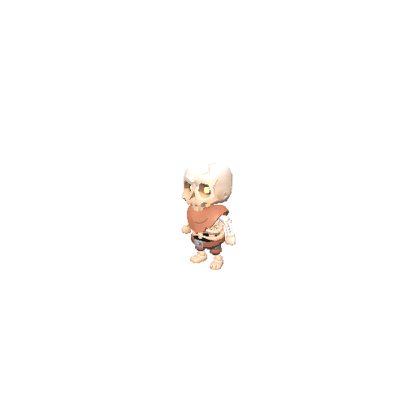
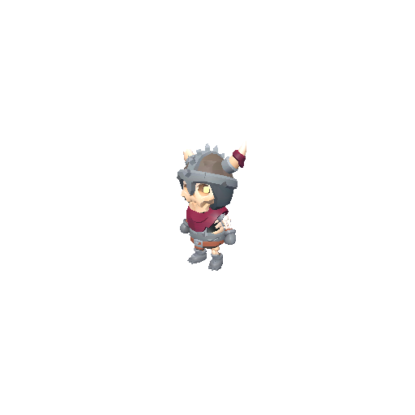

# Active monster catalog

The playable roster contains five monsters. Gameplay definitions and policies in Godot Resources are authoritative; this is a reference summary, not a second stat database. See [Monster authoring](../monster-authoring-design.md) for composition and [Level design](../level-design.md#first-realm-encounter-prototype) for encounter budgets and persistence.

| Monster definition | Role | First-realm availability |
| --- | --- | --- |
| [Skeleton Minion](../../scenes/enemies/skeleton/skeleton_minion_definition.tres) | Direct melee | Depths 1–3 |
| [Skeleton Warrior](../../scenes/enemies/skeleton/skeleton_warrior_definition.tres) | Melee with guard, dodge and conditional riposte | Depths 1–3 |
| [Skeleton Crossbowman](../../scenes/enemies/skeleton/skeleton_crossbow_definition.tres) | Projectile-only distance fighter | Depths 1–3 |
| [Plague Rat](../../scenes/enemies/rat/rat_definition.tres) | Bite/retreat, bounded low-health override | Depths 2–3 and finite nests |
| [Forsaken Warden](../../scenes/enemies/forsaken_warden/forsaken_warden_definition.tres) | Sword/guard gatekeeper with conditional riposte | Depth 3 |

Stats, rewards and policy tuning live in the linked definitions and Resources. They await [three-floor balance acceptance](../development-roadmap.md#first-three-floor-acceptance); no automatic depth-based stat scaling or monster-level field is used. Later depths use a development fallback rather than finished realm content.

The crossbowman reuses the retained KayKit skeleton rig with its own visible crossbow and animation. Approved Studio lineups show the [rat](../../asset-studio/catalogs/characters/beasts/rat/lineup.png) and [Warden](../../asset-studio/catalogs/characters/bosses/forsaken_warden/lineup.png). Skeleton models are KayKit CC0; Studio sources retain their own recorded provenance in [attributions](../../assets/ATTRIBUTIONS.json).

The retired direct Quaternius gameplay roster and its images are removed. Studio art for future monsters remains available without automatically adding those monsters to encounters.
