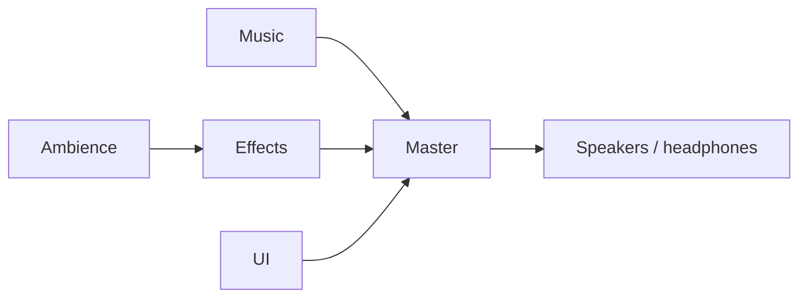

# Audio concept and implementation plan

Status: reviewed proposal; no runtime implementation or asset acquisition is delivered by this document. Start with slice 1 below. Slices 1–2 prove playback, stereo, music transitions and settings; slices 3–4 make those paths playable; slice 5 expands content in small batches. Final sound selection does not block a prototype using explicitly provisional licensed clips. This plan follows [program-design](../../.agents/skills/program-design/SKILL.md), the [architecture](../../ARCHITECTURE.md), and the existing [combat](../combat-system.md), [movement](../movement-feedback.md), [world effects](../world-effects.md) and [door access](../door-access.md) boundaries.

## Sound direction

Make the dungeon feel inhabited and physical while keeping combat easy to read. Use close, short footsteps, cloth and leather movement, dry weapon swings, clear impact transients and a little stone-room resonance. Music supplies unease and forward motion; it leaves space for attacks, defenses and nearby threats. Avoid a constant wash of loud footsteps, spell loops and notifications.

The Garrison starts with sparse low strings, a restrained pulse and metallic or wooden percussion. Its boss treatment adds rhythmic density and weight. Later realm palettes can use damp resonance and water in the Sewer, then organic percussion, foliage and distant wildlife in the Jungle. These are art directions, not claims about the available recordings. Start with one convincing exploration/boss pair rather than unrelated music for every depth.

Audio reinforces existing visual information. Guard, parry, guard break, damage and an unsuccessful action must sound distinguishable. Muting music or all audio must leave the game playable. Recorded footsteps do not change the AI's existing abstract "hearing" rules.

| Event | Intended sound and timing | Initial content |
| --- | --- | --- |
| Walk/run | Alternating short ground contacts, spacing follows actual travel; quieter monster steps | RPG `footstep00`–`footstep09`; audition before assigning surfaces |
| Rush/dodge and stop | Brief cloth/air rush only after actual dodge travel; light landing/skid | RPG `cloth1`–`cloth4` as temporary material; acquire a proper rush |
| Melee attack | Weapon-weighted swish at the active strike, whether or not it hits | RPG `knifeSlice`, `knifeSlice2`; heavier swings need additions |
| Contact, hurt and death | Separate flesh, bone, stone and metal impacts; restrained hurt/death accents | RPG `chop` and metal recordings are candidates; dedicated impacts/creatures are gaps |
| Guard/parry/break | Quiet guard raise, solid block, crisp higher parry, heavy break | RPG `metalClick`, `metalPot1`–`metalPot3` are placeholders to audition |
| Ranged attack | One mechanical preparation cue during an accepted wind-up; distinct release and actual projectile impact | Start with a clearly labelled Kenney placeholder; acquire crossbow recordings; no repeated tracking beep |
| Magic | Fire crackle/ignition, water/ice snap, wind gust, earth grind/thud; distinct release and impact | Additional licensed recordings required; no final elemental set in the two local packs |
| Doors and locks | Hinge/open sound when motion starts; close latch when the leaf reaches shut; unlock only after success | RPG `doorOpen_1/2`, `doorClose_1`–`4`, `creak1`–`3`, `metalLatch` |
| Inventory and consumables | Coin pickup, equipment handling, drink/read and result confirmation after commit | RPG `handleCoins/2`, leather/cloth/book sounds; bottle/drink additions needed |
| World interactions | Chests, traps, fountains, breakage, secrets and stairs; source-local confirmation | Reuse suitable door/book/metal candidates sparingly; acquire water, trap and breakage material |
| UI | Subtle navigation tick, activate, back, panel open/close, error and slider feedback | UI `rollover1`–`6`, `click1`–`5`, `switch1`–`38`; choose a small consistent family |
| Ambience | Quiet realm bed plus sparse local fire/water/air sources | Acquire loops separately; ambience should remain audible with music muted |

Filenames in this table identify upstream candidates, not approved sound assignments. This pass inspected filenames and license files; it did not audition the recordings. Final volume, variation and material assignments require listening at normal gameplay speed and zoom.

## Current seams

- `Main` configures a `Level` and calls `Generate()`. `GameSession` reloads the gameplay scene for floor travel, so a music player inside `main.tscn` would be destroyed on every descent. `SignalBus.LevelLoaded` already carries the generated level.
- `Level.MapGenerator.CurrentRealm` identifies the realm. `RealmEncounterController` owns the gatekeeper's persistent ID and death/descent wiring; its `OnGatekeeperSpawned` receives the concrete enemy. A boss merely existing on the floor is not an encounter-start event.
- `EnemyBehaviorComponent.Target` exposes the AI's current target. `DodgeComponent` and `GuardComponent` already expose local signals. `MovementComponent` supplies resolved movement, while `MovementEffectsComponent` currently applies additional visual-only gates such as being on screen.
- `AttackController` owns the strike/release clock and interruption. `HurtBoxComponent.ContactResolved` and the existing `SignalBus.CombatContactResolved` carry a completed `CombatContactFeedback`, including outcome and world position. Use the bus once for impact audio: the hurtbox currently uses the absence of local contact subscribers to enable fallback prop VFX, so an audio-only local subscription would accidentally suppress those visuals.
- `PlayerAttackController.CreateDefaultDefinition` constructs attacks for weapons without a custom definition. That path needs authored cues too; editing `AttackDefinition` resources alone would leave ordinary weapon attacks silent.
- Doors emit `DoorOpened`/`DoorClosed` at motion start. `RestoreAccess` directly restores state and must remain silent. A close-latch sound needs completion timing, not the existing start notification.
- `MainMenu` and `PauseMenu` own menu flow; pause already emits `GamePaused`. There is no current audio settings panel or bus layout. Inventory committed-use notifications already exist; do not invent a second consumption event for audio.
- The tracked `scenes/combat/audio/aim_lock.wav` and its import sidecar remain, but no current playback reference was found in scripts or scenes. The attack indicator is visual-only. Reproduce the reported sound against the actual running build before attributing it to a current call path; remove this unused sample during the first implementation slice after checking references again.

## Mixing, persistence and ownership

Author `default_bus_layout.tres` with this routing. Godot's [audio buses](https://docs.godotengine.org/en/latest/tutorials/audio/audio_buses.html) provide the category controls; players select a bus explicitly.



Slice 1 proves bus separation in the workbench. Slice 2 adds **Master, Music, Effects and UI** sliders and a Mono toggle to both menus; slice 5 adds an Ambience slider with actual ambient content. Effects includes ambience through the child bus. All music, including any later musical stinger, follows Music. UI clicks follow UI and continue during pause. Use conservative cue gains and master headroom; a limiter is a final guard, not a replacement for mixing crowded combat.

Store preferences in `user://audio.cfg`, independently of save slots and `RunState`. Load/apply before starting playback. Sliders use normalized gain, map to bus gain, and mute at exactly zero; reject non-finite values and clamp finite values to 0–1. Reading/saving a muted bus returns zero rather than its retained pre-mute gain. A missing file uses the authored bus defaults; malformed entries use their individual defaults. Saving preferences must preserve other valid audio entries. A write failure keeps the current audible adjustment and reports that it could not be saved. This presentation work needs no save DTO fields or save-version bump.

Compose an `audio.tscn` child into a new `scenes/session/game_session.tscn`, whose root retains the existing `GameSession.cs`. Change the existing autoload entry to that scene. This adds no autoload, singleton accessor or gameplay registry. `GameSession` keeps session-flow logic; the child owns audio. Keep autoload names/order stable. The audio child may observe the already-ready `SignalBus` during its `_Ready()`, but must not depend on the parent's singleton initialization or use `ScenePool` before startup completes.

`AudioController` coordinates one-shot playback, then its exported `MusicController` and preferences when slice 2 lands. It listens to presentation broadcasts; gameplay never calls `GameSession.Instance.Audio`. Actor/prop adapters own which cue is emitted and when. UI roots own their button bindings. Resources hold immutable configuration; current voices, cooldowns, last variation, fade progress and RNG are runtime state. Build each contract in its owning slice; do not add empty music or gameplay adapters to slice 1.

The audio controller, music decks and UI voices process during pause; world voices and local ambient/spell loops are pausable. Boss polling and its disengagement timer freeze with gameplay. Music's per-deck transition envelope and temporary pause gain multiply independently, so pausing during a crossfade cannot restore the wrong volume.

For world audio, add an explicitly wired `AudioListener3D` to the gameplay scene. `Main` moves it to the player while aligning its orientation with the camera, including camera rotation and spawn/teleport resets. This keeps distance centered on play instead of the elevated orthographic camera. Godot otherwise listens at the camera, as documented for [AudioStreamPlayer3D](https://docs.godotengine.org/en/latest/classes/class_audiostreamplayer3d.html). The combat/audio harness authors its own listener.

## ARPG mix and stereo rules

Treat sound as another gameplay information channel. Blizzard's [Diablo IV sound-design account](https://news.blizzard.com/en-us/article/23731236/diablo-iv-quarterly-updateoctober-2021) emphasizes an adaptive, clear combat mix and variation in frequently repeated sounds. Our priorities are immediate threats and player damage/defense, the player's actions, nearby enemy contacts, then decorative movement and ambience. Preserve their different attacks and frequency ranges; making every cue louder cannot improve clarity.

| Sound | Source and stereo treatment |
| --- | --- |
| Music and broad environmental beds | Preserve authored stereo; non-positional playback |
| Enemy steps, weapon contacts, doors and discrete world sources | Prefer mono recordings and let the game position them; an enemy left on screen leans left in the mix |
| Player footsteps, swing, dodge and personal feedback | Centered or narrowly panned; turning the character must not move the player's whole sound image between ears |
| UI, errors and important personal confirmations | Centered, consistent level, independent of camera position |
| A particular fountain, fire or sustained spell | Local positional source; broad room ambience remains a separate bed |

For the first pass, keep the player-centered, camera-aligned listener and export `SoundCueProfile.PanningStrength`: start world cues around 0.5 and personal cues around 0–0.2, then audition. These are tuning starting points. Avoid full left/right isolation on routine combat cues. Godot exposes [per-source panning strength](https://docs.godotengine.org/en/latest/classes/class_audiostreamplayer3d.html#class-audiostreamplayer3d-property-panning-strength); its product with the project setting controls the result.

Distance attenuation follows proximity to the player; stereo orientation follows the view, independently of character facing. Camera rotation may change left/right, but camera zoom must not change world loudness. This native listener setup preserves directional sign, not exact screen-coordinate panning. Epic documents [separating character-based attenuation from camera-based panning](https://dev.epicgames.com/documentation/en-us/unreal-engine/spatialization-overview-in-unreal-engine). If close sounds still pan too abruptly in our orthographic view, evaluate that fuller separation in the harness before changing the playback implementation; Godot's single listener does not supply independent distance and panning positions automatically.

Use the single voice-admission policy below. `MaxVoicesGlobal` is per shared cue resource, not an additional string-keyed family registry; monsters can share a footstep cue while the player's narrower version has its own profile. Initial caps are tuning data, not proof that the mix is readable. Avoid identical overlapping samples, excessive pitch randomization, long reverberant tails on every hit and Doppler on ordinary movement/combat.

The slice 2 **Mono output** toggle downmixes the final stereo mix to both ears, including music; setting positional panning to zero alone does not downmix stereo recordings. This follows [Xbox audio accessibility guidance](https://learn.microsoft.com/en-us/xbox/accessibility/xbox-accessibility-guidelines/105). Godot's [AudioEffectStereoEnhance](https://docs.godotengine.org/en/latest/classes/class_audioeffectstereoenhance.html) provides a stereo-to-mono setting: author a dedicated bypassed Master effect with `PanPullout = 0`, `Surround = 0`, `TimePulloutMs = 0`, and toggle its bypass without changing category gains. Verify it on the installed engine and stereo output.

Extend acceptance with left/center/right sources at equal distance, movement across the player, camera rotation and all zoom settings, offscreen explored enemies, and the player turning in place. Repeat crowded combat on headphones, speakers, mono output and at low volume. Direction should agree with the image, personal cues should remain stable, important cues should survive the mono downmix, and no essential information may depend solely on stereo direction. Source assets should also be checked for mono compatibility. For later binaural output, use one intentional spatialization path and test platform processing rather than stacking widening/HRTF effects.

## Music behavior

Use a `MusicProfile` per realm, with exploration and optional boss streams, nominal gain and crossfade duration. The menu has its own profile. Profiles are assigned on existing `Realm` resources and the menu scene; no depth-to-path switch in C#. An absent optional boss stream retains exploration and warns during content validation.

Start with **two non-positional `AudioStreamPlayer` decks**, routed to Music. This works with unrelated full tracks and explicit transition durations in seconds. Fade their local linear gains with an equal-power envelope over an initial 2 seconds; keep the old track running until its fade completes. Never change the user's Music bus gain to perform a transition. Ensure source loops themselves are seamless: crossfading between states does not repair a bad loop boundary. Enable looping in imported stream resources rather than restarting them from `Finished` callbacks.

| Context | Selection and transition |
| --- | --- |
| Menu | Menu loop; opening submenus does not restart it |
| Floor ready | Exploration stream from the generated realm; the same stream on the next floor continues at its current position |
| Boss engagement | Switch when the living gatekeeper targets the living player; neither generation, spawn nor entering the floor alone triggers it |
| Boss disengagement | Retain boss music for 6 seconds after losing its player target, then crossfade back; ordinary line-of-sight changes alone do not switch music |
| Boss death | Clear engagement immediately and return to exploration using the profile's crossfade duration; a later victory accent must not restart on revisits |
| Player death | Override any pending boss transition and fade music out over 0.8 seconds; the menu establishes its own context when reached |
| Pause | Keep the current musical position running at a temporary quieter local gain; pause world effects/ambience, keep UI active; resume without replaying cues |
| Scene change / generation failure | Stop old scene-owned world voices; persistent music accepts the next valid context and crossfades, including return to menu |

`LevelAudioComponent` binds after `LevelLoaded`, with the binding deferred until that notification's spawn callbacks finish. Extend `RealmEncounterController` with a runtime `Gatekeeper` reference and a local `GatekeeperChanged(EnemyBase)` signal. Read the reference when binding, then observe future changes: subscription order must not lose the initial spawn. Poll this one boss's existing target at an exported 0.2-second interval; no all-enemy scan or AI changes are needed. Rebinding clears old subscriptions, boss timers and player references. A cleared gatekeeper has no live boss and cannot trigger music on load.

Music contexts carry their originating node and a `MusicSection` enum: `Exploration`, `Boss` or `Silent`. The menu uses its profile's exploration/base stream. `Silent` expresses player death without a separate unscoped global stop command. Changes must come from a live owner in the current scene; ending an old owner cannot clear a newer context. Rebind the owner even when the selected stream is unchanged, retaining its playback position and updating nominal gain without restarting it.

Use one transition rule: at most two playing decks; requests for the same target are idempotent, reversals retarget from the current gains, and a third distinct stream replaces a single latest-pending request to start after the current fade. Ending a context clears its pending request and fades its current music out; a new valid context may interrupt that fade. `Silent` cancels pending work and fades both decks over the exported `SilenceSeconds` (initially 0.8). A request from an old scene cannot interrupt it. Keep profile gain, fade gain and pause gain separate; replacing a fade kills the previous tween. Validate resources before changing owner or playback, so an invalid assignment retains the current valid music. A null profile is valid only for `Silent`.

For later musical refinement, Godot's [AudioStreamInteractive](https://docs.godotengine.org/en/latest/classes/class_audiostreaminteractive.html) supports authored clip transitions, and [AudioStreamSynchronized](https://docs.godotengine.org/en/latest/classes/class_audiostreamsynchronized.html) starts stems together. Matching exploration and percussion stems can add pressure without changing the underlying theme. That requires compatible tempo, key, phrase lengths and loop points; unrelated CC0 tracks cannot promise beat-aligned transitions. Do not build custom beat scheduling, combat-intensity scoring or boss-phase rules in this first pass.

## SFX behavior and bounded contracts

Proposed types below use `[GlobalClass]` for reusable nodes/resources, one class per file. Dependencies and tunables are exported properties with explicit Inspector wiring. Optional unassigned cues disable that sound; invalid assigned content warns once and is skipped without affecting gameplay.

Cue validation requires at least one non-null non-looping variant, finite gain, positive ordered pitch bounds, nonnegative panning/interval, positive voice limits, and positive world range/unit size. Music requires a valid looping exploration stream and finite positive crossfade duration; missing optional boss audio retains exploration. Shared cues/streams are immutable; do not duplicate sample data per actor.

| Type | Essential configuration / API | Responsibility |
| --- | --- | --- |
| `SoundCueProfile : Resource` | `AudioStream[] Variants = []`, `SoundCategory Category`, `VolumeDb`, `PitchMin/Max`, `PanningStrength`, `UnitSize`, `MaxDistance`, `Priority`, `MaxVoicesPerSource`, `MaxVoicesGlobal`, `MinInterval`; `string[] Validate()` | Immutable one-shot definition; category is Effects, UI or Ambience; looped variants are invalid |
| `MusicProfile : Resource` | `AudioStream Exploration`, optional `AudioStream Boss`, `VolumeDb`, `CrossfadeSeconds`; `string[] Validate()` | Immutable music selection; exploration/boss streams must be authored to loop |
| `AudioController : Node` | Exported `WorldSoundScene`, `WorldVoicesRoot`, `UiVoicesRoot`, voice limits; `Music` from slice 2; `void PresentWorld(SoundCueProfile cue, Node source, Vector3 position)`; `void PresentUi(SoundCueProfile cue, Node source)`; `void ReleaseScene(Node scene)` | Validate/rate-limit broadcasts and dispatch voices; add the single resolved-contact observer in slice 3; no gameplay state |
| `MusicController : Node` | Exported `DeckA`, `DeckB`, `SilenceSeconds`; `bool SetContext(Node owner, MusicProfile profile, MusicSection section)`; `void EndContext(Node owner)` | Own both decks, context lifetime and fades; false on invalid configuration leaves existing playback intact |
| `WorldSound : AudioStreamPlayer3D, IPooledNode` | `void PlayCue(AudioStream stream, float gainDb, float pitch)` | One fixed-position voice per spawn; reset and stop on despawn, return to `ScenePool` on completion |
| `ActorAudioComponent : Node, IPooledNode` | Exported actor, Movement, Dodge, Guard, AttackController, HurtBox, Health and named movement/guard/hurt/death cues; exported step distance/speed thresholds | Translate actor-local resolved state to audio; reset on tree entry/pool reuse; player and monster scenes share it |
| `LevelAudioComponent : Node` | Exported `Level`, boss poll interval and disengage delay | Publish realm/boss context; bind the concrete gatekeeper and player |
| `UiAudioComponent : Node` | Exported `BaseButton[] Buttons = []` and navigation/activation cues; `void PlayBack()`; `void PlayError()` | Explicit scene-scoped UI bindings, including keyboard/gamepad focus |
| `InventoryAudioComponent : Node` | Exported actor, pickup/equip cues and `Dictionary<StringName, SoundCueProfile> UseSounds = []`; `void Bind(Inventory inventory)` | Observe the injected runtime inventory's committed notifications; rebinding disconnects the old inventory and plays nothing |
| `AudioSettingsPanel : Control` | Exported four sliders, Mono toggle and status label in slice 2; Ambience slider in slice 5 | Read current settings, apply changes and persist on release/close; initialize without emitting slider ticks |
| `AudioPreferences` (static helper) | `void LoadAndApply()`; `float ReadGain(AudioChannel channel)`; `void SetGain(AudioChannel channel, float gain)`; `bool ReadMono()`; `void SetMono(bool enabled)`; `Error Save()` | Focused ConfigFile/AudioServer bridge; no mutable static gameplay or settings registry; Mono selects the dedicated Master downmix effect |

Add Variant-compatible broadcasts and static emit helpers on `SignalBus`: `WorldSoundEmitted(SoundCueProfile cue, Node source, Vector3 position)` and `UiSoundEmitted(SoundCueProfile cue, Node source)` in slice 1; `MusicContextChanged(Node owner, MusicProfile profile, MusicSection section)` and `MusicContextEnded(Node owner)` in slice 2. These announce presentation; callers receive no acknowledgement and cannot depend on playback success. Local adapters use `SubscribeUntilExit`, including when observing ancestors, resources or the bus.

Extend the existing `ImpactSurfaceProfile` with optional `DamageSound`, `GuardSound`, `ParrySound`, `GuardBreakSound` and an exported `Dictionary<DamageElement, SoundCueProfile> ElementDamageSounds = []`. Hurtboxes already reference this material profile; damageable props can participate without an actor adapter. On damaged contacts, an assigned elemental entry takes precedence over the ordinary material damage cue. Defended outcomes select their respective cues. Audio ignores visual-only `CombatFeedbackSettings.Enabled`; disabling VFX must not disable sound. Do not add presentation references to `DamageContext` or change damage resolution.

Initial limits are 24 world one-shots, 4 UI one-shots, 2 per source/cue, 6 per shared cue, and a 60 ms source/cue interval unless the cue overrides those values. First reject invalid/category-mismatched cues, out-of-range world requests, interval violations and source-limit violations. World playback requires the explicitly current viewport listener (`Viewport.GetAudioListener3D()`); no authored listener means world audio is disabled with one diagnostic, while UI/music remain available.

When a cue/global world limit is reached, candidates are voices of that cue if its limit is binding, otherwise all world voices. A higher-priority request may replace the lowest-priority candidate; for equal priority, a nearer request may replace the farthest candidate. Choose the oldest among equally eligible candidates; an equal-priority, equally distant request is dropped. UI uses four authored non-positional player slots and replaces its oldest slot when full. This is the only stealing policy. Remove voice records explicitly on finish, stealing and scene release; Godot's `Finished` signal must not be assumed to fire after `Stop()`.

Select a non-repeating variant when more than one exists, with restrained pitch variation, from an audio-only RNG. Never draw from generation, loot or attack RNGs. Store cooldown/last-variant state per source instance and cue, removing it when the source exits. A source exit does not truncate its already-emitted impact tail. Give parry, guard break and player damage higher authored priorities than footsteps.

Pool world voices under the persistent audio child's **pausable `WorldVoicesRoot`**, with a snapshot position and the emitting source's current scene recorded. Observe that scene's `TreeExiting` and call `ReleaseScene` to stop/despawn its voices before discarding their records. Do not simply parent pooled voices to a floor and let scene destruction free them: `ScenePool` retains active-node bookkeeping. Normal completion, eviction, scene release and audio shutdown all use the same idempotent return-to-pool path. UI slots live under the persistent **Always-processing `UiVoicesRoot`**, so a selection click can finish over scene travel. Reject stale emissions from sources outside the current scene. Missing buses diagnose/skip their category rather than silently routing to Master.

Ambient loops and any later sustained spell sounds have local scene owners, bounded range and explicit stop/reset on cancellation, death, despawn or scene exit. They do not occupy the one-shot pool. The first ambience batch adds one realm bed and one local fountain/fire example; do not introduce a global ambience manager or arbitrary multi-loop allocation system before those are useful.

### Hook placement and failure rules

- **Movement:** `ActorAudioComponent` samples resolved ground displacement after `MovementComponent` at the presentation physics priority. Accumulate travel distance, cap catch-up contacts per tick and reset on teleport, pooling, airborne motion, death or motion overrides. Walking into a wall is silent. Dodge-start arms a cue; first actual dodge displacement plays it once. Do not reuse dust callbacks: audio must work with VFX disabled and nearby actors just outside the screen.
- **Visibility:** Player feedback remains audible while invisible. For enemy/prop feedback, require an explored source and audible range; suppress unknown sources to avoid revealing hidden content. Offscreen alone is not a reason to suppress nearby audio. Initial attenuation is distance-based; closed-door acoustic occlusion and room reverb are later work. This deliberately retains the current exploration boundary rather than introducing a new hearing mechanic.
- **Attacks and telegraphs:** Add local `AttackStarted(AttackDefinition)` and `AttackReleased(AttackDefinition)` signals to `AttackController`. Started fires once after acceptance and execution setup, when a wind-up is real; mere target acquisition/tracking emits nothing. Released fires once at melee contact-window opening, the first actual projectile spawn of a volley, or a successful `ReleaseSpell`; cancellation before release emits no release. An empty melee swing still has its swish. Export optional `StartSound`/`ReleaseSound` on `AttackDefinition`; the existing `TryPrepareAttack` already duplicates that definition, so `PreparedAttack` needs no extra audio fields. Audio observes these events; animation tracks and the aiming indicator never own playback. Start with short one-shot wind-ups for the crossbow and one dangerous Warden attack, with distinct release/impact sounds and no new aiming-lock event. Strong warning accents are deliberately authored, not automatically added to every attack. Sustained charging requires cancellation ownership and is deferred unless a spell needs it.
- **Generated weapon definitions:** Add optional `PrimaryStartSound`, `PrimaryReleaseSound`, `SecondaryStartSound` and `SecondaryReleaseSound` exports to `Weapon`. `CreateDefaultDefinition` copies the matching pair into the generated definition. For unarmed defaults, an exported optional `UnarmedReleaseSound` on `PlayerAttackController` supplies the initial shared punch/kick cue. Custom attack definitions and spell casts use their own cues exclusively, including intentional silence; do not silently refill an unset custom cue from the weapon. No extra sound selection or fields are needed in `PreparedAttack`, the damage path or save DTOs.
- **Contacts:** `AudioController` observes `SignalBus.CombatContactResolved` once, selects the target's `ImpactSurfaceProfile` cue and calls `PresentWorld` at `feedback.Position`. Neither actor adapters nor projectiles replay target impacts. Existing Guard signals supply guard-raise/end feedback only. Dead/evaded/rejected contacts do not produce a damage impact. Actor adapters may add a distinct, throttled hurt vocal through existing `DamageResolved`, and one death vocal through Health's death signal; these are separate from the material impact. Restore/rebind must not replay them, and prop fallback VFX must still work.
- **Magic:** Put release cues on each spell's cast `AttackDefinition`. Release plays once per cast/volley, not once per target. Elemental damage impacts use `DamageContext.Element` and the target surface profile through the contact path. Spell/projectile scenes emit their own non-damaging world impacts only when no hurtbox handled that contact; non-damaging wards, teleport and summons emit at their committed operation. Lingering/area effects rate-limit repeated impacts and own any sustained local loop. A failed cast or mana check must not sound successful; observe existing `ManaShortfall` for a throttled player error cue.
- **Doors:** Add exported open/close/unlock cues and a local motion-completion notification to `Door`. Open emits at accepted `OpenDoor`; the close latch emits once after `Swing` finishes closed. `RestoreAccess`, scene readiness and aborted/failed interactions remain silent. Locks emit success feedback only after their existing commit succeeds.
- **Items:** Add an independent inventory audio adapter subscribing to existing committed local notifications; map existing `ConsumableItem.UseCue` values to sound profiles. Do not implement or rename the separate [consumable visual proposal](consumable-feedback-plan.md). Pickup/use/equip sounds occur after success; rebind/load never synthesize them. Generic read/drink confirmation must not reveal unknown item identities or a hidden curse. Teleport departure/arrival need the operation's actual positions, not guessed inventory UI state.
- **UI:** Activation follows `Pressed` once, not both button-down and release. Bind audio before callbacks that change scenes, so the synchronous cue is admitted before its source exits. Deduplicate mouse hover and focus transitions, suppress automatic initial focus, ignore disabled/invisible controls and throttle navigation ticks. Bind dynamic slot/dialog buttons when their owning panel builds them and unbind when removed. Panel back/error are explicit calls; gamepad cancel produces the same cue as a Back button. Slider ticks are throttled and silent on programmatic initialization.

## Control flow and ordering

```text
Existing GameSession autoload -> game_session.tscn composition
  audio child ready -> load/apply preferences -> subscribe to SignalBus
  all autoloads ready -> menu/gameplay may emit cues (ScenePool now available)

MainMenu ready -> publish menu MusicContextChanged
Main -> ConfigureLevel -> Level.Generate -> restore saved deltas silently
  existing LevelLoaded -> existing spawn callbacks -> OnGatekeeperSpawned
  deferred LevelAudioComponent bind -> read CurrentRealm.Music + Encounters.Gatekeeper
    publish exploration context; observe future gatekeeper replacement
    poll existing boss.Target -> engagement state + hysteresis -> context change
      persistent MusicController -> validate -> crossfade / retain same stream
  level exit -> end only its own context; disconnect and clear local state

Source emits world cue -> AudioController admits -> ScenePool.Spawn under WorldVoicesRoot
  associate voice with source's scene; apply cue, position and inherited pause mode
  finish / eviction / scene TreeExiting -> one release path -> ScenePool.Despawn
  detach voice record exactly once; source death alone may leave its short tail playing

Accepted attack -> existing execution clock -> AttackReleased
  exported release cue -> WorldSoundEmitted -> budget/variation -> pooled WorldSound
Resolved contact -> existing SignalBus.CombatContactResolved -> AudioController
  select target ImpactSurfaceProfile cue -> PresentWorld at resolved contact position
  existing local visual subscribers/fallback remain unchanged
Health.Died -> ActorAudioComponent -> one separate death vocal

Settings slider -> AudioPreferences.SetGain -> category bus changes immediately
  release/close -> Save -> status on failure; no run/save-slot mutation
```

## Asset intake and additions

The local `~/Downloads/kenney_rpg-audio` and `~/Downloads/kenney_ui-audio` each contain 51 OGG files in their `Audio/` directory, plus a top-level preview. Their included licenses identify Kenney and CC0, consistent with the public [RPG Audio](https://kenney.nl/assets/rpg-audio) and [UI Audio](https://kenney.nl/assets/ui-audio) license listings. In slice 1, **copy** the effects and licenses into `assets/kenney-rpg-audio/` and `assets/kenney-ui-audio/`, preserving the Downloads originals. Exclude previews, shortcuts, archives and `.DS_Store`. Normalize imported filenames to lowercase snake_case and retain a source-to-repository filename map. Add both packs and an audio compatibility group to [ATTRIBUTIONS.json](../../assets/ATTRIBUTIONS.json) in the same change, following [asset intake rules](../../assets/AGENTS.md).

The next acquisition priorities are stronger material impacts, magic releases/impacts, crossbow release, creature voices, drink/bottle sounds, ambient loops, and one coherent exploration/boss music pair. Candidate public sources checked on 2026-11-07:

| Source | Candidate role | Selection limit |
| --- | --- | --- |
| Kenney [Impact Sounds](https://kenney.nl/assets/impact-sounds), 130 files, CC0 | Broaden impacts and foley in the same source family | Audition individual material hits before assigning them |
| yd's [Dungeon Ambience](https://opengameart.org/content/dungeon-ambience), CC0 | Exploration/atmosphere audition | Evaluate repetition and whether its texture masks tactical cues |
| Ruhinre's [Whispers in the Fog](https://opengameart.org/content/whispers-in-the-fog), CC0 | Alternative exploration loop | Candidate only; no match to a boss track or stems established |
| MintoDog's [Hope](https://opengameart.org/content/hopeorchestral-battle-music), CC0, loopable | Temporary high-pressure music for testing transitions | Its bright orchestral direction may not suit the Warden; audition before adoption |

These sources are not acquired or approved soundtrack choices. Prefer CC0; a freely downloadable CC BY asset can be considered with its exact author/license and shipped attribution recorded. Exclude NC, marketplace extraction restrictions and unknown terms as required by the repository. Check each selected file's own provenance rather than assuming a collection has one license. Preserve license evidence, original filename and any trimming/transcoding/loop edits. Avoid repeated lossy conversion; keep music OGG and suitable existing OGG effects unless measured import/latency needs justify a change.

## Delivery slices and verification

Implement in dependency order, with one audible acceptance exercise per slice. The workbench uses production playback, not a second mock backend, and grows as each capability lands. No slice requires all final assets or the full active catalog to be complete.

### 1. Playback proof — start here

**Deliver:** copy/register the two local Kenney packs; audition a small click/footstep/door selection; create buses, `SoundCueProfile`, `WorldSound`, `AudioController` and the persistent session/audio scene composition. Add `UiAudioComponent` to a small main-menu button set. Add `scenes/debug/audio/audio_harness.tscn` with a current listener, left/center/right source markers, cue selection, replay, stress and pause controls, and active-voice counts. The harness sends the same two sound broadcasts used by gameplay. Remove the unused aiming file after rechecking references; do not make reproducing an old build's sound a blocker for playback.

**Affected paths/contracts:** asset packs/manifest, `default_bus_layout.tres`, `project.godot`, session/audio scenes, the cue/controller/voice/UI scripts, `SignalBus` sound broadcasts, menu scene, audio harness/debug index and `tests/AudioPlaybackTest.cs`.

**Prove:** a menu click is audible and occurs once; world samples pan left/center/right and fade with listener distance. Pausing silences/pauses world voices while UI still works. Cue/source limits and stealing follow the single policy above. Start many voices, leave/reopen the harness repeatedly, and confirm both audio and `ScenePool` active counts return to baseline. Validate invalid cues/buses do not fall through to Master. Verify native panning on the installed engine by listening, not just inspecting properties.

**Still absent:** music, saved settings, automatic movement/attack feedback and boss logic. This is a usable audition/playback tool, not a claim of gameplay audio coverage.

### 2. Music proof and preferences

**Deliver:** acquire two licensed loop candidates labelled provisional; add `MusicProfile`, `MusicController` and workbench exploration/boss/silence controls. The menu and first realm may share the quiet loop initially; a third final track is not required. Add `LevelAudioComponent` for realm exploration context only, then the shared settings panel, ConfigFile preferences, four volume sliders and Mono toggle to both menus. Apply settings before any startup playback. The workbench uses that same settings panel.

**Affected paths/contracts:** music profiles/imports/manifest, music controller/decks and context broadcasts, preferences/panel, menu and pause scenes, `Realm.Music`, realm resources, level scene/component, audio workbench and `tests/MusicTransitionTest.cs` plus settings coverage in `AudioPlaybackTest`.

**Prove:** manually switch exploration ↔ boss mid-loop and during fades; submit a third stream and silence, and confirm at most two decks, latest-pending behavior and no stale owner control. Listen through three loop boundaries. Travel between real floors using the same stream without a restart, then return to menu. Independently mute Music/Effects/UI, pause/resume during a fade, restart the app and confirm preferences. Verify mono with a deliberately asymmetric stereo test recording, plus malformed config and save-failure behavior.

**Still absent:** automatic boss switching and most action sounds. A musically mismatched but labelled test pair can prove the mechanics; it does not approve the soundtrack.

### 3. First playable action feedback

**Deliver:** explicitly wire the gameplay listener and one `ActorAudioComponent` on the player/base enemy scenes. Enable footsteps from actual travel, a first-travel dodge cue, one melee release swish, resolved material impacts and guard/parry/break outcomes. Add success-only door open/close audio, initially one variant family. Add `AttackStarted`/`AttackReleased`, optional attack sound references, and the single global contact-audio observer. Start with the existing Kenney candidates; additional impact packs are optional, not prerequisites.

**Affected paths/contracts:** `Main`/gameplay scene listener, actor scenes/component, `AttackController`/`AttackDefinition`, `Weapon`/selected weapon resources and `PlayerAttackController.CreateDefaultDefinition`, `ImpactSurfaceProfile`/selected profiles, `Door`/door scenes, contact adapter in `AudioController`, existing combat harness and `tests/AudioFeedbackTest.cs`. Reuse the existing duplicated attack definition; do not modify `PreparedAttack`.

**Prove:** running into a wall is silent; teleports and pooled reuse do not burst footsteps; dodge plays only after travel. A missed swing swishes but does not play a hit; an interrupted pre-release attack does neither release nor impact. Exercise a generated weapon attack, a custom definition and unarmed attack; an intentionally silent custom definition stays silent. One contact produces one material impact, including block/parry/break, without suppressing prop fallback VFX. Door restore/readiness is silent, and closing latches once at completion. Test with VFX disabled and compare gameplay/RNG outcomes with audio on/off. Listen while rotating/zooming the camera and turning the player.

**Still absent:** polished monster vocals, dedicated crossbow telegraphs, automatic boss music and catalog-wide spell/item coverage. List provisional assignments in the workbench.

### 4. Threat and boss encounter proof

**Deliver:** author a short natural crossbow wind-up plus distinct release, and a stronger one-shot preparation cue for one existing dangerous Warden attack. Use the slice 3 `StartSound`/release path; add no aiming-only subsystem or new attack mechanic. Expose `RealmEncounterController.Gatekeeper`/`GatekeeperChanged` and extend `LevelAudioComponent` to the boss selection rules above. Add automatic player-death silence.

**Affected paths/contracts:** selected attack/cue resources and enemy scenes, encounter controller, level audio component, audio/combat workbenches and `tests/RealmEncounterTest.cs`, `MusicTransitionTest.cs`, `AudioFeedbackTest.cs`.

**Prove:** warning, visual wind-up and shot/strike share the real attack clock; target tracking never repeats the warning; canceled attacks do not release. The boss stream begins only on real engagement, remains stable through short losses of target, exits on death/disengagement, and never starts just because the boss spawned. Verify cleared-boss revisit/load, player death during a fade, scene exit and a new floor arriving while an old request was pending. The existing visuals remain sufficient with sound muted.

**Still absent:** complete spell/item/ambient content and any new Warden mechanics. Test existing attacks; do not depend on the separately planned guard-breaking move.

### 5. Expand content in bounded batches, then accept the mix

The system is already usable after slices 1–4. Expand it in independently verifiable batches rather than one all-catalog change:

| Batch | Owning paths and proof |
| --- | --- |
| Magic | Active spell/projectile scenes and elemental surface mappings. Prove one damaging elemental spell and one non-damaging ward/teleport first, then cover the active roster. Check release-once, multi-target/lingering limits, failed casts, actual departure/arrival positions and local loop cleanup if a sustained sound is needed. |
| Items and interactions | `InventoryAudioComponent`, runtime player inventory binding, existing pickup/equip/use/lock/trap/chest commit owners and resources. Prove one pickup and one consumed item first; then extend the map. Check cancellation, silent restore/rebind and no hidden-identity/curse leaks. Keep the separate consumable visual proposal untouched. |
| Ambience | One realm bed and one local fountain/fire example, their scene-owned players, the Ambience slider/preferences entry and workbench controls. Check Music mute leaves ambience audible, Effects mute includes it, pause/scene exit stop it correctly, and it does not mask combat. Expand only after listening. |

Every batch names unassigned/provisional active content in the workbench. Full first-three-floor acceptance requires deliberate coverage of the events in the palette table, not merely a generic fallback noise everywhere. Play real floors on headphones, speakers, mono output and at low volume; tune cue gain/range, priorities and concurrency before adding more sound layers. Authoring acceptance includes assigning/replacing a cue in the Inspector and reopening the scene without C# changes.

### Shared verification and deferred scope

Implementation checks follow the [Godot workflow](../../.agents/skills/godot-mcp/SKILL.md): `dotnet build "Rogue Gauntlet.sln"`, import new scripts/resources and generated UIDs, targeted GdUnit4 suites with isolated short `TMPDIR`, and `ExportRelease` compilation. Use `TestFactories` for runtime resource/scene loads and restore global AudioServer bus state after settings tests. Testable contracts include voice eviction/cooldowns, settings validation, release-once semantics, contact deduplication, preserved prop fallback visuals, displacement-driven steps and music context/fade interruption. Timed runtime tests use fixed simulation deltas. Headless tests verify routing/state/cleanup, not audibility; windowed listening is required. The local engine reports Godot 4.7 stable, but this planning pass did not run gameplay or audio runtime checks.

Defer custom screen-space panning, HRTF integration, closed-door acoustic simulation, room reverb zones, synchronized music stems, per-monster combat-intensity scoring, global loop management, dynamic ducking and reduced-dynamic-range presets. Add them only to address a demonstrated listening/gameplay need. No placeholder types or future-only fields for those features belong in the prototype.

## Proposed affected paths

```text
+ default_bus_layout.tres
~ project.godot                                  # existing GameSession autoload -> scene
+ scenes/session/game_session.tscn               # existing script root + audio child
+ scenes/audio/AudioController.cs, audio.tscn
+ scenes/audio/SoundCueProfile.cs, MusicProfile.cs, MusicController.cs
+ scenes/audio/WorldSound.cs, sound_world.tscn, sound_cue_profiles/, music_profiles/
+ scenes/audio/ActorAudioComponent.cs, LevelAudioComponent.cs
+ scenes/audio/UiAudioComponent.cs, InventoryAudioComponent.cs
+ common/audio/AudioPreferences.cs
+ scenes/ui/AudioSettingsPanel.cs, audio_settings_panel.tscn
~ scripts/SignalBus.cs
~ scenes/menu/MainMenu.cs, main_menu.tscn
~ scenes/ui/PauseMenu.cs, pause_menu.tscn, owning dynamic inventory/dialog UIs
~ scenes/main/Main.cs, main.tscn                  # explicitly wired player-centered listener
~ scenes/player/Player.cs, player.tscn, scenes/enemies/enemy_base.tscn and active variants
~ scenes/attacks/AttackController.cs, AttackDefinition.cs
~ scenes/player/PlayerAttackController.cs, scenes/items/Weapon.cs and weapon resources
~ scenes/effects/combat/ImpactSurfaceProfile.cs and authored material profiles
~ scenes/levels/level.tscn, generators/Realm.cs, realms/{garrison,sewer,jungle}.tres
~ scenes/levels/encounters/RealmEncounterController.cs
~ scenes/props/Door.cs, door.tscn, cave_door.tscn, lock commit owners
~ active spell/projectile, item-use, pickup and interactive scenes/resources
- scenes/combat/audio/aim_lock.wav, aim_lock.wav.import
+ assets/kenney-rpg-audio/, assets/kenney-ui-audio/, selected additional audio packs
~ assets/ATTRIBUTIONS.json
+ scenes/debug/audio/AudioHarness.cs, audio_harness.tscn
+ tests/AudioPlaybackTest.cs, AudioFeedbackTest.cs, MusicTransitionTest.cs
~ tests/RealmEncounterTest.cs, MainSceneSmokeTest.cs
~ docs/README.md, development-roadmap.md, scenes/debug/README.md
+ docs/audio-system.md                            # consolidate implemented rules after delivery
```

Each C# script receives its Godot-generated `.cs.uid` on import. Keep the affected paths with their owning slice; do not create empty framework classes or unassigned future state up front. `ARCHITECTURE.md` only gains the high-level audio ownership once implemented. Remaining creative decisions are the final musical pair, sound auditions and in-game tuning; technical ownership and first-pass behavior are settled above.
