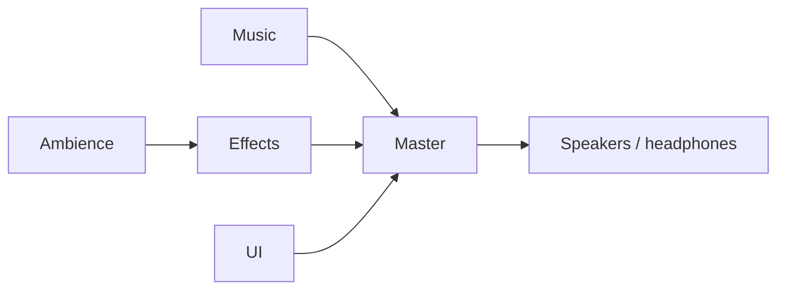

# Audio concept and implementation plan

Status: the first-draft spec is committed; menu, workbench and gameplay audio have been heard. The Kenney CC0 packs, MintoDog CC0 exploration/boss pair and OpenGameArt CC0 swish pack are in the repo. Two-deck music, the shared menu/exploration loop, persistent category settings, mono downmix, initial player/door cues, first-seen/target-acquired boss switching, per-attack release cues, player-centered camera-aligned stereo placement, the first resolved-contact impact pass and one-shot crossbow/Warden wind-up cues are wired. Gameplay feedback identified footsteps as too frequent/loud and the original knife-slice cue as too impact-like; the prototype now uses wider step spacing, lower gains and dedicated swish recordings. Per-realm music, distinct material/element impact coverage, broader monster-threat coverage and spell/item audio remain future slices. This plan follows [program-design](../../.agents/skills/program-design/SKILL.md), the [architecture](../../ARCHITECTURE.md), and the existing [combat](../combat-system.md), [movement](../movement-feedback.md), [world effects](../world-effects.md) and [door access](../door-access.md) boundaries.

## Sound direction

Make the dungeon feel inhabited and physical while keeping combat easy to read. Use close, short footsteps, cloth and leather movement, dry weapon swings, clear impact transients and a little stone-room resonance. Music supplies unease and forward motion; it leaves space for attacks, defenses and nearby threats. Avoid a constant wash of loud footsteps, spell loops and notifications.

Give the score a dark-metal influence without making every floor a wall of distortion. Garrison exploration should stay spacious and tense, with low guitar/organ color, a slow pulse and sparse impacts; boss engagement can add distorted guitar, fuller drums and a more urgent riff. Keep enough space for combat cues. Later realms can reshape that palette with damp resonance and water in the Sewer, then organic percussion and foliage in the Jungle. These are art directions, not claims about the recordings. Start with one exploration/boss pair rather than unrelated music for every depth.

Audio reinforces existing visual information. Guard, parry, guard break, damage and an unsuccessful action must sound distinguishable. Muting music or all audio must leave the game playable. Recorded footsteps do not change the AI's existing abstract "hearing" rules.

| Event | Intended sound and timing | Initial content |
| --- | --- | --- |
| Walk/run | Repeated soft ground contacts, spaced by actual travel; quieter monster steps | Kenney `footstep00`–`footstep03`; prototype now spaces steps 2.5 units apart at -13 dB |
| Rush/dodge and stop | Brief cloth/air rush only after actual dodge travel; light landing/skid | RPG `cloth1`–`cloth4` as temporary material; acquire a proper rush |
| Melee attack | Short airy swish at the active strike, whether or not it hits; reserve impact cues for confirmed contacts | OpenGameArt `Swishes` CC0 pack; 13 mono variants for positional playback at -12 dB |
| Contact, hurt and death | Separate flesh, bone, stone and metal impacts; restrained hurt/death accents | First pass routes confirmed contacts through the target surface; Kenney `chop` is a provisional shared flesh/bone hit; distinct material and creature recordings remain gaps |
| Guard/parry/break | Quiet guard raise, solid block, crisp higher parry, heavy break | Guard raise remains actor-owned; one resolved target-surface cue plays for block/parry/break using the existing Kenney metal recordings |
| Ranged attack | One mechanical preparation cue during an accepted wind-up; distinct release and actual projectile impact | Start with a clearly labelled Kenney placeholder; acquire crossbow recordings; no repeated tracking beep |
| Magic | Fire crackle/ignition, water/ice snap, wind gust, earth grind/thud; distinct release and impact | Additional licensed recordings required; no final elemental set in the two local packs |
| Doors and locks | Hinge/open sound when motion starts; close latch when the leaf reaches shut; unlock only after success | RPG `doorOpen_1/2`, `doorClose_1`–`4`, `creak1`–`3`, `metalLatch` |
| Inventory and consumables | Coin pickup, equipment handling, drink/read and result confirmation after commit | RPG `handleCoins/2`, leather/cloth/book sounds; bottle/drink additions needed |
| World interactions | Chests, traps, fountains, breakage, secrets and stairs; source-local confirmation | Reuse suitable door/book/metal candidates sparingly; acquire water, trap and breakage material |
| UI | Subtle navigation tick, activate, back, panel open/close, error and slider feedback | UI `rollover1`–`6`, `click1`–`5`, `switch1`–`38`; choose a small consistent family |
| Ambience | Quiet realm bed plus sparse local fire/water/air sources | Acquire loops separately; ambience should remain audible with music muted |

The initial footsteps, dodge, attack-release, guard and door assignments are provisional Kenney mappings, chosen to prove timing and routing. The user has selected the MintoDog pair for the prototype. Exact gains, variation and material assignments still need gameplay listening at normal speed and zoom.

## Current seams

- `Main` configures a `Level` and calls `Generate()`. `GameSession` reloads the gameplay scene for floor travel, so a music player inside `main.tscn` would be destroyed on every descent. `SignalBus.LevelLoaded` already carries the generated level.
- `Level.MapGenerator.CurrentRealm` identifies the realm. `RealmEncounterController` owns the gatekeeper's persistent ID and death/descent wiring; its `OnGatekeeperSpawned` receives the concrete enemy. A boss merely existing on the floor is not an encounter-start event.
- `EnemyBehaviorComponent.Target` exposes the AI's current target. `DodgeComponent` and `GuardComponent` already expose local signals. `MovementComponent` supplies resolved movement, while `MovementEffectsComponent` currently applies additional visual-only gates such as being on screen.
- `AttackController` owns the strike/release clock and interruption. `HurtBoxComponent.ContactResolved` and the existing `SignalBus.CombatContactResolved` carry a completed `CombatContactFeedback`, including outcome and world position. Use the bus once for impact audio: the hurtbox currently uses the absence of local contact subscribers to enable fallback prop VFX, so an audio-only local subscription would accidentally suppress those visuals.
- `PlayerAttackController.CreateDefaultDefinition` constructs attacks for weapons without a custom definition. That path needs authored cues too; editing `AttackDefinition` resources alone would leave ordinary weapon attacks silent.
- Doors emit `DoorOpened`/`DoorClosed` only for accepted interactions; restore remains silent. Current close playback starts with the door motion; a separate latch-at-completion cue can be added if listening shows it is needed.
- `MainMenu` and `PauseMenu` own menu flow; pause already emits `GamePaused`. The persistent audio panel applies and saves the Master, Music, Effects and UI buses. Inventory committed-use notifications already exist; do not invent a second consumption event for audio.
- No current playback reference to the former `scenes/combat/audio/aim_lock.wav` was found in scripts, scenes or UID references. The attack indicator is visual-only. Slice 1 removed the unused sample and import sidecar; reproducing the reported sound against an older build is not a playback dependency.

## Mixing, persistence and ownership

Author `default_bus_layout.tres` with this routing. Godot's [audio buses](https://docs.godotengine.org/en/latest/tutorials/audio/audio_buses.html) provide the category controls; players select a bus explicitly.



The prototype has **Master, Music, Effects and UI** buses, with UI clicks routed separately and music on Music. The settings panel in both menus controls those four buses and the Master-bus mono downmix. The authored Ambience bus currently routes through Effects, so Effects volume also controls ambience until the later ambience slice adds its own slider. Use conservative cue gains and master headroom; a limiter is a final guard, not a replacement for mixing crowded combat.

`AudioPreferences` stores settings in `user://audio.cfg`, independently of save slots and `RunState`, and `AudioController` applies them before playback. Sliders use normalized gain, map to bus gain, and mute at exactly zero; non-finite values are rejected and finite values clamp to 0–1. Reading/saving a muted bus returns zero rather than its retained pre-mute gain. A missing file uses authored bus defaults; malformed individual entries use their defaults. Saving preserves other valid audio entries. A write failure keeps the current audible adjustment and reports that it could not be saved. This presentation work needs no save DTO fields or save-version bump.

Compose an `audio.tscn` child into a new `scenes/session/game_session.tscn`, whose root retains the existing `GameSession.cs`. Change the existing autoload entry to that scene. This adds no autoload, singleton accessor or gameplay registry. `GameSession` keeps session-flow logic; the child owns audio. Keep autoload names/order stable. The audio child may observe the already-ready `SignalBus` during its `_Ready()`, but must not depend on the parent's singleton initialization or use `ScenePool` before startup completes.

`AudioController` coordinates one-shot playback and owns the `MusicController` child. It listens to presentation broadcasts; gameplay never calls `GameSession.Instance.Audio`. Actor/prop adapters own which cue is emitted and when. UI roots own their button bindings. Resources hold immutable configuration; current voices, cooldowns, last variation, fade progress and RNG are runtime state. Keep user preferences separate from save slots and run state.

The audio controller, music decks and UI voices process during pause; world voices and local ambient/spell loops are pausable. Boss polling and its disengagement timer freeze with gameplay. Music's per-deck transition envelope and temporary pause gain multiply independently, so pausing during a crossfade cannot restore the wrong volume.

For world audio, the gameplay scene has an explicitly wired `AudioListener3D`. `Main` keeps it at player height and follows the gameplay camera's orientation, including camera rotation and spawn/teleport updates. This keeps distance centered on play instead of the elevated orthographic camera. Godot otherwise listens at the camera, as documented for [AudioStreamPlayer3D](https://docs.godotengine.org/en/latest/classes/class_audiostreamplayer3d.html). The combat/audio harness authors its own listener.

## ARPG mix and stereo rules

Treat sound as another gameplay information channel. Blizzard's [Diablo IV sound-design account](https://news.blizzard.com/en-us/article/23731236/diablo-iv-quarterly-updateoctober-2021) emphasizes an adaptive, clear combat mix and variation in frequently repeated sounds. Our priorities are immediate threats and player damage/defense, the player's actions, nearby enemy contacts, then decorative movement and ambience. Preserve their different attacks and frequency ranges; making every cue louder cannot improve clarity.

| Sound | Source and stereo treatment |
| --- | --- |
| Music and broad environmental beds | Preserve authored stereo; non-positional playback |
| Enemy steps, weapon contacts, doors and discrete world sources | Prefer mono recordings and let the game position them; an enemy left on screen leans left in the mix |
| Player footsteps, swing, dodge and personal feedback | Centered or narrowly panned; turning the character must not move the player's whole sound image between ears |
| UI, errors and important personal confirmations | Centered, consistent level, independent of camera position |
| A particular fountain, fire or sustained spell | Local positional source; broad room ambience remains a separate bed |

For the first pass, keep the player-centered, camera-aligned listener and export `SoundCueProfile.PanningStrength`: start world cues around 0.5 and personal cues around 0–0.2, then audition. These are tuning starting points. Avoid full left/right isolation on routine combat cues. Godot exposes [per-source panning strength](https://docs.godotengine.org/en/latest/classes/class_audiostreamplayer3d.html#class-audiostreamplayer3d-property-panning-strength); its product with the project setting controls the result.

Distance attenuation follows proximity to the player; stereo orientation follows the view, independently of character facing. Camera rotation may change left/right, but camera zoom must not change world loudness. This native listener setup preserves directional sign, not exact screen-coordinate panning. Epic documents [separating character-based attenuation from camera-based panning](https://dev.epicgames.com/documentation/en-us/unreal-engine/spatialization-overview-in-unreal-engine). If close sounds still pan too abruptly in our orthographic view, evaluate that fuller separation in the harness before changing the playback implementation; Godot's single listener does not supply independent distance and panning positions automatically.

Use the single voice-admission policy below. `MaxVoicesGlobal` is per shared cue resource, not an additional string-keyed family registry; monsters can share a footstep cue while the player's narrower version has its own profile. Initial caps are tuning data, not proof that the mix is readable. Avoid identical overlapping samples, excessive pitch randomization, long reverberant tails on every hit and Doppler on ordinary movement/combat.

The **Mono output** toggle downmixes the final stereo mix to both ears, including music; setting positional panning to zero alone does not downmix stereo recordings. This follows [Xbox audio accessibility guidance](https://learn.microsoft.com/en-us/xbox/accessibility/xbox-accessibility-guidelines/105). Godot's [AudioEffectStereoEnhance](https://docs.godotengine.org/en/4.7/classes/class_audioeffectstereoenhance.html) provides the downmix: the dedicated Master effect uses `PanPullout = 0`, `Surround = 0`, `TimePulloutMs = 0`, and `AudioServer.SetBusEffectEnabled` toggles it without changing category gains. Verify it on the installed engine and stereo output.

Extend acceptance with left/center/right sources at equal distance, movement across the player, camera rotation and all zoom settings, offscreen explored enemies, and the player turning in place. Repeat crowded combat on headphones, speakers, mono output and at low volume. Direction should agree with the image, personal cues should remain stable, important cues should survive the mono downmix, and no essential information may depend solely on stereo direction. Source assets should also be checked for mono compatibility. For later binaural output, use one intentional spatialization path and test platform processing rather than stacking widening/HRTF effects.

## Music behavior

The current prototype uses two non-positional `AudioStreamPlayer` decks on the Music bus and two looped `MusicProfile` resources. MintoDog's Heavy Dungeon is exploration music; Heavy Battle 1 is the boss track. The user has auditioned and selected this CC0 pair for the prototype. Their imported OGG streams loop in the resource settings.

| Event | Current response |
| --- | --- |
| Main menu entered / `LevelLoaded` | Start the exploration loop in the menu; the same profile continues into gameplay and across floors without restarting. |
| First accepted gatekeeper attack | Emit one boss-context change and crossfade to boss music; generation and boss spawn alone do not switch it. |
| Gatekeeper death | Return to exploration music. |
| Player death | Fade both decks to silence. |
| Workbench controls | Manually play exploration, play boss, or fade to silence for direct comparison. |

Crossfades use the profile's gain and an exported 1.5-second sine-eased tween. Reversals kill the previous tween and retarget the deck gains. The prototype keeps at most two decks and does not change the user's Music bus gain during a transition.

The settings panel now adjusts and persists the Master, Music, Effects and UI buses, with a Master-bus mono downmix toggle. Later refinement can assign tracks per realm, choose whether boss music should start on target acquisition or the first telegraph, add a short disengagement grace period, and duck music during pause. Keep these decisions driven by gameplay listening; the first prototype intentionally has no generic owner/context registry, pending-track queue, or beat scheduler.

For later musical refinement, Godot's [AudioStreamInteractive](https://docs.godotengine.org/en/latest/classes/class_audiostreaminteractive.html) supports authored clip transitions, and [AudioStreamSynchronized](https://docs.godotengine.org/en/latest/classes/class_audiostreamsynchronized.html) starts stems together. Matching exploration and percussion stems can add pressure without changing the underlying theme. That requires compatible tempo, key, phrase lengths and loop points; unrelated CC0 tracks cannot promise beat-aligned transitions. Do not build custom beat scheduling, combat-intensity scoring or boss-phase rules in this first pass.

## SFX behavior and bounded contracts

Reusable types use `[GlobalClass]` where Godot authoring benefits from them, one class per file. Dependencies and tunables are exported properties with explicit Inspector wiring. Optional unassigned cues disable that sound; invalid assigned content warns once and is skipped without affecting gameplay.

Cue validation requires at least one non-null non-looping variant, finite gain, positive ordered pitch bounds, panning between 0 and 1, nonnegative interval, positive voice limits, and positive world range/unit size. Each `MusicProfile` requires a loopable stream and finite gain; `MusicController` validates the requested profile before changing playback. Shared cues/streams are immutable; do not duplicate sample data per actor.

| Type | Essential configuration / API | Responsibility |
| --- | --- | --- |
| `SoundCueProfile : Resource` | `AudioStream[] Variants = []`, `SoundCueCategory Category` (`World` or `UI`), `GainDb`, `PitchMinimum/Maximum`, `PanningStrength`, `UnitSize`, `MaxDistance`, `Priority`, `MaxVoicesPerSource`, `MaxVoicesGlobal`, `MinIntervalSeconds`; `bool Validate(out string error)` | Immutable one-shot definition; world cues route to Effects and UI cues route to UI; looped Ogg/WAV/MP3 variants are invalid |
| `MusicProfile : Resource` | `AudioStream Stream`, `GainDb`; `bool Validate(out string error)` | Immutable single-track definition; the stream must be authored/imported to loop |
| `AudioController : Node` | Exported `WorldSoundScene`, `WorldVoicesRoot`, `UiVoicesRoot`, door cues and voice limits; listens to world/UI/door broadcasts and resolved combat contacts; child `MusicController`; `void ReleaseScene(Node scene)` | Select contact cues from the target's surface profile, then validate/rate-limit and dispatch through pooled world playback; no gameplay state |
| `MusicController : Node` | Exported `DeckA`, `DeckB`, exploration/boss `MusicProfile`s and `TransitionSeconds`; `PlayExploration()`, `PlayBoss()`, `StopMusic()` | Own both decks and crossfades between the two authored contexts or silence |
| `WorldSound : AudioStreamPlayer3D, IPooledNode` | `void PlayCue(AudioStream stream, SoundCueProfile profile, Vector3 position, float pitch, Action<WorldSound> finishedCallback)` | One fixed-position voice per spawn; reset and stop on despawn, return to `ScenePool` on completion |
| `AttackDefinition : Resource` | Optional `SoundCueProfile ReleaseCue` | Per-attack override for weapon, monster and spell release sounds |
| `Weapon : EquipableItem` | Optional `PrimaryReleaseCue` and `SecondaryReleaseCue` | Fallback release sounds for generated weapon attacks and focused spell casts; an attack definition's own cue wins |
| `ActorAudioComponent : Node` | Exported actor, Movement, Attack, optional actor release fallback, footstep/rush/guard-raise cues and cadence thresholds | Emits the attack definition's release cue for players and monsters; keeps movement and guard-raise feedback local to the actor |
| `LevelAudioComponent : Node` | Proposed exported `Level`, boss poll interval and disengage delay | Future per-realm selection and target-loss policy; the gatekeeper starts music on first screen entry or player acquisition and returns to exploration on death |
| `UiAudioComponent : Node` | Exported `Control ButtonRoot` and `SoundCueProfile PressedCue` in slice 1 | Binds buttons under the authored main-menu panel before the screen's own handlers; later panels own their bindings |
| `InventoryAudioComponent : Node` | Exported actor, pickup/equip cues and `Dictionary<StringName, SoundCueProfile> UseSounds = []`; `void Bind(Inventory inventory)` | Observe the injected runtime inventory's committed notifications; rebinding disconnects the old inventory and plays nothing |
| `AudioSettingsPanel : Control` | Exported four sliders, Mono toggle and status label; Ambience slider can follow with actual ambience content | Reads current settings, applies changes immediately and persists on drag release/close |
| `AudioPreferences` (static helper) | `void LoadAndApply()`; `float ReadGain(AudioChannel channel)`; `void SetGain(AudioChannel channel, float gain)`; `bool ReadMono()`; `void SetMono(bool enabled)`; `Error Save()` | Focused ConfigFile/AudioServer bridge; no mutable static gameplay or settings registry; Mono selects the dedicated Master downmix effect |

`SignalBus` currently provides `WorldSoundEmitted(SoundCueProfile cue, Node source, Vector3 position)`, `UiSoundEmitted(SoundCueProfile cue, Node source)`, door events and `BossEncounterChanged(bool)`. These announce presentation; callers receive no acknowledgement and cannot depend on playback success. Do not add a generic music-context protocol unless per-owner arbitration becomes necessary. Local adapters use `SubscribeUntilExit`, including when observing ancestors, resources or the bus.

Extend the existing `ImpactSurfaceProfile` with optional `DamageSound`, `GuardSound`, `ParrySound`, `GuardBreakSound` and an exported `Dictionary<DamageElement, SoundCueProfile> ElementDamageSounds = []`. Hurtboxes already reference this material profile; damageable props can participate without an actor adapter. On damaged contacts, an assigned elemental entry takes precedence over the ordinary material damage cue. Defended outcomes select their respective cues. Audio ignores visual-only `CombatFeedbackSettings.Enabled`; disabling VFX must not disable sound. Do not add presentation references to `DamageContext` or change damage resolution.

Initial limits are 24 world one-shots, 4 UI one-shots, 2 per source/cue, 6 per shared cue, and a 60 ms source/cue interval unless the cue overrides those values. First reject invalid/category-mismatched cues, out-of-range world requests and interval violations. When a source, cue or world limit binds, apply the admission policy below and drop the request if no eligible voice can be replaced. World playback requires the explicitly current viewport listener (`Viewport.GetAudioListener3D()`); no authored listener means world audio is disabled with one diagnostic, while UI/music remain available.

When a per-source limit binds, candidates are voices of that source and cue. When a per-cue limit binds, candidates are voices of that cue; otherwise the global limit considers all world voices. A higher-priority request may replace the lowest-priority candidate; for equal priority, a nearer request may replace the farthest candidate. Choose the oldest among equally eligible candidates; an equal-priority, equally distant request is dropped. UI uses four authored non-positional player slots and replaces its oldest slot when full. This is the only stealing policy. Remove voice records explicitly on finish, stealing and scene release; Godot's `Finished` signal must not be assumed to fire after `Stop()`.

Select a non-repeating variant when more than one exists, with restrained pitch variation, from an audio-only RNG. Never draw from generation, loot or attack RNGs. Store cooldowns per source instance and cue, and the last variant per cue; clear source cooldowns when its scene exits. A source exit does not truncate its already-emitted impact tail. Give parry, guard break and player damage higher authored priorities than footsteps.

Pool world voices under the persistent audio child's **pausable `WorldVoicesRoot`**, with a snapshot position and the emitting source's current scene recorded. Observe that scene's `TreeExiting` and call `ReleaseScene` to stop/despawn its voices before discarding their records. Do not simply parent pooled voices to a floor and let scene destruction free them: `ScenePool` retains active-node bookkeeping. Normal completion, eviction, scene release and audio shutdown all use the same idempotent return-to-pool path. UI slots live under the persistent **Always-processing `UiVoicesRoot`**, so a selection click can finish over scene travel. Reject stale emissions from sources outside the current scene. Missing buses diagnose/skip their category rather than silently routing to Master.

Ambient loops and any later sustained spell sounds have local scene owners, bounded range and explicit stop/reset on cancellation, death, despawn or scene exit. They do not occupy the one-shot pool. The first ambience batch adds one realm bed and one local fountain/fire example; do not introduce a global ambience manager or arbitrary multi-loop allocation system before those are useful.

### Hook placement and failure rules

- **Movement:** `ActorAudioComponent` currently samples player ground displacement and emits alternating steps after the configured travel distance. It resets on teleport and overrides, requires actual movement/on-floor locomotion, and gates while the player is locked, staggered or disabled. Dodge-start arms a cue; first actual dodge displacement plays it once. Walking into a wall is silent. Do not reuse dust callbacks: audio must work with VFX disabled and nearby actors just outside the screen. Monster movement cues remain a follow-up slice.
- **Visibility:** Player feedback remains audible while invisible. For enemy/prop feedback, require an explored source and audible range; suppress unknown sources to avoid revealing hidden content. Offscreen alone is not a reason to suppress nearby audio. Initial attenuation is distance-based; closed-door acoustic occlusion and room reverb are later work. This deliberately retains the current exploration boundary rather than introducing a new hearing mechanic.
- **Attacks and telegraphs:** `AttackController.AttackReleased` includes the active `AttackDefinition` at its existing release clock. `ActorAudioComponent` uses its `ReleaseCue` when assigned, then the actor fallback. Weapon definitions can set primary/secondary release fallbacks; a custom attack's cue takes precedence. Monster attack strategies already own an `AttackDefinition`, so their attack sounds are authored there. A missed swing still gets its release cue; cancellation before release does not. One-shot enemy telegraphs remain future work; do not add an aiming-only subsystem or repeated tracking beep.
- **Boss music:** `RealmEncounterController` starts the boss transition on the gatekeeper's first screen entry or first acquisition of the player, whichever comes first. Both route through a one-shot guard; death restores exploration music. It does not wait for the boss to begin an attack.
- **Contacts:** `AudioController` observes `SignalBus.CombatContactResolved` once, selects the target's `ImpactSurfaceProfile` cue and routes it through world playback at `feedback.Position`. A damaging elemental contact first checks `ElementDamageSounds`, then falls back to `DamageSound`; blocked, parried and guard-broken contacts use their dedicated profile fields. Neither actor adapters nor projectiles replay target impacts. Existing Guard signals supply guard-raise/end feedback only. Dead/evaded/rejected/absorbed contacts do not produce a damage impact. Actor adapters may add a distinct, throttled hurt vocal through existing `DamageResolved`, and one death vocal through Health's death signal; these are separate from the material impact. Restore/rebind must not replay them, and prop fallback VFX must still work.
- **Magic:** Put release cues on each spell's cast `AttackDefinition`. Release plays once per cast/volley, not once per target. Elemental damage impacts use `DamageContext.Element` and the target surface profile through the contact path. Spell/projectile scenes emit their own non-damaging world impacts only when no hurtbox handled that contact; non-damaging wards, teleport and summons emit at their committed operation. Lingering/area effects rate-limit repeated impacts and own any sustained local loop. A failed cast or mana check must not sound successful; observe existing `ManaShortfall` for a throttled player error cue.
- **Doors:** `AudioController` observes accepted `DoorOpened`/`DoorClosed` events and emits positional open/close cues. Both currently start with door motion; `RestoreAccess`, scene readiness and failed interactions remain silent. A separate close latch at motion completion is deferred unless the current sound proves mistimed. Unlock feedback is not wired yet.
- **Items:** Add an independent inventory audio adapter subscribing to existing committed local notifications; map existing `ConsumableItem.UseCue` values to sound profiles. Do not implement or rename the separate [consumable visual proposal](consumable-feedback-plan.md). Pickup/use/equip sounds occur after success; rebind/load never synthesize them. Generic read/drink confirmation must not reveal unknown item identities or a hidden curse. Teleport departure/arrival need the operation's actual positions, not guessed inventory UI state.
- **UI:** Activation follows `Pressed` once, not both button-down and release. Bind audio before callbacks that change scenes, so the synchronous cue is admitted before its source exits. Deduplicate mouse hover and focus transitions, suppress automatic initial focus, ignore disabled/invisible controls and throttle navigation ticks. Bind dynamic slot/dialog buttons when their owning panel builds them and unbind when removed. Panel back/error are explicit calls; gamepad cancel produces the same cue as a Back button. Slider ticks are throttled and silent on programmatic initialization.

## Control flow and ordering

```text
Existing GameSession autoload -> game_session.tscn composition
  audio child ready -> create UI voice slots -> subscribe to SignalBus
  all autoloads ready -> menu/gameplay may emit cues (ScenePool now available)

MainMenu ready -> MainMenuEntered -> MusicController.PlayExploration()
Main -> ConfigureLevel -> Level.Generate -> restore saved deltas silently
  LevelLoaded -> MusicController.PlayExploration()
  gatekeeper VisibleOnScreenNotifier3D.ScreenEntered or PlayerTargetAcquired -> BossEncounterChanged(true) -> PlayBoss()
  gatekeeper death -> BossEncounterChanged(false) -> PlayExploration()
  PlayerDeath -> StopMusic()
  persistent MusicController -> validate profile -> crossfade / retain same stream

Source emits world cue -> AudioController admits -> ScenePool.Spawn under WorldVoicesRoot
  associate voice with source's scene; apply cue, position and inherited pause mode
  finish / eviction / scene TreeExiting -> one release path -> ScenePool.Despawn
  detach voice record exactly once; source death alone may leave its short tail playing

Player or monster attack release (AttackDefinition.ReleaseCue) -> ActorAudioComponent -> WorldSoundEmitted
Player displacement / dodge / guard raise -> ActorAudioComponent -> WorldSoundEmitted
HurtBox contact resolution -> CombatContactResolved -> AudioController chooses target surface/outcome/element cue
  -> WorldSoundEmitted -> positional pooled voice
Door open/close commit -> DoorOpened / DoorClosed -> AudioController -> positional door cue
Menu button activation -> UiSoundEmitted -> centered UI voice slot
```

## Asset intake and additions

The local `~/Downloads/kenney_rpg-audio` and `~/Downloads/kenney_ui-audio` each contain 51 OGG files in their `Audio/` directory, plus a top-level preview. Their included licenses identify Kenney and CC0, consistent with the public [RPG Audio](https://kenney.nl/assets/rpg-audio) and [UI Audio](https://kenney.nl/assets/ui-audio) license listings. Both packs and their licenses have been copied into `assets/kenney-rpg-audio/` and `assets/kenney-ui-audio/`, preserving the Downloads originals. Previews, shortcuts, archives and `.DS_Store` are excluded. Imported filenames use lowercase snake_case, with a source-to-repository filename map; both packs and their audio compatibility group are in [ATTRIBUTIONS.json](../../assets/ATTRIBUTIONS.json), following [asset intake rules](../../assets/AGENTS.md).

The next acquisition priorities are stronger material impacts, magic releases/impacts, crossbow release, creature voices, drink/bottle sounds and ambient loops. The MintoDog exploration/boss pair has been acquired and selected for this prototype. Candidate public sources checked on 2026-11-07:

| Source | Candidate role | Selection limit |
| --- | --- | --- |
| Kenney [Impact Sounds](https://kenney.nl/assets/impact-sounds), 130 files, CC0 | Broaden impacts and foley in the same source family | Audition individual material hits before assigning them |
| HydroGene's [JRPG Epic Rock Battle Theme #1](https://opengameart.org/content/jrpg-epic-rock-battle-theme-1), CC0 | Alternate RPG boss candidate with a separate intro and seamless loop | More classic rock/JRPG than dark metal |
| Ruhinre's [Whispers in the Fog](https://opengameart.org/content/whispers-in-the-fog), CC0 | Atmospheric alternative if the metal exploration bed feels too busy | Candidate only; no match to a boss track or stems established |
| yd's [Dungeon Ambience](https://opengameart.org/content/dungeon-ambience), CC0 | Non-musical exploration bed alternative | Evaluate repetition and whether its texture masks tactical cues |

The remaining rows are candidates, not approved additions. Prefer CC0; a freely downloadable CC BY asset can be considered with its exact author/license and shipped attribution recorded. Exclude NC, marketplace extraction restrictions and unknown terms as required by the repository. Check each selected file's own provenance rather than assuming a collection has one license. Preserve license evidence, original filename and any trimming/transcoding/loop edits. Avoid repeated lossy conversion; keep music OGG and suitable existing OGG effects unless measured import/latency needs justify a change.

## Delivery slices and verification

Implement in dependency order, with one audible acceptance exercise per slice. The workbench uses production playback, not a second mock backend, and grows as each capability lands. No slice requires all final assets or the full active catalog to be complete.

### 1. Playback proof — accepted in the workbench

**Delivered:** copied and registered both local Kenney packs; created buses, `SoundCueProfile`, `WorldSound`, `AudioController` and the persistent session/audio composition. The main-menu panel has `UiAudioComponent`. `scenes/debug/audio/audio_harness.tscn` uses production playback with a listener, left/center/right source markers, cue selection, replay, stress, pause controls and active-voice counts. The user confirmed menu and harness playback. The unused aim-lock sample and import sidecar were removed after checking references.

**Remaining proof:** verify stereo direction, distance and pause behavior on the installed engine, and stress/scene-exit cleanup. These need a windowed run; headless loading does not establish audibility.

**Implementation progress:** C# builds, audio resources import and both menu and harness scenes load headlessly. The user confirmed audible menu and harness playback. These checks do not establish stereo direction or pause behavior; complete that listening acceptance in a windowed run.

### 2. Music, settings and first gameplay cues — partially implemented

**Delivered:** imported looped MintoDog Heavy Dungeon and Heavy Battle 1 profiles; added two music decks, smooth crossfades, exploration-on-level-load, boss-on-first-screen-entry-or-player-acquisition, return-to-exploration-on-boss-death, player-death silence and workbench controls. Added persistent Master/Music/Effects/UI sliders and a saved Master-bus mono downmix toggle in the main and pause menus. Added a player-centered camera-aligned listener, quieter footsteps at wider travel intervals, first-travel dodge cue, randomized OpenGameArt attack-release swishes, editor-authored weapon/attack release cues, a Warden release cue, guard/block/parry/break cues and positional door open/close cues.

**Remaining proof:** relaunch after changing each slider and mono option, confirm exact mute and live mix response, and play a real floor to tune step cadence, attack swishes, defenses and door cues. Confirm spatial placement. Rotate the camera and player separately, zoom in/out, pause during a crossfade and travel to another floor to check the loop does not restart.

**Remaining implementation:** per-realm and menu music profiles, target-loss grace behavior, distinct material/element impact assets and mappings, and authored release profiles for the active weapon/spell roster.


### 3. Threat and combat coverage

**Delivered, first pass:** `AudioController` listens once to resolved contacts and selects the target `ImpactSurfaceProfile` cue for damaged, blocked, parried and guard-broken outcomes. Playback uses the resolved world position and existing admission/variation rules; dodges, absorbed contacts and rejected contacts stay silent. Both current flesh and bone profiles use the provisional Kenney `chop` cue, and surface profiles export elemental overrides. The actor no longer replays block/parry/break cues, while guard raise remains actor-owned. Hurtbox fallback VFX is unchanged.

**Delivered, second pass:** `AttackDefinition` authors an optional one-shot `WindUpCue` alongside its release cue. `ActorAudioComponent` plays it once from the existing accepted `AttackStarted` signal, so tracking never retriggers it and attacks rejected before start stay silent. The skeleton crossbow has a quiet Kenney mechanical click; the Warden's heavy swing has a stronger randomized draw sound. Release cues remain synchronized to the existing attack clock.

**Remaining delivery:** replace the temporary crossbow cue when a fitting recording is available; add distinct material and elemental recordings/mappings; then extend cues to active monster movement, damage and death where useful.

**Prove:** warning and visual wind-up share the real attack clock; target tracking never repeats a warning; canceled attacks do not release. A contact produces one impact at the resolved position, including block/parry/break outcomes, without suppressing fallback VFX. Existing visuals remain sufficient with sound muted. Keep all cue changes independent of gameplay RNG and outcomes.

**Still absent:** distinct material/element recordings, optional hurt/death accents, and spell/item/ambient coverage. Play the real gameplay loop with VFX both enabled and disabled, confirm the crossbow/Warden warnings read clearly at normal play distance, and compare gameplay/RNG outcomes with audio on/off.

### 4. Boss threat and encounter refinement

**Delivered:** boss music begins when the gatekeeper first enters the screen or first acquires the player, whichever happens first, and returns to exploration on its death; player death fades music out.

**Affected paths/contracts:** selected attack/cue resources and enemy scenes, encounter controller, level audio component, audio/combat workbenches and `tests/RealmEncounterTest.cs`, `MusicTransitionTest.cs`, `AudioFeedbackTest.cs`.

**Prove:** the warning and visual wind-up share the real attack clock, tracking never repeats the warning, canceled attacks do not release, and the boss track does not start merely because the boss spawned. The existing visuals remain sufficient with sound muted.

**Remaining:** evaluate whether losing the target needs a grace period. The screen-entry/target-acquisition start rule and the Warden's authored one-shot wind-up cue are implemented.

### 5. Expand content in bounded batches, then accept the mix

After slices 1–4 are accepted in gameplay, expand in independently verifiable batches rather than one all-catalog change:

| Batch | Owning paths and proof |
| --- | --- |
| Magic | Active spell/projectile scenes and elemental surface mappings. Prove one damaging elemental spell and one non-damaging ward/teleport first, then cover the active roster. Check release-once, multi-target/lingering limits, failed casts, actual departure/arrival positions and local loop cleanup if a sustained sound is needed. |
| Items and interactions | `InventoryAudioComponent`, runtime player inventory binding, existing pickup/equip/use/lock/trap/chest commit owners and resources. Prove one pickup and one consumed item first; then extend the map. Check cancellation, silent restore/rebind and no hidden-identity/curse leaks. Keep the separate consumable visual proposal untouched. |
| Ambience | One realm bed and one local fountain/fire example, their scene-owned players, the Ambience slider/preferences entry and workbench controls. Check Music mute leaves ambience audible, Effects mute includes it, pause/scene exit stop it correctly, and it does not mask combat. Expand only after listening. |

Every batch names unassigned/provisional active content in the workbench. Full first-three-floor acceptance requires deliberate coverage of the events in the palette table, not merely a generic fallback noise everywhere. Play real floors on headphones, speakers, mono output and at low volume; tune cue gain/range, priorities and concurrency before adding more sound layers. Authoring acceptance includes assigning/replacing a cue in the Inspector and reopening the scene without C# changes.

### Shared verification and deferred scope

Implementation checks follow the [Godot workflow](../../.agents/skills/godot-mcp/SKILL.md). The current pass builds the solution, imports the new audio resources and headlessly loads the menu, workbench and gameplay scenes. No automated tests were added or run. Headless checks verify wiring and resource loading, not audibility; windowed listening is still required. Future test coverage can focus on voice eviction/cooldowns, settings validation, release-once semantics, contact deduplication, preserved prop fallback visuals, displacement-driven steps and music fade interruption. Timed runtime tests use fixed simulation deltas.

Defer custom screen-space panning, HRTF integration, closed-door acoustic simulation, room reverb zones, synchronized music stems, per-monster combat-intensity scoring, global loop management, dynamic ducking and reduced-dynamic-range presets. Add them only to address a demonstrated listening/gameplay need. No placeholder types or future-only fields for those features belong in the prototype.

## Remaining proposed affected paths

```text
~ scenes/menu/MainMenu.cs, main_menu.tscn
~ scenes/ui/PauseMenu.cs, pause_menu.tscn, owning dynamic inventory/dialog UIs
~ scenes/audio/LevelAudioComponent.cs, InventoryAudioComponent.cs
~ scenes/audio/ActorAudioComponent.cs and enemy scene wiring for additional monster cues
~ scenes/player/PlayerAttackController.cs, scenes/items/Weapon.cs and weapon resources for authored cue coverage
~ scenes/effects/combat/ImpactSurfaceProfile.cs and authored material profiles
~ scenes/levels/generators/Realm.cs, realms/{garrison,sewer,jungle}.tres
~ scenes/props/Door.cs and lock commit owners
~ active spell/projectile, item-use, pickup and interactive scenes/resources
~ assets/<selected additional audio packs>
~ assets/ATTRIBUTIONS.json
+ tests/AudioPlaybackTest.cs, AudioFeedbackTest.cs, MusicTransitionTest.cs
~ tests/RealmEncounterTest.cs
~ docs/README.md, development-roadmap.md, scenes/debug/README.md
+ docs/audio-system.md                            # consolidate implemented rules after delivery
```

Keep the affected paths with their owning slice; do not create empty framework classes or unassigned future state up front. `ARCHITECTURE.md` can gain the high-level audio ownership after gameplay acceptance. Remaining creative decisions are later music/context choices, sound auditions and in-game tuning; technical ownership and first-pass behavior are settled above.
