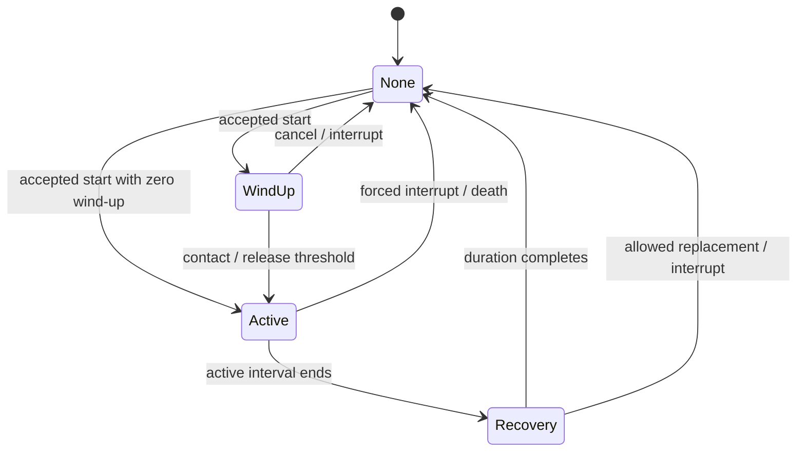

# Combat presentation, attack execution and harness cleanup

Status: **implemented (feedback components, attack execution, shared indicators and harness slices)**. The source inventory below records the baseline checked on 2026-11-05; current behavior is documented in [combat actions and defense](../combat-system.md), [weapon attacks](../weapon-attack-system.md), [world effects](../world-effects.md), [monster authoring](../monster-authoring-design.md) and the [combat harness](../combat-harness.md). This work preserves gameplay defaults and complements the remaining [combat redesign](combat-redesign-plan.md), whose Warden attack and guard walking are separate gameplay work. Rendered review at normal zoom remains an acceptance item. The [game design](../game-design.md) owns intended gameplay; the [roadmap](../development-roadmap.md) owns delivery priority.

## Goal and scope

Make incoming attacks and confirmed contacts immediate, weighty and readable. Unify attack warnings, coordinate target flash, material-specific particles, existing damage numbers, camera impulse and small visual motion, and simplify the combat harness around production scenes. Clean up attack execution so its phase transitions and interruption rules are explicit and independently testable. Keep the current damage, defenses, poise, hit volumes, action windows, movement and RNG behavior in gameplay.

The harness defaults to a passive movable dummy or one selected production monster with autonomous offense disabled. Defense modes are settings on the monster's real defense component, and invulnerability is an independent hurtbox setting. The harness configures these capabilities rather than implementing its own combat policies.

**Simplicity rule:** implement and expose each capability on its reusable component first. The same exported property must work in the Godot Inspector, Remote Inspector and a harness control. The harness owns only scene selection/spawning, a small explicit set of UI bindings, and its existing diagnostics/scenario entry points. Keep helpers local until a real second caller or a distinct growing responsibility justifies extraction. No generic property inspector, harness-specific combat policies, actor adapters or mandatory new test framework.

Interpret **lunge** as moving the **attacker** forward on a successful melee hit. The original behavior-preserving scope proposed a model offset; after playtest feedback, the approved implementation uses bounded movement on the attacker's physics body. This is the one gameplay change in the feedback work. Existing defender knockback remains exactly as authored. Sound is deferred; add no audio infrastructure in these slices.

Three requested effects need an explicit distinction:

| Request | Included in the behavior-preserving pass | Separate gameplay/pacing decision |
| --- | --- | --- |
| Knockback | Preserve existing physical pushes; add a small visual recoil to otherwise unreactive flinches | Pushing every hit, changing distance/decay, or pushing blocked contacts changes positioning and action interruption |
| Hit stop / freeze the game | Preserve the current attacker-only execution stop and its duration | A whole-world freeze changes relative timing against other actors; even with unchanged game-time durations it gives different real-time response opportunities |
| Lunge | A 0.2 m collision-resolved attacker movement over the authored feedback duration, once per successful melee execution; actor status locks, stagger and knockback retain priority | Intentionally changes attacker spacing slightly after a hit; it does not alter damage, contact checks already resolved, or defender reactions |

The first pass deliberately retains today's attacker-only stop. A true whole-world freeze is designed separately below so it can be evaluated without claiming it preserves existing combat behavior.

## Baseline inventory before implementation

This is a source and scene inventory, not a fresh visual playtest or claim that all listed effects read well at the gameplay camera distance.

| Mechanism | What exists and where | Coverage and limits |
| --- | --- | --- |
| Physical knockback | `HurtBoxComponent.ReactToHit` delegates to `MovementComponent.Push`; `AttackDefinition.Knockback` defaults to 3. Push velocity decays by the actor's `Speed` and moves through `MoveAndSlide`. | Poise flinches do not push. Poise breaks and poise-free interruptions push; `ForcePushback` adds the existing secondary/air-staff exception, subject to hyper-armor and resistance. `DamageContext.ForcedPush` is a separate spell force that can move even a fully absorbed, unblocked contact. Preserve both contracts. |
| Hit-reaction pose | Player/enemy animation trees use `IsKnockedBack`; forced stagger uses `ActorActionGateComponent` and `CombatAnimationComponent`. | Pushes show a hit pose, while a stagger owns its own pose. Ordinary poise flinches get particles but no dedicated body flash or new pose. Do not introduce another pose owner. |
| Hit flash | Spell visuals use `ImpactFlash.TryClaim` to bound bright spell flashes; elemental wards call `IGuardVisual.FlashGuard` when absorbing damage, with their own visual treatment. | No reusable actor-wide flash on ordinary resolved weapon damage. The spell helper is a brightness limiter, not a target-flash component. Retain existing ward flashes without a second absorption flash layered on top. |
| Hit stop | `AttackController.StartHitStop` pauses its elapsed execution time, contact sampling and combat pose once per melee swing. Defaults: player primary 50 ms, secondary 80 ms; rat/minion 30 ms, warrior 40 ms, Warden 50 ms. Combo steps scale it; rear/sneak vulnerability can double it. | Starts on `Damaged`, `Blocked` or `GuardBroken`, including zero-chip blocks. Other actors, pushes, defense/status clocks and projectiles keep running. Parry cancels the intercepted attack instead. Projectile contacts do not stop the firing execution. The first qualifying target consumes the swing's stop; later contacts do not extend it. |
| Screen shake | `Main` listens to the player's `HurtBox.HitReacted` and `AttackController.HitStopStarted`, then uses the assigned Phantom Camera noise emitter. | Taken interruption/stagger: 0.25 world-unit impulse; outgoing contact: hit-stop seconds × 2.5. Noise decays over 0.18 s; weaker impulses cannot replace a stronger active impulse. Outgoing blocks shake indirectly through hit stop, with no separate blocked scale. Incoming flinches, normal blocks, parries and projectile hits have no equivalent direct hook. The combat harness uses a plain camera and does not exercise this `Main` wiring. |
| Hit particles | `HurtBoxComponent.SpawnHitEffect` pools `hit_effect.tscn`, a red blood burst: 100 particles, 0.5 s lifetime. Player and monster base/templates assign it. | Called from the eligible unprotected hit-reaction path, including poise flinches. Blocks/parries/absorbed contacts and suppressed reactions do not use it. Spawned under the hurtbox with an approximate directional offset; no actual contact point/normal or material selection. Skeletons inherit blood too. This path has no cloak suppression check. |
| Other VFX | `MeleeAttackProfile.SwooshScene` selects pooled slash/chop/thrust ribbons. Blade markers can drive their cosmetic geometry. Projectiles have cast, muzzle, impact and expiry scenes; spell scenes own additional effects. | Trails are already independent of collision. Projectile impact scenes play after a recognized damage-target contact without branching on the returned defense outcome, so a visual projectile impact alone does not prove health damage. Existing spell visuals should remain separate from target response. |
| Damage numbers | `DamageNumbersComponent` observes `HurtBox.DamageResolved`; pooled `DamageNumber` pops, rises and fades over 0.9 s with alternating lateral drift. | Wired on monster bases/templates, Bone Nest and the practice target; not on the player. Critical = larger gold; rear/sneak = orange; chip = muted grey; zero block/parry/dodge/immune/absorbed have labels. Invisible monsters suppress numbers. Preserve this sole number producer. |
| Lunge | `MovementComponent.SetLocomotionOverride` exists. | Its current callers are dodge paths. No contact-triggered combat lunge was found. The movement plan mentions lunges as a possible override user, not delivered behavior. |
| Attack warnings | `AttackTelegraph` draws the melee contact footprint for Heavy/Unblockable attacks; `ProjectileAimIndicator` draws a dashed aim line, then a wider line and arrowhead at aim lock. Both inherit `GroundCue`. | Two visual APIs and scene assignments. Ordinary melee has no ground warning. The Warden is wired for a telegraph, but its current Normal slash is suppressed by the tier check. Crossbow aim lock is 0.3 s before release. Existing minimum wind-ups and aim/facing commitment are gameplay and remain unchanged. |
| Parry / guard / poise | Shared action gate, defense evaluators, poise component, authored guard/poise resources, animations and regression suites. | These decide gameplay. Feedback observes their final result; it must not evaluate defense again, apply a second push, stagger, cancel an action or consume a defense window. |

Important source entry points: [AttackController](../../scenes/attacks/AttackController.cs), [PlayerAttackController](../../scenes/player/PlayerAttackController.cs), [HurtBoxComponent](../../scenes/components/HurtBoxComponent.cs), [MovementComponent](../../scenes/components/MovementComponent.cs), [Main](../../scenes/main/Main.cs), [DamageNumbersComponent](../../scenes/components/DamageNumbersComponent.cs), [HitEffect](../../scenes/effects/HitEffect.cs), [SurfaceAppearanceController](../../scenes/effects/world/SurfaceAppearanceController.cs), and [ImpactFlash](../../scenes/magic/shared/ImpactFlash.cs).

### Existing plans and tests

The combat redesign explicitly leaves flinch readability open, including a possible material flash or additive reaction. There is no dedicated plan coordinating all the feedback channels above. The [movement plan](movement-and-dash-rework-plan.md) changes locomotion and dodge tuning; keep that work independent.

Existing coverage includes `MeleeContactTest.HitStopPausesOnlyTheAttackersClockOncePerSwing`, `PoiseTest` (including both push contracts), `CombatDefenseTest`, `CombatIntegrationTest`, `PlayerComboTest`, `CombatAnimationHandoffTest` and `DamageNumberTest`. These are starting regression coverage, not evidence that this proposal is implemented or that camera/particle presentation has been visually reviewed.

The current `CombatHarness` already instantiates the production `EnemyBase` scenes, but maintains a hand-authored five-scene array and substantial additional simulation/UI behavior: repeat attack/dodge/guard automation, crowd spawning, a sinusoidally moved target, direct spell casting and trace controls. Its practice target is a `StaticBody3D` with health/hurtbox/numbers, without movement, poise or an action gate. The defense dropdown includes invulnerability as a mutually exclusive entry. Setting `EnemyBehaviorComponent.AIEnabled = false` stops autonomous decisions, but `EnemyDefenseController` can still initiate ripostes. Its real exported `Mode` already provides `None`, `Dodge`, `GuardParry` and `ProfileDefault`; reuse it directly.

## Attack state machine

### What exists today

There are two cooperating state machines already, implemented in ordinary C#:

- **Action arbitration:** `ActorActionGateComponent` owns the actor's action kind/phase, an explicit `CanTransition` table and generation-stamped leases. It decides whether attack, dodge, guard, item use or forced reaction may replace the current owner.
- **Attack execution:** `AttackController` derives `WindUp`, `Active` and `Recovery` from `_elapsedTime`, owns start/finish/cancel, and uses separate flags for facing commitment, release and hit stop. Its execution state is implicit across those fields rather than encapsulated as one state machine.

`CombatAnimationComponent` samples the pose from the executor's clock; the actor `AnimationTree` does not own attack states. Enemy AI has a separate `EnemyStateMachine` deciding intent. Neither animation nor AI should become authoritative for contact timing.

### Recommended cleanup

Extract a small plain-C# `AttackExecution` with an explicit enum and transition ownership. Reuse the existing `ActorActionPhase` values (`None`, `WindUp`, `Active`, `Recovery`) rather than create a second vocabulary. Keep the action gate as the sole action arbiter. A state machine is useful here because it centralizes legal transitions and clock behavior; a class per phase or a generic state-machine framework adds no current benefit.



The gate retains all current cancellation permissions. The execution machine reports the resulting phase; it cannot authorize a dodge, guard or combo replacement. Death/status lock/parry still cancel through the existing owner and lease contracts.

Key proposed plain types and signatures, without implementation:

```csharp
public readonly record struct AttackExecutionTiming(float Duration, float ContactStart, float ContactEnd);
public readonly record struct AttackExecutionStep(
    float PreviousTime, float CurrentTime, ActorActionPhase Phase, bool ClockStopped, bool Completed);

public sealed class AttackExecution
{
    public ActorActionPhase Phase { get; }
    public float Elapsed { get; }
    public float Remaining { get; }
    public bool IsRunning { get; }
    public bool TryStart(AttackExecutionTiming timing);
    public AttackExecutionStep Advance(float delta);
    public bool TryStartHitStop(float duration);
    public void Finish();
}
```

Contracts:

- Invalid/non-finite timing, reversed thresholds, a second start while running, and invalid delta reject without mutation. A failed start does not acquire a gate lease or start a pose. Prepare/validate timing before committing the actor's action.
- Phase and execution time have one owner. Remove the controller's duplicated `_isAttacking`, `_elapsedTime`, `_hitStopRemaining` and `_hitStopUsed` state when their ownership moves; public controller properties delegate to the machine.
- Preserve current threshold semantics, including `Active` at the contact end. One large delta can cross the whole contact interval: sample that intersected interval once before closing it. Do not lose hits by requiring a frame to land inside `Active`.
- Keep current order: advance time, publish its resulting phase/hyper-armor, sample pose and committed facing, process the intersected contact/release interval, close contact, then finish. If the resulting phase is already `Recovery`, an intersected contact still resolves as today. Do not emit reentrant intermediate gate changes while traversing skipped phases.
- Hit stop is an orthogonal suspension of this clock, not a phase replacing `Active`. It remains once per execution, with the current first-contact selection and current whole-tick stop behavior, including discarding the residual delta of the tick that exhausts the stop. A positive authored stop multiplied by a zero vulnerability scale still consumes the once-per-swing opportunity, as today. Contact count, pose and release timing therefore retain their existing semantics.
- Melee, projectiles and spells use this same execution clock. Facing lock, projectile volley bookkeeping, target deduplication and delivery remain in `AttackController`; they are not new state machines or feedback responsibilities.
- Finish/cancel is idempotent. The controller releases its lease and pose, closes detector/trail/telegraph and emits one `AttackFinished`. A contact callback that replaces/cancels the execution cannot finish a newer one.

This extraction should land before adding feedback listeners, with parity tests and no retuning. It makes attack lifecycle easier to inspect without turning flash, shake, blood or numbers into attack states.

## One reusable attack indicator

### Visual and gameplay contract

Use one production `attack_indicator.tscn` and `AttackIndicatorComponent` for monster weapon attacks, including Normal melee. The visual language is a softly filled ground bar/footprint: faint and transparent during aiming/wind-up, clearer when direction commits, strongest during contact or projectile release, then removed promptly. Remove dashed lines and arrowheads. The actor scene owns the capability; the player normally omits it, but can assign the same component when a preview or game mode needs it.

Straight projectile attacks use a filled bar along the shot direction. Melee uses `MeleeAttackProfile.FootprintOutline()` with the same fill/edge treatment, preserving the real reach and shape of wide swings, capsules and radial attacks. This is a single visualization implementation and style with attack-derived geometry. A narrow rectangle on every melee attack would describe direction but conceal its actual coverage; retain truthful footprints rather than changing collision to fit a rectangular graphic. Optional debug hit-volume overlays remain independent.

| Presentation stage | Melee | Projectile |
| --- | --- | --- |
| Aiming | Faint footprint follows the actor's current facing and root position during wind-up | Faint filled bar follows the current candidate shot; no arrow/dashes |
| Committed | Raise opacity at the existing facing-lock boundary; keep committed facing | Raise opacity at the existing aim-lock boundary; keep captured origin/direction |
| Attacking | Stronger fill during the existing active contact interval, removed when contact closes | Brief brighter release cue using the actual captured shot, then fade; it does not follow the projectile |
| Hidden | Idle/recovery after contact, rejected start, cancellation, death, suppressed visibility | Same, except a normally released shot may finish its short visual release tail |

No new aim lock, minimum wind-up, facing snap, attack delay or attack range is introduced. Ranged attacks with zero aim-lock duration can show an uncommitted candidate until release; the preview must not capture/overwrite the gameplay target early. A spread uses bars for its actual lanes through this same component, rather than a second arrow system. Area spells keep their existing spell-specific visuals; radial melee still uses the shared melee footprint treatment.

Keep Normal/Heavy/Unblockable threat information through profile tints, using the existing derived threat tier. It changes the style of the same cue, not the defense rules. Respect walls/depth and actor invisibility; do not render through walls with `NoDepthTest` or expose unseen shooters. Clip a projectile warning to its visible unobstructed segment using the existing world-obstruction rules, with any extra presentation queries performed in the physics phase. The readable projectile bar width is presentation, not a claim that its whole width is a damaging beam.

### Godot authoring and ownership

- Add `[Tool, GlobalClass] AttackIndicatorComponent : MeshInstance3D` and `[Tool, GlobalClass] AttackIndicatorProfile : Resource`, one class per file. The component owns a private material/mesh and no combat state. The reusable scene can be added in the Scene dock, and its typed properties are assignable in the Inspector.
- `AttackController.Indicator` is an optional typed `[Export]` reference. `AttackIndicatorComponent.Profile` selects the shared immutable look; optional `CommitSound` retains the already-authored aim-lock cue without adding sound work. Profile exports cover aiming/committed/attacking opacity, Normal/Heavy/Unblockable tints, edge treatment, ground offset, readable projectile width and release-fade duration. Expose reactive setters and configuration warnings; unassigned capability means no cue, not runtime discovery or node creation.
- A readonly `AttackIndicatorFrame` describes execution identity, stage, threat tier, world frame and cached outline/shot segments. `AttackController` builds it from the prepared attack and its authoritative tracking/commit/release data. `AttackIndicatorComponent.Present(in AttackIndicatorFrame frame)` renders it; `End(AttackIdentity execution, bool interrupted)` clears or finishes a normal release tail. Stale end callbacks cannot hide a newer execution's cue.
- Cache geometry per prepared execution/style; do not rebuild its outline/material every frame. Update the frame only after this tick's facing/aim data is known. Component-owned fade time affects only the released cue and never advances or stops the execution machine. New attack, cancellation, death, invisibility, rebind, exit and pooling/reset clear stale visual state.
- Provide Inspector preview controls for stage, reach/width and threat tier plus an `[ExportToolButton]` to clear/replay a static example. In editor mode preview only the graphic; never execute combat, find a live target, change shared profiles, or run AI. Godot's [tool-script and configuration-warning guidance](https://docs.godotengine.org/en/stable/tutorials/plugins/running_code_in_the_editor.html) is the editor contract.
- Monster scenes/templates explicitly assign the component and profile. `MonsterSceneValidator` replaces the separate `Telegraph`/`AimIndicator` checks with the shared local component/profile check for supported weapon attacks, including Normal melee. Keep existing timing, projectile-pattern and threat-tier validation. Update the editor monster validation workflow and authoring guide in the same slice.
- Remove `AttackTelegraph`, `ProjectileAimIndicator`, their scenes and `GroundCue` after migrating every caller/resource/test. Keep no aliases or parallel warning paths. If any other genuine `GroundCue` user appears during implementation, retain only that still-used base rather than a compatibility wrapper.

```text
Prepared attack + AttackExecution phase
  -> AttackController updates current / committed facing or shot data
  -> one AttackIndicatorFrame
  -> optional actor-authored AttackIndicatorComponent
     -> aiming / committed / attacking look from its Profile
  -> actual detector/contact or projectile release proceeds unchanged
  -> end/cancel clears only the matching execution's graphic
```

The cue's frame is emitted independently of `EffectsEnabled` and debug hitbox flags: turning off cosmetic trails must not alter warning timing, tracking or attack behavior. An explicit indicator visibility setting controls its display; tests compare all simulation outcomes with it on/off.

## A smaller harness using production components

### Component properties first; UI bindings second

One player and one selected target are sufficient. The target picker contains **Dummy** plus discovered production monsters; spawning replaces the current target. Keep weapon selection and normal gameplay inputs, a target picker/spawn button, the four defense choices, independent invulnerability and a small collapsed debug section. Respawning the selected target resets it; restarting the arena can use Godot's normal scene reload. Do not design a general reset/capture/restore protocol for actor internals.

Every behavior/display control forwards to an exported property on its owning component. This table is the implementation boundary:

| Harness binding | Owning component/API | Required component behavior |
| --- | --- | --- |
| Defense: Default / No defense / Always dodge / Always guard-parry | Existing `EnemyDefenseController.Mode` enum | Choose/react through the real defense controller; obey capabilities, facing, delay, cooldown and action ownership |
| Target invulnerable | Existing `HurtBoxComponent.Invulnerable` | Prevent unprotected health loss; leave defense mode, active guard, poise and cooldowns alone |
| Monster AI, optional and off by default | Existing `EnemyBehaviorComponent.AIEnabled` | Run the normal movement/attack AI when enabled; stop autonomous intent when disabled, retaining movement, accepted actions and reactions |
| Riposte, default false in practice | New `EnemyDefenseController.RiposteEnabled`, production default true | Clear/deny pending and explicit ripostes without disabling guard/dodge |
| Rewards, false in practice; no normal UI row needed | New `DeathComponent.RewardsEnabled`, production default true | Suppress loot/XP while retaining death reactions and cleanup |
| Active hitboxes | Existing `AttackController.DebugDrawEnabled` | The detector/controller owns drawing and cleanup |
| Hurtboxes | New `HurtBoxComponent.DebugDrawEnabled` | Move the current harness mesh-drawing code into this reusable component; it owns the mesh/material and cleanup |
| Attack warning / impact presentation | `AttackIndicatorComponent.Enabled`, `CombatFeedbackController.Enabled`, existing `AttackController.EffectsEnabled` | Components enable/clear their own visuals; attack and hit-stop timing stay unchanged |
| Optional camera shake | `CombatCameraFeedbackController.Enabled` | The production camera component owns impulses |

All new switches are ordinary `[Export]` properties with deserialization-safe reactive setters. Changing a property in the Remote Inspector must have the same effect as its harness control. Bind enum entries to `EnemyDefenseMode` values, not another harness enum or a new policy layer. Unavailable capabilities disable their controls; the harness does not construct them. A small typed branch when binding `EnemyBase` versus `CombatPracticeTarget` is sufficient; do not introduce a universal actor adapter or a reflection-based Inspector clone.

`EnemyDefenseController.Mode` owns mode transitions: discard stale pending choices, release guard through its existing end/recovery when entering `None`, and preserve a running dodge and cooldowns. Invulnerability never calls that setter as a side effect. Default continues to use the authored defense strategy. Shared `MonsterDefinition`/behavior/profile resources remain untouched. Turning off AI never disables the subtree, sets speed to zero or clears the scene's spawn animation manually.

Make `AIEnabled` itself reactive in `EnemyBehaviorComponent`: disabling clears voluntary steering without suppressing pushes or cancelling a committed action; enabling resumes a valid behavior state with the current target/normal perception. A target assigned for a one-shot attack must not leave a newly enabled monster stuck in idle/patrol. Keep this reconciliation in the production component, not in a harness state-switch routine. Defense mode, invulnerability and `RiposteEnabled` remain independent. The dummy has no AI, so its checkbox is unavailable.

Slow motion remains one small scene-level control of `Engine.TimeScale`, restored on exit; it needs no new clock or harness service. Keep a concise outcome readout and the existing CLI/trace entry points. Remove repeat/automation controls and timers, sinusoidal target motion, the crowd panel, direct spell/level/free-cast UI and per-frame trace checkboxes. Existing programmatic spell/multi-target test helpers may remain outside the visible panel; do not require a new scenario-runner class or spell-fixture framework just to simplify UI.

For visual warning review, one optional Debug button calls the monster's existing `EnemyBehaviorComponent.TryAttack()` once. Normal reach, sight, slots and action validation apply. There is no preview attack executor, repeat loop or cooldown bypass. The dummy has no attack, so this action is disabled. A harness scene may explicitly assign the same indicator to the player for preview; the gameplay player scene normally omits it.

### Optional live AI needs a small navigation surface

The arena does not need a generated dungeon or a `Level`. Its current floor already provides physics collision, so weapon attacks, dodge and pushback can work there. Production pursuit/retreat/ring movement uses `NavigationAgent3D` and navigation-map reachability, however; the current harness scene has no navigation region. Add one `NavigationRegion3D` with a flat navigation mesh baked in the editor and saved with the arena, plus simple physical boundary colliders. Wait for the navigation map's initial synchronization before enabling AI. This uses [Godot's ordinary region/navmesh setup](https://docs.godotengine.org/en/stable/tutorials/navigation/navigation_using_navigationmeshes.html) and needs no arena movement strategy, runtime bake or procedural-map substitute.

With Monster AI enabled the same authored scenes can approach, attack and use their existing retreat/defense behavior. With it disabled the selected target stays reactive/passive as above. `LargeActorFitComponent` already permits movement outside a generated floor, so the Warden needs no fake room data. This arena verifies open-space combat; dungeon doors, room restrictions and corridor navigation remain main-scene checks. Validate walking and AI on/off transitions in the rendered harness; retain existing component/state tests, and verify saved-navmesh headless path-query support before relying on it for new navigation assertions on this machine.

### Keep the existing practice target; compose the missing capabilities

Keep `CombatPracticeTarget` and `combat_practice_target.tscn`. Change its root from `StaticBody3D` to `CharacterBody3D`, retain its thin damage facade, and explicitly wire shared movement, hurtbox, health, poise/action gate, feedback and damage-number components. Use a simple authored stagger pose through `CombatAnimationComponent` where required by the shared gate. It needs no humanoid rig, monster definition, AI or attack capability. Reuse existing component scenes/resources; introduce a dummy-specific tuning resource only when existing presets do not fit.

Steering stays zero. Real `MovementComponent` push velocity, collision and gravity move the body; it remains where the solver leaves it until respawn. Flinch, poise break, stagger, flash and particles use the same shared component paths as monsters. No scripted body movement, duplicate damage/poise logic, silent healing or autonomous action. Disable the defense selector for this passive dummy; invulnerability remains independent. Test monster-specific defense/status combinations on the actual monster scenes instead of expanding the dummy into a parallel monster implementation.

Respawn creates a fresh target instead of reviving a terminal death fade. Reset physics interpolation after explicit spawn placement, and detach the old target/subscriptions before binding the replacement. Geometry-only tests that need a stationary target can disable its movement component in their fixture setup; no second interactive dummy type is needed.

### Discover and instantiate production scenes

Replace the per-monster exported array with a local `DiscoverMonsters()` helper in `CombatHarness`, using one exported root directory (`res://scenes/enemies/`). Recursively enumerate resources, skip the `templates/` subtree, and inspect candidate `.tscn` roots off-tree. Offer concrete `EnemyBase` scenes with an authored definition, reusing `MonsterSceneValidator` for validation rather than adding new validation rules. Component/base scenes are not entries; report invalid authored monsters without repairing them. No catalog Resource, registry, discovery service or new factory class is needed for this single caller.

Use `ResourceLoader.ListDirectory`, whose [resource names survive export and ordering is unspecified](https://docs.godotengine.org/en/stable/classes/class_resourceloader.html#class-resourceloader-method-list-directory). Sort by display name then scene path; paths are stable selection/scenario keys and can disambiguate duplicate names. Settle wrapper finalizers with the existing `ResourceCacheGuard` before refresh loads. Tests retain `TestFactories.Load`/`LoadScene`. Discovery must find all five current monsters, including the Warden, and new valid scenes without editing a roster.

Spawn the exact production `PackedScene`. Before tree entry set only instance practice switches/position; let normal scene initialization run. After readiness bind the player target through existing APIs, seed the existing combat streams and bind the selected components to the controls. Leave authored dependencies intact, including the death component's loot reference. Export the player, target parent, dummy scene and spawn markers explicitly. Validate before replacing the old target; failed selection leaves it intact. A local selected-target reference and ordinary node cleanup are sufficient lifecycle management.

```text
Target selection -> existing PackedScene + normal initialization
  -> bind the instance's exported components to the panel
UI change -> assign the owning component property
Component -> normal defense / poise / movement / presentation behavior
Optional one-shot attack -> existing monster TryAttack()
```

Adapt existing tests/scenarios only where a control was removed, a target becomes movable or discovered scene ordering replaces fixed indices. Preserve spell, status, crowd and combat coverage using their existing programmatic setups. Do not rename the practice target, build a new test framework or mandate broad fixture migrations as part of this cleanup.

## Feedback design

### One resolved-contact observation

Add an immutable plain `CombatContactFeedback` record struct. Capture it in `HurtBoxComponent` at the existing final `Resolved(...)` boundary, after gameplay mutations for that resolution. It carries the existing `DamageContext` identity/owner/delivery/element, defender hurtbox, outcome, final damage, emphasis flags, nullable hit reaction, suppression flag, lethal flag, approximate world impact position/direction and a value snapshot of authored presentation settings.

Publish the same snapshot through:

- A local `HurtBoxComponent.ContactResolved` C# event for its actor's presentation controller. A plain event is appropriate for this non-Variant struct.
- `SignalBus.EmitCombatContactResolved(in CombatContactFeedback feedback)` for decoupled camera and attacker presentation subscribers. Use a C# event for this struct on the existing bus; add no autoload or actor registry.

Keep the existing Variant-compatible `DamageResolved` signal and `DamageNumbersComponent` as the sole number path. Preserve its ordering and current reflection behavior. Each original/reflected resolution publishes its own snapshot once; feedback cannot cause another resolution. Sources without an execution identity still get target feedback, but cannot trigger once-per-swing lunge aggregation. Do not deduplicate unrelated hazards/ticks merely because their identity is zero.

The existing API does not provide a true collision manifold point. Snapshot an authored body anchor/hurtbox-based approximation before death cleanup; do not add gameplay collision queries to obtain a cosmetic point. No consumer rerolls damage, reads a later health value to infer the result, or decides parry/poise a second time.

### Authored configuration and owners

Proposed new types use repository naming conventions:

| Proposed type | Ownership and Inspector contract |
| --- | --- |
| `CombatFeedbackProfile : Resource` | Shared immutable source presentation: base strength, flash amount/duration, camera impulse, visual recoil/lunge distance and motion duration. Explicit scales for blocked/parried/guard-broken/emphasized results; strengths are bounded. No damage, poise, physical push or gameplay hit-stop fields. Optional on `AttackDefinition`; default primary/secondary profiles explicitly assigned to `PlayerAttackController`. |
| `CombatFeedbackSettings` | Plain readonly value snapshot of the selected profile, captured during attack preparation and carried by `DamageContext`. Projectile initialization/pool reset and projectile splash carry/reset it explicitly. A missing source profile uses the defender's explicitly assigned fallback, never a hardcoded resource load. Existing spell, reflected and hazard contacts initially use that fallback; their combat interfaces need no expansion. |
| `ImpactSurfaceProfile : Resource` | Defender's authored damage and guard-contact particle scenes: flesh, bone, stone, metal as needed. Guard/parry scenes describe the struck defense rather than making skeletons bleed. No resistance or armor meaning. |
| `CombatFeedbackController : Node` | Actor-local coordinator. Exports actor, hurtbox, surface profile, optional surface controller, optional visual-motion component and optional invisibility reference. Observes local contacts; observes the bus only for outgoing contacts owned by this actor. Owns no health, action or movement state. |
| `CombatVisualMotionComponent : Node` | Sole owner of an exported, otherwise unanimated `Node3D` visual offset root. Exports actor, action gate and health for reset/lifecycle. Applies bounded translation only and restores the baseline; never calls `MovementComponent.Push` or `SetLocomotionOverride`. |
| `CombatCameraFeedbackController : Node` | Scene-local observer, bound to the current player. Exports the existing Phantom noise emitter plus intensity/cap controls. Aggregates eligible player-related contacts and owns impulses, replacing the hit subscriptions/impulse implementation in `Main`. |

`CombatFeedbackProfile` and `ImpactSurfaceProfile` use exported `{ get; set; }` properties, Inspector ranges and validation; resources contain no runtime counters or clocks. Source assignments are `AttackDefinition.FeedbackProfile` and `PlayerAttackController.PrimaryFeedbackProfile` / `SecondaryFeedbackProfile`. `HurtBoxComponent.FeedbackProfile` is the explicit defender fallback, replacing its old particle-only assignment without introducing a lookup of the actor coordinator. Accepting an attack snapshots profile values alongside its existing definition snapshot. Do not add per-combo-step profile overrides without a concrete authoring need; retain the existing `AttackComboStep.HitStopScale` unchanged. A malformed optional profile suppresses that channel with a diagnostic; it never rejects an otherwise valid attack. Missing optional component exports disable that channel. Defaults and fallback assignments are explicit in scenes.

Settle the authored fields as `Strength`, `FlashColor`, `FlashAmount`, `FlashDuration`, `CameraImpulse`, `RecoilDistance`, `LungeDistance`, `MotionDuration`, `BlockedScale`, `ParriedScale`, `GuardBrokenScale` and `EmphasisScale` on `CombatFeedbackProfile` (all floats except `Color FlashColor`). Distances/strengths/scales are finite and nonnegative; durations must be positive when their channel is enabled. Use the maximum applicable emphasis, not a product of critical/rear/sneak scales. `ImpactSurfaceProfile` exports optional `PackedScene DamageParticles`, `GuardParticles` and `ParryParticles`; a missing scene disables that particle cue. These are explicit assignments, not string-keyed lookups.

The context's new field is nullable, `CombatFeedbackSettings? Feedback { get; init; }`, so an absent profile differs from an authored zero-strength profile. The hurtbox chooses resolved settings from the source snapshot or its exported defender fallback before publishing the observation. If both are absent, publish disabled settings with the outcome for diagnostics and numbers. Profile validation/capture cannot reject or alter damage resolution.

Core proposed playback signatures (no implementation bodies):

| Owner | Member |
| --- | --- |
| Contact event contract | `delegate void CombatContactFeedbackHandler(in CombatContactFeedback feedback)` |
| `CombatFeedbackController` | `void Present(in CombatContactFeedback feedback)` |
| `CombatVisualMotionComponent` | `void Recoil(Vector3 worldDirection, float distance, float duration)` |
| `MovementComponent` | `bool TryLunge(AttackIdentity execution, Vector3 direction, float distance, float duration)` |
| `CombatVisualMotionComponent` | `void Clear()` |
| `CombatVisualMotionComponent` | `Vector3 UnshiftedWorldPosition(Node3D anchor)` |
| `SurfaceAppearanceController` | `void PulseHit(Color color, float amount, float duration)` |
| `CombatCameraFeedbackController` | `void Bind(Player player)` |

Presentation methods return no gameplay success/failure. Expose `Enabled` on the actor and camera feedback controllers; disabling clears their presentation state, and reenabling affects future feedback. `UnshiftedWorldPosition` removes this component's translation only for anchors under its visual root; unrelated anchors are unchanged. Scene wiring must validate that the visual root contains no physics bodies, hurtboxes or gameplay areas. Missing motion/flash dependencies skip that channel without throwing. Make the typed motion reference optional on `AttackController`, explicitly wired for rigs with a visual offset root; without it gameplay reads the original anchor position.

No change to `ICombatSpell.Cast` or `SpellPower` is needed: all spell contacts already reach the hurtbox observation, and its actor controller selects the assigned fallback. Dedicated source-strength profiles on spell definitions can be added when a concrete spell requires them; do not modify every spell builder for unused presentation plumbing.

### Response matrix

Resolve outcome first, then select a response. Start with this conservative mapping; numeric art tuning remains a playtest task.

| Resolved result | Target presentation | Camera / attacker presentation |
| --- | --- | --- |
| Ordinary damaging flinch | Brief localized light/warm flash, surface-matched burst, small recoil; existing number | Small bounded impulse when the player is involved; successful direct melee may lunge once |
| Interrupted / poise-broken damage | Stronger flash/burst; existing physical push and reaction pose. Suppress extra cosmetic translation so the same hit is not displaced twice | Stronger capped impulse; preserve existing attacker stop |
| Critical / rear / sneak | Existing gold/orange number; modestly emphasize flash/burst | Bounded emphasis, not multiplication of every flag; preserve existing rear/sneak hit-stop scale |
| Blocked, with or without chip | Guard spark/ring at contact, existing muted number/`Block`; no flesh flash, recoil or new push | Shorter/weaker impulse than unblocked impact; no forward lunge; existing melee stop unchanged |
| Parried | Distinct crisp guard spark/ring, existing `Parry`; existing attacker stagger/pose | One concise success impulse; no extra stop, lunge, stagger or push |
| GuardBroken | Distinct guard burst; use the existing guard-break stagger rather than adding recoil; existing number | Stronger capped impulse; existing melee stop unchanged |
| Absorbed | Retain an existing ward flash, otherwise a small surface cue; retain existing `0`; no damaging flash or recoil | None by default; existing spell `ForcedPush` is unaffected |
| Dodged / Invulnerable / Filtered | Existing number where applicable; no damaging flash, blood or recoil | None |
| Suppressed hit reaction / periodic tick | Existing numbers and authored status visuals | No new impact flash, burst, shake or lunge by default; preserve current health/shield behavior |
| Lethal contact | One world-owned burst and existing number may survive the actor; death owns materials/pose | One bounded contact impulse; no corpse recoil or lunge by a dead attacker |

Invisible targets suppress target flashes, particles and recoil consistently with numbers/world-effect gating. Player-owned feedback can still confirm the player's own contact, using only the resolved outcome; it must not reveal the hidden target's position. Offscreen non-player exchanges do not shake the camera. A visual failure in one channel does not cancel the other channels or roll back health.

### Flash and material composition

Extend `SurfaceAppearanceController`, the existing material owner, with a transient hit channel. Do not add a component that independently saves/restores `MaterialOverride` or `MaterialOverlay`.

- Flash blends over the currently selected skin using private shader instances and shared hit uniforms. It does not acquire a higher-priority skin and displace frozen/iron/stone appearance. Cloak/teleport visibility takes precedence; suppress flashes while cloaked or transitioning rather than expose hidden geometry.
- When no appearance is active, use an explicitly assigned source-preserving flash shader through the same snapshot/factory owner. Retain source albedo, textures, alpha cutouts, culling, normals and emissive gear; extend source-property transfer where necessary. The temporary flash-only materials restore exactly when the pulse ends.
- New gear inherits the current pulse through existing subtree observation. Refreshing an appearance during a pulse preserves its remaining amount; finishing the pulse cannot restore stale pre-skin materials.
- Repeated hits refresh a bounded envelope using the maximum current/new strength; they never stack brightness. Reuse the existing `ImpactFlash` limiter for bright peaks, allowing a subdued tint when denied. Do not turn routine damage into repeated full-screen white flashes.
- Death/terminal surface shutdown cancels the pulse before corpse fade; invisibility, exit and reuse clear it. Use Mobile-compatible shaders and the existing two-pass rules for transitions; no `GeometryInstance3D.Transparency`.

Start a target pulse around 60–90 ms, with a rapid onset and short decay. These are proposed visual values, independent of the existing 30–80 ms base execution stops.

### Particles, camera and visual motion

**Particles.** Reuse `HitEffect`/`ScenePool` and the existing blood asset initially. Move hit-particle dispatch out of `HurtBoxComponent.ReactToHit` into the actor feedback controller and replace every `HurtBox.HitEffect` scene assignment with its `ImpactSurfaceProfile`; migrate the world-effect preview reference as needed. Remove the old dispatch/property in the same slice so there is no double blood. Add restrained bone dust/chips for skeletons/nests and metal sparks for defenses; choose the Warden's final material response in the visual review. The burst is spawned under a scene-owned effects parent using the captured world transform, with valid-node checks and pool resets, so it does not follow a recoiling or dying hurtbox. Spell/projectile effects retain their own explosion/flight visual; do not duplicate those with another generic explosion.

**Camera.** Stop deriving shake strength from hit-stop duration. Use presentation strength/outcome, with separate incoming/outgoing scaling; keep the existing emitter and strongest-wins behavior. Aggregate contacts from one execution in a physics tick with a maximum, not a sum, so a sweep through five targets does not produce five stacked shakes. Add a short capped minimum interval for repeated projectile/area contacts; uncorrelated zero identities must not be grouped as one swing. Clear aggregation after dispatch and on scene exit; keep no unbounded history of execution IDs. Never retrigger every frame of a sustained contact. Add scene Inspector controls for camera intensity (including zero), flash intensity and visual motion scale; these affect presentation only. The harness gets the same camera-feedback component and a matching emitter/host so it can exercise production shake.

**Target recoil and attacker lunge.** Keep flinch recoil as a small visual offset. A successful direct melee contact moves its attacker by the profile's bounded `LungeDistance` (0.2 m default) over `MotionDuration` (0.1 s default), at most once per execution. The lunge is additive to ordinary movement and uses `CharacterBody3D.MoveAndSlide`, so walls and collision shape resolve displacement. Status locks, stagger and defender knockback suppress or supersede it. Misses, blocks, parries, spells and delayed projectiles do not lunge. A confirmed contact is already resolved before the lunge begins; only subsequent spacing and movement can change.

**Gameplay-origin hazard:** `AttackController.GetProjectileOrigin` and its line-of-sight checks currently read a model-mounted muzzle's `GlobalPosition`. Moving only a model can therefore still change gameplay. All such reads under the offset root must use `UnshiftedWorldPosition`; validate muzzle origins, aim-lock origins/directions and sight results against motion disabled. Root/body positions, detector frames, target centers, nav agents, camera follow, interactions and health bars stay outside the visual offset. Bone-driven trails can follow the shifted model because they are cosmetic. Reset motion on action replacement, death, teleport, load, exit and pool/harness reuse; keep it separate from animation-authored transforms. Any rig whose gameplay anchors cannot be isolated stays at zero visual motion until that is resolved.

## Contact and lifecycle ordering

```text
Player / enemy intent
  -> existing ActorActionGateComponent acceptance
  -> AttackController starts prepared snapshot + AttackExecution + pose
  -> AttackExecution advances (existing attacker-only stop can suspend it)
  -> AttackController samples melee / releases projectile or spell
     -> defender facade -> HurtBoxComponent.ResolveDamage
        -> existing faction/death filter, defense, vulnerability, armor/shield, health
        -> existing poise / interruption / physical push (unchanged)
        -> final immutable contact snapshot, including lethal/result/reaction
           -> existing DamageResolved signal -> DamageNumbersComponent
           -> local ContactResolved -> CombatFeedbackController
              -> surface pulse / surface particles / optional cosmetic recoil
           -> SignalBus.EmitCombatContactResolved
              -> owning attacker feedback -> once-per-execution physical lunge
              -> scene camera feedback -> queue/aggregate impulse
        -> existing reflected contact, where applicable, resolves independently
     -> melee return -> existing outcome-based attacker hit stop
  -> finish/cancel releases the same gate lease and pose once
  -> visual motion and camera process their bounded queues/envelopes
```

Do not defer damage or change its order to align visuals. Feedback callbacks must not throw into gameplay; invalid scene/channel configuration is diagnosed and skipped independently. They cannot acquire an action lease, restart the attack clock, change hit-stop selection, or read visual offsets back into simulation. Signal subscriptions use `SubscribeUntilExit`; rebind disconnects the previous player, and duplicate spawn notifications never double-connect.

Cosmetic seeds derive from a separate domain and contact identity/target identity or a presentation-only counter; never draw from the attack, shield, generation or loot RNG. Feedback is transient and unsaved. No save version bump is needed for a behavior-equivalent extraction and new presentation; reassess only if actual gameplay or saved schema changes.

## Whole-world hit stop: separate candidate

The requested whole-game freeze is not present. Recommend evaluating it only after the feedback pass, with the current stop as the baseline. It would **replace**, not stack with, attacker-only hit stop for an affected contact. Freezing both actors/world while also retaining a later attacker-only delay would double the pause and change the punish window again.

Proposed trial contract, if selected for later implementation:

- One scene-local `CombatHitStopController`, explicitly wired in main/harness. No new singleton. Start after all already-due contacts in the current physics tick finish; cap stops and merge simultaneous requests by the longest requested end, never by summing durations. Start with rare emphatic player-related contacts, rather than every tick/particle/projectile.
- Suspend the whole simulation consistently: movement, attack/guard/parry/dodge/poise clocks, AI, projectiles, status ticks, cooldowns and game-time input-buffer expiry. Rendering and pause-menu input remain responsive. Snapshot the impact frame before cosmetic decay; start camera/noise and particle decay on resume, so the impulse is not consumed invisibly during the stop.
- Use an unscaled elapsed-time source to release the stop. Avoid an independent `Engine.TimeScale = 0` writer: `TimeScaleComponent` already owns buff slow motion and the harness also writes debug slow motion. Godot documents that time scale affects delta/timers, while [tree pause stops physics and follows node process modes](https://docs.godotengine.org/en/latest/tutorials/scripting/pausing_games.html).
- Reusing `SceneTree.Paused` requires separate pause ownership/reasons shared with `PauseMenu`. Today `PlayerInputController.NotificationPaused` clears buffered input and ends held guard. A combat stop must not run that menu/focus-loss behavior. Opening the actual menu during a stop must keep it paused after the stop expires, and closing the menu must not release an outstanding stop. This is real additional integration, not a single assignment.
- Define input explicitly: capture fresh presses during a combat stop into the existing buffer with frozen game time, retain held guard and consume on resume under existing arbitration. Actual menu pause/focus loss continues to require fresh defense input. Give the input collector an always-processing path without allowing the action executor to advance.
- Verify save/quit/floor transition, death during the request tick, owner teardown, a buff slow-motion change, the harness speed toggle and pause opened during the stop. No stuck pause or stale restoration of the previous time scale. Clear outstanding combat-stop ownership on scene exit.

The exact pause-reason adapter/API remains a design gate for this optional trial; it is not needed by slices 1–6 below. Whole-world stop changes human reaction time and encounter pacing, so it cannot pass the strict baseline behavior-equivalence test. Stronger or unconditional knockback remains a separate mechanics decision.

## Delivery slices and verification

### 1. Make attack execution explicit

Extract `AttackExecution` and delegate the controller's phase/clock/stop state to it. Preserve start/cancel/lease/pose sequencing, contact interval intersection, first-target hit-stop selection, combo clocks and all authored values. No new effects in this slice.

Verify plain-C# transition/clock tests for valid/invalid start, skipped intervals, exact boundaries, zero wind-up, stop once, residual stop delta and idempotent finish; then existing melee contact, combo, animation handoff, positioning and defense suites. Compare a seeded harness run before/after for contact sequence, outcome, health, poise, action timing, positions and gameplay RNG draws, normalizing runtime instance IDs. This is the extraction's acceptance gate.

### 2. Simplify the harness and make targets production-faithful

Upgrade the existing practice-target scene into a composed movable dummy, add local automatic monster discovery and remove the hand-authored monster list. Reduce the panel to selection/spawn, component-owned defense mode, independent invulnerability and optional debug controls. Add `RiposteEnabled`/`RewardsEnabled` on their production components with unchanged gameplay defaults; practice uses false and leaves all component references intact. Move hurtbox debug drawing to `HurtBoxComponent.DebugDrawEnabled`. Keep existing programmatic test/scenario helpers and the one-shot call to the monster's production attack API.

Verify component behavior independently of the harness first: mode transitions, defense with invulnerability on/off, riposte/reward switches and debug drawing. Invulnerability cannot change mode, guard state or cooldowns. A representative actor with the relevant capabilities covers those combinations; do not multiply the same behavior matrix across every harness UI and monster. The passive target must move through the real body solver after a break/push, stop without snapping back and respawn cleanly after death.

Harness integration tests cover discovery of all five monsters and authored spawn paths, template filtering, stable ordering, a newly saved scene, selection failure, correct production-scene wiring and control binding/rebinding. Unsupported capabilities report unavailable. Check default practice instances do not pursue, initiate attacks or riposte, while their shared components still process defenses, reactions and death without awarding loot/XP. In rendered review enable Monster AI on the saved arena navmesh and check real movement/attacks, then disable it during movement and after a one-shot attack without freezing pushes or stranding the behavior state. The harness must not add/replace capabilities.

Extend the existing integration tests to change the same property once through a panel control and once directly, and assert identical component behavior. Change it in the Remote Inspector during rendered review too. Adapt only tests/scenarios affected by removed controls, movable targets and discovered-scene ordering; select monsters by scene path and defenses by their real enum value. Geometry tests disable target movement explicitly where needed; existing multi-target/spell/status programmatic tests retain coverage without a mandatory fixture rewrite. Smoke-test game defense/riposte and rewards with default exported switches so practice settings cannot leak.

### 3. Replace the two warning systems with the shared indicator

Add the editor-available indicator component/profile, wire all production weapon-using monster scenes/templates and replace the two old controller exports/visual paths. The same optional capability works on a player in a preview scene. Update monster validation and the authoring guide; migrate/delete the old scenes/scripts and their UID references together.

Verify a Normal melee attack (including the current Warden slash) now shows the same warning treatment as other supported attacks. Cover aiming, facing/aim lock, actual melee contact and projectile release, zero-lock ranged attacks, spread lanes, skipped contact windows, interruption, death, invisibility, wall occlusion, normal completion, stale callbacks and immediate reuse. Assert the frame's melee geometry matches the prepared contact footprint and projectile directions match captured release data; enabling/omitting the component cannot change contact timing, tracking, hit outcome or RNG draws. Run runtime component/state tests headlessly and rendered harness reviews with every discovered monster's one-shot attack and slow motion. In the editor add the reusable scene, assign its profile/reference, preview its stages, save/reopen and verify configuration warnings. Players stay without a production cue unless explicitly authored.

### 4. Coordinate resolved-contact feedback and material responses

Add the immutable observation, profiles, actor controller and bus hook; carry source settings through melee/projectile/splash and use the authored defender fallback for existing area/reflected/hazard contacts. All resolve through the same observation. Move existing blood dispatch into this owner, keep numbers on their existing signal, and add bone/guard particle scenes. Preserve attacker hit stop independently of presentation enablement.

Verify one presentation dispatch per actual resolution, one number per existing signal, no duplicate blood, no blood on block/parry, pool reset, correct reflection/zero-identity handling and lethal bursts surviving their actor. Use the existing poise/defense/number suites as regressions. Missing/invalid visual profiles must not change health, outcome, action or RNG results. This slice is usable with flash, shake and motion absent.

### 5. Add flash and coherent camera impulses

Extend the sole material owner and source shader family, then move camera hit handling from `Main` into the scene component; wire the harness to the same emitter path. Add outcome-specific scales and per-scene intensity controls. Remove the old `Main` subscriptions/strength fields when their replacements land, with no transitional aliases.

Verify ordinary/no-skin flash, frozen/iron/stone, equipped emissive gear, equipment added mid-pulse, cloak/teleport suppression, death fade, duplicate player spawn/rebind and active pulse teardown. Test strongest-wins aggregation and flood caps as pure selection logic; inspect actual flash/shake in the Mobile renderer. Zero flash/shake settings must leave combat identical. No physical recoil/lunge is needed to exercise this slice.

### 6. Add bounded cosmetic motion and review the full exchange

Keep visual offset roots limited to target flinch recoil and cosmetic animation anchors. The attacker lunge uses the actor's movement component and collision body; it does not move the visual root or alter an already-resolved contact.

Verify physics body transforms/velocities, melee detector frames, muzzle origins, aim lock, sight queries, target centers and action timings with motion on/off. Check action replacement, teleport/load, death, walls, status locks, repeated contacts and reuse for exact reset. In the harness/editor review primary/secondary, critical/rear/sneak, poise flinch/break, block/parry/guard break, dodge, projectile/area impacts and death at actual gameplay zoom. Use existing multi-target tests or the main scene for crowd readability rather than restoring a crowd-control panel to the harness. Check that the shared indicators, health bars and damage numbers remain readable and effects do not hide the response window.

For C# implementation slices run `dotnet build "Rogue Gauntlet.sln"`, targeted GdUnit4 tests with `GODOT_BIN` and an isolated short `TMPDIR`, and the ExportRelease build. For new scripts/scenes/resources use the `godot-mcp` import/resource validation workflow and headless main/harness smoke checks. Headless tests validate state, not rendered pixels or navmesh path quality; the editor review establishes visual acceptance. Compare feedback enabled/disabled with **existing gameplay hit stop enabled in both**, so presentation settings never toggle gameplay timing.

Whole-world stop is a later optional slice only after its pause/input contract is settled and separately accepted. Do not implement it as part of a visual cleanup by default.

## Affected paths

The following are proposed changes for slices 1–6; they are not files delivered by this document.

```text
+ common/combat/AttackExecution.cs                 # Plain explicit execution state/clock
+ common/combat/CombatContactFeedback.cs           # Immutable presentation observation/settings
~ common/combat/DamageContext.cs                   # Presentation settings snapshot, no new damage rules
~ scripts/SignalBus.cs                             # Decoupled resolved-contact broadcast
~ scenes/attacks/AttackController.cs               # Delegate execution state; carry settings; unshifted muzzle reads
+ scenes/combat/AttackIndicatorComponent.cs       # One editor-available warning renderer
+ scenes/combat/AttackIndicatorProfile.cs
+ scenes/combat/AttackIndicatorFrame.cs           # Readonly source frame/stage contract
+ scenes/combat/attack_indicator.tscn
+ scenes/combat/attack_indicator_profiles/*.tres
- scenes/combat/AttackTelegraph.cs, attack_telegraph.tscn
- scenes/combat/ProjectileAimIndicator.cs, projectile_aim_indicator.tscn
- scenes/combat/GroundCue.cs                      # Retire with its two replaced subclasses
~ scenes/attacks/AttackDefinition.cs                # Optional source feedback profile
~ scenes/attacks/PreparedAttack.cs                  # Captured presentation settings
~ scenes/attacks/Projectile.cs                     # Carry/reset settings, retain collision/explosion behavior
~ scenes/player/PlayerAttackController.cs          # Explicit default feedback profiles, retain existing stop tuning
~ scenes/components/HurtBoxComponent.cs            # Resolved snapshot; own debug drawing; replace particle export
~ scenes/components/DeathComponent.cs              # Exported rewards switch, true by default
~ scenes/enemies/EnemyDefenseController.cs         # Existing Mode binding; exported riposte switch, true by default
~ scenes/enemies/EnemyBehaviorComponent.cs          # Component-owned AI toggle/reconciliation; default unchanged
~ scenes/enemies/MonsterSceneValidator.cs           # Shared indicator wiring/authoring checks
+ scenes/effects/combat/CombatFeedbackProfile.cs
+ scenes/effects/combat/ImpactSurfaceProfile.cs
+ scenes/effects/combat/CombatFeedbackController.cs
+ scenes/effects/combat/CombatVisualMotionComponent.cs
+ scenes/effects/combat/CombatCameraFeedbackController.cs
+ scenes/effects/combat/feedback_profiles/*.tres
+ scenes/effects/combat/impact_surface_profiles/*.tres
+ scenes/effects/combat/impact_sparks.tscn, impact_bone.tscn
~ scenes/effects/HitEffect.cs                      # Validate/reset all newly configurable particle state
~ scenes/effects/world/SurfaceAppearanceController.cs
~ scenes/effects/world/SurfaceMaterialFactory.cs
~ scenes/effects/world/shaders/*                   # Shared hit channel and source-preserving baseline shader
~ scenes/effects/world/chilled/chilled_surface.gdshader
~ scenes/player/player.tscn
~ scenes/enemies/enemy_base.tscn, templates/*.tscn
~ scenes/enemies/{rat,skeleton,forsaken_warden}/*.tscn
~ scenes/levels/encounters/bone_nest.tscn
~ scenes/main/Main.cs, main.tscn                   # Delegate camera feedback; retain follow/zoom
~ scenes/debug/combat/CombatHarness.cs, combat_harness.tscn # Small UI bindings, local discovery, scene spawning
+ scenes/debug/combat/arena_navigation.tres         # Saved editor-baked flat navmesh for optional production AI
~ scenes/debug/combat/CombatPracticeTarget.cs, combat_practice_target.tscn # Shared movement/poise/feedback composition
~ scenes/debug/combat/scenarios/*.json              # Adapt actual selections affected by dynamic discovery
+ scenes/debug/combat/scenarios/combat_feedback.json
~ scenes/debug/effects/WorldEffectHarness.cs, world_effect_harness.tscn # Update any migrated blood preview wiring
+ tests/AttackExecutionTest.cs, CombatFeedbackTest.cs
+ tests/CombatVisualMotionTest.cs
+ tests/AttackIndicatorTest.cs
~ tests/TestFactories.cs, CombatIntegrationTest.cs, MonsterAuthoringTest.cs, MonsterRosterTest.cs
~ tests/MeleeContactTest.cs, CombatPositioningTest.cs, DamageNumberTest.cs, WardenTest.cs
~ tests/*SpellTest.cs, *CombatTest.cs                # Only assumptions affected by target movement/UI changes
~ tests/WorldEffectLifecycleTest.cs
~ docs/combat-system.md, weapon-attack-system.md, world-effects.md, combat-harness.md
~ docs/monster-authoring-design.md, ../scenes/enemies/templates/README.md
```

Use `rg` to complete every affected authored assignment during implementation, including inherited scene overrides, retired indicator scripts/UIDs, removed harness controls and projectile splash context construction. Keep existing practice-target names and unrelated test APIs. Do not change attack/poise/guard/dodge gameplay values, save DTOs, generated content or production AI policy/defaults as part of these slices. The additional exported riposte/reward switches configure practice instances; gameplay retains its current defaults. Update feature documents only as behavior lands; keep the inventory/proposal distinction until then.

## Acceptance and remaining choices

- **Baseline contract:** feedback on/off produces the same contacts, health, poise, pushes, action transitions, projectile origins, timing and gameplay RNG sequence for the same simulation inputs. The explicit attack machine passes the same comparison against the pre-extraction implementation.
- **Perceptual contract:** flesh damage, guarded contact, parry and poise break can be distinguished at normal zoom; a normal poise flinch is visible while the defender keeps acting. Stronger hits have more emphasis without summing every effect to its maximum.
- **Warning contract:** one reusable actor-authored component/style covers ordinary melee and ranged aiming/commit/release, with true melee footprints and readable projectile bars. Production player scenes normally omit it. Visibility cannot control attack behavior.
- **Harness contract:** Dummy plus every concrete production monster is selectable without a per-monster list. The existing practice target physically moves under pushes; selected monsters are passive by default, with optional production AI movement/attacks on the arena's saved navmesh. Defense, AI, riposte and invulnerability are independent component settings. Capabilities work and are testable without a harness instance; a panel control and a direct Inspector/property edit produce the same behavior. Harness code contains no defense decision logic, hit/poise reaction, debug-mesh implementation, custom reset protocol or new simulation framework. Existing regression coverage remains.
- **Authoring contract:** a designer can add the indicator scene/profile and assign source/target feedback profiles, toggle defense/riposte/invulnerability on their owning components, disable individual presentation channels and preview in the harness without editing C#. Shared resources remain unchanged during play.
- **Scope choices:** physical attacker lunge is now implemented as a small gameplay movement after a successful melee hit. Whole-world stop remains a separate pacing decision. Audio remains deferred. Final flash color, Warden material treatment, particle density, camera cap and visual motion amplitudes require rendered playtesting; proposed numbers above are starting points, not established tuning.

For the current request the recommendation is to implement slices 1–6 in order: explicit execution, simpler production-faithful harness, shared attack indicator, coordinated contacts, flash/camera and cosmetic motion. Then judge whether global freeze adds enough weight to justify its different timing and input behavior.
